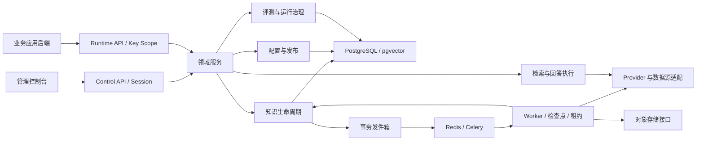

# AI 知识中台：全新 V1 产品 PRD 与项目重写执行书

> 可直接交给 GPT-5.6 或其他具备代码能力的模型执行。本文同时包含产品需求、架构边界、视觉规格、复用判断、清理规则、开发批次和续接协议，不依赖此前聊天记录。

## 0. 给接手模型的执行指令（先读）

**强制编码规则：所有第一方代码都必须有中文注释。重写代码、复用保留的代码、测试、脚本、配置与前端样式均按第 27 节补齐；不得把注释当作可选项。**

你接手的是 `aiknowledge` 项目的全面重新开发。用户要求：全面理解现有代码，重新设计实用且有辨识度的产品，重构前后端和项目结构，前端要美观，删除有证据证明不再需要的代码，并保持需求、架构和修改记录同步。不是只输出建议，也不是只改 CSS。

将本文视为**重新定义的第一版产品需求**。旧 PRD 和旧目录是考察材料，不限制新产品设计；旧代码只有在符合新目标、边界清晰、通过验证时才复用。可以重新实现任何不合适的模块，不以保留率为目标。现有业务数据与调用方的迁移责任仍需处理。

本次文档交付不表示项目已经重写。用户后续要求“按本文重写”时，按照下面的顺序执行，不把文档中所有阶段写成已完成：

1. 定位仓库，读取 `AGENTS.md`（如有）、本文、本文第 25 节“实施状态与续接点” 和 本文第 26 节“追加式修改记录”。
2. 阅读 本文第 22 节“代码事实与复用审计”、本文第 23 节“前端架构实施说明”、本文第 24 节“后端架构实施说明”，然后按第 18 节沿实际代码链验证；摘要不能代替源代码。
3. 先执行 M0 基线，列出当前改动和保留/改造/重写/删除候选，再从 M1 开始交付可运行的纵向切片。
4. 首批先做设计系统、真实应用概览和契约边界，再做知识中心；不要一次删除旧前后端后留下空壳。
5. 对当前批次连续完成代码、测试、文档和记录。只有外部条件阻塞或用户改变目标才暂停该依赖项；继续完成可独立推进的工作。
6. 每完成一批，更新状态记录；上下文不足时写清完成到哪里、失败项和下一条可执行动作，使其他模型可续接。

### 可直接复制的启动指令

```text
请在当前 aiknowledge 仓库按照 docs/项目重写执行书.md 重新开发整个项目。
先读取第 0 节、状态记录、审计和前后端架构，再核对实际源代码。
产品按全新 V1 定义，旧实现能用就复用，不合适就重写；按证据清理无用代码。
前后端与 UI 都要交付可运行结果，不能只写计划或做静态页面。
所有第一方代码都必须编写中文注释，遵守本文第 27 节。
从本文第 25 节中第一个未完成批次开始，完成后验证并更新记录。
本次按当前批次持续实施，不重复询问已经明确的重写和常规清理授权。 --更新
```

### 单文件目录与维护原则

**只需把本文件交给后续模型，即可获得完整的需求、价值、架构、代码审计、执行规则、Skill 行为和当前进度。后续也只在本文件维护这些内容，不再创建同内容的分散 Markdown。**

| 位置 | 内容 |
| --- | --- |
| 第 0–2 节 | 接手指令、事实边界、项目价值与产品目标 |
| 第 3–7 节 | 角色、功能、信息架构、视觉与状态模型 |
| 第 8–16 节 | 前后端重构、契约、迁移、测试、里程碑与验收 |
| 第 17–20 节 | 文档版本、源码阅读、创意产品设计与清理规则 |
| 第 21 节 | 完整 `--更新` Skill 工作流，后续同步的依据 |
| 第 22 节 | 存量代码事实、复用审计与基线结果 |
| 第 23–24 节 | 前端与后端架构的实际状态、目标和实施约束 |
| 第 25 节 | 当前实施状态、阻塞、验证与精确续接点 |
| 第 26 节 | 追加式修改记录，保留历史 |
| 第 27 节 | 所有代码必须有中文注释的强制规范与验收 |

根 AGENTS.md 和 Skill 的 SKILL.md 仅为工具读取本文件的精简入口，不再存放另一份完整规则。旧 PRD、API 和 README 属于历史或启动资料，按实际需要查阅；新目标及续接不依赖额外文档。

用户最新明确需求优先于目标文档；实际代码/迁移/测试说明当前实现事实。代码与 PRD 不同，先判断是尚未实现、程序缺陷还是需求变更；不得为了让文档匹配错误代码而悄悄降低需求。新产品版本 V1.0 与旧 API `/v1`、旧软件包版本和已有迁移名称互相独立，不因产品重新编号修改历史数据库迁移。

| 项目 | 内容 |
| --- | --- |
| 产品 | AI 知识中台（AI Knowledge Core） |
| 文档版本 | V1.0 |
| 日期 | 2026-09-12 |
| 状态 | 重构目标稿，可用于需求拆分；不代表功能已经实现 |
| 本次交付 | 可供其他模型执行的全新 PRD、架构、重写说明与同步 Skill；产品代码尚未重写 |
| 适用团队 | 产品、设计、前端、后端、测试、部署维护 |
| 首个验证业务 | AI 简历；AI 基金等作为后续扩展场景 |

## 1. 版本关系与事实边界

本文件独立定义全新产品的目标、页面、技术边界、功能需求和验收方式。现有 `PRD.md` 仅作为存量版本参考；新产品不要求逐条继承旧 PRD。实施时按里程碑发布并更新实现状态，不将目标接口提前标记为可用。

本次依据现有 README、需求与架构文档、路由、页面、检索服务、入库 Worker、模型配置、接口及测试代码进行静态分析，并执行可用的构建与测试基线，结果见审计与状态记录。没有完成真实页面体验、完整服务集成、容量压测或生产环境审计。本文性能指标是待验证的目标，不是当前测量结果。

### 1.1 当前能力与重构方向

| 领域 | 当前依据 | V1 处理 |
| --- | --- | --- |
| 应用与环境 | 已有隔离上下文、API Key 与 Scope | 保留边界，补配置发布和真实隔离测试 |
| 管理控制台 | React、Ant Design、React Query，已有路由懒加载 | 重构信息架构、设计系统和领域模块 |
| 知识管理 | 文件、文本、远程来源、文档版本和异步入库 | 完善预览、批处理、版本治理与任务恢复 |
| 检索与回答 | 关键词与向量加权、回答模式及结构校验 | 建立调试、评测、策略版本和发布闭环 |
| 模型管理 | 目录与应用绑定保存为 JSON 文件，应用级解析 | 迁移结构化存储，补环境覆盖和解析快照 |
| 入库任务 | 已有重试；所有片段一次提交 Embedding | 分批、检查点、并发控制和幂等发布 |
| 运行治理 | 请求、错误、证据、Token 和反馈基础记录 | 时间线、聚合指标、告警与反馈处理 |
| 自动化 | 页面主要展示入库历史 | 新增调度、增量同步和调度运行记录 |
| 质量评测 | 项目梳理标记尚未实现 | 新增评测集、实验对比与发布门禁 |
| 测试保障 | 已有后端测试，前端主要为 API 错误测试 | 补集成、关键交互、端到端和迁移验证 |

### 1.2 已确认的设计债务

- 知识管理页面约 834 行，承担集合、文档、来源、任务、表单和错误详情，需要按业务能力拆分。
- 全局样式文件集中承载页面样式，需要建立设计令牌与模块样式边界。
- 模型解析仅接收应用身份，环境级模型配置尚未形成完整实现；旧配置与新目录并存，需要明确来源与迁移顺序。
- 文件型模型配置的进程内锁不能作为多进程并发一致性方案，V1 使用数据库事务和版本校验。
- 当前检索降级、任务重试和 SQL 隔离条件已有基础；需要验证实际行为，不以重写替代验证。

## 2. 产品定位与核心目标

AI 知识中台为多个业务后端提供独立的知识接入、检索、回答和运行治理能力。业务项目继续管理自己的终端用户、交易和业务数据，中台管理可复用的 AI 能力。

**一句话价值：把分散的业务知识变成有依据、可测试、可发布、能持续改进的 AI 服务，让每个新业务项目更快拥有可靠的 AI 能力。**

### 产品价值主张

项目服务的核心用户是同时维护多个 AI 应用的小团队和开发者。业务系统负责面向用户的业务体验，中台负责知识与回答能力的完整生命周期。它交付的最小价值单位是“一个已经导入知识、验证效果、可以通过 API 调用的业务能力”。

| 现有痛点 | 中台提供的价值 | 对应能力 | 价值验证 |
| --- | --- | --- | --- |
| 每个项目重复接模型、解析文件、写检索和错误处理 | 复用公共工程，让开发时间投入业务功能 | 应用空间、Provider、连接器、标准 API、能力配方 | 用第二个应用验证是否主要通过配置和接入完成；记录新增公共代码量和耗时 |
| 文档散落，上传以后不知道是否有效 | 把文档变成可维护的业务知识资产 | 入库阶段、片段预览、版本、新鲜度和来源 | 知识可用率、过期来源处理时长、失败导入恢复时间 |
| 模型回答看似合理却缺少依据 | 让答案来源、推断和不确定项可检查 | 检索、证据阅读器、回答模式、拒答策略 | 引用支持率、无依据回答样本数、用户纠错率 |
| 改提示词或换模型之后不知道变好还是变坏 | 让 AI 能力像软件一样经过验证和发布 | 固定评测集、配置版本、发布检查、回滚 | 同样本质量/延迟/成本对比、回归缺陷、回滚耗时 |
| 故障要在多个项目和供应商日志中查找 | 集中定位知识、模型、队列与接口问题 | requestId、阶段耗时、任务尝试、错误建议 | 从故障发生到定位原因的时间 |
| 项目增多后费用不可解释、配置难维护 | 按业务归因成本和配置，支持有证据的选择 | 环境绑定、Token/用量、价格版本、P1 预算 | 单次有效回答估算成本、不同模型的质量成本对比 |
| 代码和需求越改越混乱，换模型接手要重新理解 | 保留可持续迭代的工程资产 | 领域模块、契约、修改记录、`--更新` Skill | 新模型/开发者接手一个模块时所需阅读范围与完成时间 |

### 业务价值示例

**AI 简历：** 维护简历写作规范、岗位能力和行业知识，提供“岗位匹配、简历建议、面试准备”能力。业务后端传入本次简历与 JD，中台按策略返回结构化建议和依据。价值是建议遵循业务标准、输出结构稳定、规范更新可生效，且不默认长期保存个人简历。首版用该场景证明完整交付能力，而不是只演示一次聊天。

**第二个知识型应用：** 使用独立应用环境导入产品说明或客服知识，创建带引用问答能力，并复用相同 API 和运行中心。价值是验证平台通用性：不应复制另一套知识后端，也不应改核心回答流程才能接入。

**AI 基金等时效敏感应用：** 在后续阶段利用证据时效、可信来源和拒答规则。价值在于管理数据来源、分析边界和可追溯性；不以模型通用知识替代实时数据，也不承诺投资结果。该场景不作为首版扩大工具与金融业务范围的理由。

### 价值闭环与主指标


主指标定义为：**被真实业务调用、具有已发布版本、并在对应评测集通过门禁的有效 AI 能力数量**。测试请求和演示数据不计入真实业务调用；能力数量需同时报告成功率和质量，避免为增加数量创建重复策略。

| 指标 | 计算口径 | 首版要求 |
| --- | --- | --- |
| 首次接入时间 | 从应用创建到首个成功业务调用；另记录实际操作时长与外部等待 | 先用 AI 简历建立基线，再用第二应用比较 |
| 知识可用率 | 有有效已发布版本的非归档文档 / 非归档文档 | 展示分子、分母；零文档显示“尚未接入” |
| 回答质量 | 固定样本中满足预期模式、结构和证据要求的比例 | 报样本数与失败类型，不用技术成功率代替 |
| 引用支持率 | 人工或经校验的评测中，引用实际支持对应论断的数量 / 已检查引用数量 | 报检查范围和方法，不把返回引用对象当作支持 |
| 运行成功率 | 技术成功的已完成请求 / 已完成请求 | 排除运行中；拒答、降级单列；无请求显示“无数据” |
| 单次有效回答成本 | 评测通过样本或明确合格口径下的相关调用估算成本 / 有效回答数 | 标注模型价格版本、币种及未知用量 |
| 问题恢复时间 | 从失败发生到服务恢复或任务成功的时间 | 记录失败类型、重试和人工介入，不混合无关阶段 |

首版验收必须展示两个故事：一条“知识导入到业务调用”的成功路径，一条“发现问题到修复、评测与重新发布”的改进路径。只提供很多管理页面不等于体现项目价值。

### 投入边界与价值判断

团队若只有一次性、无专属知识的简单聊天需求，中台建设收益可能有限。当前选择建设的前提是需要持续维护知识、多个能力或多个应用，并且重视质量和迭代治理。M0 记录实际应用数量、知识规模和维护频率，不假设每个企业都需要完整平台。

工程收益可用“新应用预计重复建设时间 − 实际接入时间 − 平台维护分摊”作估算，并记录依据；模型成本优化必须在质量不下降的对比中评价。本文不预先承诺准确率提升百分比、费用下降百分比或商业收入。

后续新增功能先说明：服务哪个角色、解决哪个具体问题、对应哪个价值指标、怎样验收。没有清晰受益者和验证方式的功能进入候选池，不直接堆进首版。

本次核心目标是：让新增页面、接入数据源、调整模型或回答策略时，变更范围清晰、效果可评估、上线可回滚。

| 目标 | 产品结果 | 验收方式 |
| --- | --- | --- |
| 易用 | 管理员知道下一步该做什么 | 新用户独立完成应用接入测试任务 |
| 易改 | 一个功能主要在一个领域模块内修改 | 以新增数据源适配器和策略字段做扩展演练 |
| 可信 | 每次回答能追溯策略、模型和证据 | 请求详情可恢复对应配置与文档版本 |
| 稳定 | 重试、失败、并发不会破坏已有知识 | 中断、重复投递、并发发布集成测试 |
| 可控 | 开发验证与生产运行互不干扰 | 环境隔离测试及发布回滚演练 |
| 可衡量 | 优化效果和成本有依据 | 固定评测集与固定负载的前后对比 |

### 2.1 范围与优先级

- **P0：首个重构版本必须完成。** 新设计系统与导航、领域拆分、知识可靠入库、环境模型配置、策略版本、基础评测门禁、运行追踪、接口兼容与迁移。
- **P1：在核心闭环稳定后完成。** 定时增量同步、运行面入库、流式回答、评测对比增强、告警、角色分工及成本预算。
- **P2：按实际业务需要扩展。** 受控只读业务工具、复杂格式/OCR、更多连接器、多维度索引等。

本轮不建设多组织 SaaS、计费结算、公共知识共享、任意代码执行、Agent 自主循环和工作流画布。整体重构保持模块化单体，不预设微服务拆分。

## 3. 用户、权限与关键场景

| 角色 | 任务 | 权限边界 |
| --- | --- | --- |
| 平台管理员 | 管理应用、模型资源、全局配置与维护 | P0 保留现有管理员模式；全局操作审计 |
| 应用维护者 | 维护指定应用知识、策略与发布 | P1 增加应用授权，不可查看其他应用 |
| 只读观察者 | 查看授权范围内运行指标和发布记录 | P1 支持，不可修改配置、查看密钥或导出原文 |
| 业务后端 | 检索、回答、反馈与后续同步 | API Key 推导应用、环境与 Scope |

关键场景：

1. 新建应用后，通过步骤引导完成模型检查、导入知识、创建策略、测试、签发 Key。
2. 知识维护者查看过期或失败来源，定位失败阶段，修复后重试，旧版本继续服务。
3. 开发者复制策略形成草稿，对比结果，通过评测后发布生产，异常时回滚。
4. 维护者用 requestId 查询慢请求，区分检索、模型、联网和排队耗时。
5. 新业务接入采用知识、策略和输出 Schema 配置；特定业务规则留在业务项目中。

## 4. 信息架构与页面设计

### 4.1 导航原则

采用固定顶部栏、可折叠左侧导航、主内容区的后台布局。顶部始终显示当前应用和环境；生产环境使用明显文字标签。应用切换后只能进入有权限的目标环境，不继承原环境的数据和编辑草稿。

平台范围包含：平台概览、应用管理、模型资源、平台设置。

应用范围包含：应用概览、知识中心、AI 能力、质量评测、自动化、运行中心、开发接入、应用设置。未交付模块不显示可点击空入口。

### 4.2 页面与主操作

| 页面 | 核心信息 | 主要操作 |
| --- | --- | --- |
| 平台概览 | 应用数量、整体健康、异常、近期用量 | 进入异常应用、创建应用 |
| 应用概览 | 接入进度、知识可用性、已发布能力、近期失败 | 继续接入、导入知识、测试能力 |
| 知识集合 | 集合用途、文档数、可用率、最近更新 | 新建、搜索、归档、进入详情 |
| 集合详情 | 文档、数据源、处理任务、集合配置 | 导入、筛选、批量归档 |
| 文档详情 | 原文或解析内容、版本、片段、元数据、处理历史 | 预览、重新处理、回滚、归档 |
| 数据源详情 | 来源配置、同步状态、变更摘要 | 试抓取、立即同步、编辑、暂停 |
| AI 能力 | 检索策略、回答策略、草稿与发布状态 | 新建、复制、编辑、调试、发布 |
| 调试台 | 输入、答案、证据、配置、耗时、Token | 运行、对比、保存评测样本 |
| 质量评测 | 评测集、运行历史、指标差异、门禁结果 | 导入样本、发起评测、查看失败项 |
| 自动化 | 调度规则、下次执行、历史和重试 | 新建、暂停、立即执行 |
| 运行中心 | 请求、入库任务、错误、反馈、审计 | 筛选、查看时间线、处理反馈 |
| 开发接入 | Key、Scope、接口示例、接入检查 | 签发、吊销、复制无密钥示例 |
| 应用设置 | 环境、模型继承、资源策略、保留策略 | 覆盖配置、检查生效来源 |
| 模型资源 | 能力类型、供应商、配置引用、连通状态 | 登记、测试、停用、查看引用 |

### 4.3 统一交互规则

- 页面仅保留一个视觉突出的主操作，低频操作收进操作菜单。
- 小型新增使用弹窗，关联详情使用抽屉，复杂配置和版本对比使用独立页面。
- 列表支持服务端筛选、分页、稳定排序；筛选、页码和选中页签保存在 URL。
- 全选默认只选择当前页；跨页批量操作必须明确范围、总数和执行结果。
- 请求失败显示持续错误面板与重试入口，不渲染成“暂无数据”。
- 表单支持字段级错误、保存中状态和离开未保存提示；失败保留输入。
- 切换环境时取消旧请求，缓存键包含应用和环境，旧响应不能覆盖新环境。
- 异步操作返回任务并进入进度展示；提示“已接收”，不能提前提示“导入成功”。
- 删除、归档、发布和回滚展示影响范围；被引用资源优先停用或阻止删除。

## 5. 视觉与样式系统

### 5.1 视觉方向

采用清晰、克制、适合长时间操作的浅色专业控制台。主要使用中性背景、白色内容区和单一品牌色，信息密度可控。去除重复装饰、大面积渐变、无含义指标卡和不必要动效。

以下是首版设计规格，设计验收可微调具体色值，但全站必须统一使用令牌。

| 项目 | 首版规格 |
| --- | --- |
| 主色 | 深青绿 `#087F8C`；链接、主按钮、选中态共用，品牌呈现偏知识工作室 |
| 背景 / 内容 | `#F6F7FB` / `#FFFFFF` |
| 主要 / 次要文字 | `#182230` / `#667085` |
| 分隔线 | `#E4E7EC` |
| 状态 | 成功、警告、错误、处理中使用语义令牌；同时有图标和文字 |
| 字体 | 系统中文字体优先；正文 14px、辅助 12px、分区标题 18px、页标题 24px |
| 间距 | 4、8、12、16、24、32、48px |
| 圆角 | 控件 6px、卡片与弹层 10px |
| 布局 | 顶栏 56px、侧栏 224px、内容边距 24px；宽表格允许内容区滚动 |
| 表格 | 默认行高约 48px；支持紧凑模式；长文截断但可查看完整内容 |
| 动效 | 常规过渡 120–200ms，遵循系统减少动态效果设置 |

### 5.2 组件与状态规范

共享组件包括 PageHeader、FilterBar、DataTable、StatusBadge、EmptyState、ErrorState、AsyncTaskProgress、ConfirmAction、JsonViewer、EvidencePanel 和 MetricCard。共享 UI 不请求业务 API，不包含应用权限规则。

每个核心页面必须覆盖：加载、首次空态、筛选无结果、正常、部分失败、无权限、网络失败。任务与策略等领域状态使用统一展示映射，组件不能自行编造状态。

### 5.3 适配与视觉验收

- 1440px 桌面为主要设计视口，验证 1280px、1024px 和 768px。
- 低于 1024px 侧栏折叠；低于 768px 表格保留局部横向滚动，表单转单列，不裁切关键操作。
- 键盘可到达主要控件，弹层关闭后焦点回到触发点，表单有可读标签。
- 正文文字与背景对比度目标至少 4.5:1；状态不能仅依靠颜色表达。
- 深色主题不纳入 P0，但颜色实现采用语义令牌，为后续主题扩展保留边界。
- 对概览、知识列表、文档详情、策略编辑、调试和运行详情执行截图回归。

## 6. 功能需求与验收

### 6.1 应用、环境与接入

| 编号 | 优先级 | 需求 | 验收标准 |
| --- | --- | --- | --- |
| APP-01 | P0 | 应用创建、编辑、停用与环境管理 | 编码唯一；停用后拒绝新运行请求，保留历史记录 |
| APP-02 | P0 | 接入向导与健康检查 | 步骤按真实资源计算；不以点击完成代替配置检查 |
| APP-03 | P0 | Key 生命周期 | 明文仅签发时展示；支持范围、过期、吊销和轮换记录 |
| APP-04 | P0 | 环境隔离 | API、Worker、缓存、对象存储和评测均验证环境边界 |
| APP-05 | P1 | 角色和应用授权 | 所有写接口在服务端校验；隐藏按钮不能替代授权 |

### 6.2 知识全生命周期

| 编号 | 优先级 | 需求 | 验收标准 |
| --- | --- | --- | --- |
| KNO-01 | P0 | 集合与元数据管理 | 支持用途、标签、状态、新鲜度规则与筛选 |
| KNO-02 | P0 | 统一导入 | 保持现有文件、文本、网页、API、Feed 等支持范围；错误说明支持格式和限制 |
| KNO-03 | P0 | 导入前检查 | 校验大小、格式、URL 和配置；预览结果明确不等于正式发布 |
| KNO-04 | P0 | 文档和片段预览 | 可定位版本、页码或章节；不支持原版渲染时展示解析文本 |
| KNO-05 | P0 | 原子发布与版本回滚 | 新版本失败不影响旧版；回滚只选择兼容且完整的索引版本 |
| KNO-06 | P0 | 批量与幂等处理 | 返回逐项结果；相同来源未变化时不重复生成有效版本 |
| KNO-07 | P0 | 分批向量化与恢复 | 按数量及供应商限制分批；已成功批次可复用；失败不发布部分索引 |
| KNO-08 | P0 | 任务详情 | 展示阶段、进度依据、尝试次数、错误建议和 requestId |
| KNO-09 | P0 | 归档与清理 | 归档后新检索排除；已有引用保留版本信息并受访问权限约束 |
| KNO-10 | P1 | 批量取消与优先级 | 已完成任务不可取消；执行中取消在安全检查点生效 |
| KNO-11 | P2 | OCR 与复杂文档解析 | 独立解析适配器，按业务样本验收，不影响既有解析链 |

来源相同内容是否复用以应用、环境、来源标识和内容摘要为边界，不跨应用复用可访问的知识对象。重试必须记录新尝试，不覆盖历史错误。

### 6.3 模型与配置治理

| 编号 | 优先级 | 需求 | 验收标准 |
| --- | --- | --- | --- |
| MOD-01 | P0 | 模型目录结构化存储 | 目录、绑定迁入数据库；并发编辑有版本冲突提示与审计 |
| MOD-02 | P0 | 环境模型覆盖 | 展示“环境覆盖 / 应用默认 / 平台默认”的来源和实际配置 |
| MOD-03 | P0 | 能力检查 | 区分 Chat、Embedding、搜索能力；测试显示时间、耗时和稳定错误 |
| MOD-04 | P0 | 凭证引用 | P0 使用环境变量或部署密钥引用；接口仅返回配置状态，无明文 |
| MOD-05 | P0 | Embedding 兼容管理 | 索引记录模型标识、版本、维度；相同维度不同模型也不能直接混用 |
| MOD-06 | P0 | 引用保护 | 使用中的模型不可硬删除；停用前显示受影响环境和策略 |
| MOD-07 | P1 | 配额与预算 | 支持应用环境预算、用量预警；价格未知显示“未配置”而非零成本 |

目标解析顺序：已发布策略的显式配置 → 环境绑定 → 应用默认 → 平台默认。发布时冻结解析结果或其不可变版本引用。显式配置失效时返回配置错误，不静默转向其他模型；自动降级仅使用策略授权的候选模型，并记录原因。

更换 Embedding 模型必须创建新索引构建任务。构建、校验后切换活动索引；旧索引保留至回滚窗口结束。新检索的查询向量必须与活动索引使用相同模型空间。

### 6.4 检索、回答与调试

| 编号 | 优先级 | 需求 | 验收标准 |
| --- | --- | --- | --- |
| AI-01 | P0 | 策略完整管理 | 新建、编辑草稿、复制、停用、版本对比与发布；生产读取已发布版本 |
| AI-02 | P0 | 检索调试 | 展示命中片段、各路分数、最终排序、有效配置、降级信息和耗时 |
| AI-03 | P0 | 混合检索配置 | 保持现有加权行为可兼容；新增排序方案通过评测后启用 |
| AI-04 | P0 | 回答与引用 | 保持六种回答模式；引用对应实际版本；无证据不得伪造来源 |
| AI-05 | P0 | 输出与预算约束 | 校验 JSON Schema；控制上下文、输出和总超时；失败返回明确错误 |
| AI-06 | P0 | 调试台 | 同屏展示输入、结果、证据、耗时和模型；支持保存脱敏样本 |
| AI-07 | P0 | 临时输入保护 | 输入默认不入库、不进长期日志；保存评测样本需显式操作 |
| AI-08 | P1 | 重排序与实验对比 | 在固定样本上比较质量、延迟和成本，再决定启用 |
| AI-09 | P1 | 流式回答 | 事件包含 requestId、增量、完成与错误；最终结构校验结果明确 |

调试台使用管理员会话与应用环境权限调用专用控制面调试接口，复用运行面服务，不要求管理员把长期业务 API Key 输入浏览器。开发接入提供后端调用示例用于验证真实 Key 权限。

置信度若为规则计算值，必须标注其含义，不包装成已校准的正确概率。引用存在不等于论断正确，评测需单独判断引用支持关系。

### 6.5 策略发布与质量评测

| 编号 | 优先级 | 需求 | 验收标准 |
| --- | --- | --- | --- |
| REL-01 | P0 | 草稿与不可变发布版本 | 发布后修改生成新草稿；请求记录使用的版本 |
| REL-02 | P0 | 发布检查 | 检查模型、集合映射、索引兼容、Schema 与基础评测 |
| REL-03 | P0 | 环境提升 | 复制配置，不复制密钥和运行数据；引用按目标环境显式映射 |
| REL-04 | P0 | 发布和回滚 | 原子切换生效版本；进行中请求继续使用开始时的快照 |
| EVA-01 | P0 | 固定评测集 | 支持问题、输入、预期文档、预期模式、Schema 和标签 |
| EVA-02 | P0 | 基础发布门禁 | 记录样本与配置版本；检查结构、模式及必需证据；失败阻止生产发布 |
| EVA-03 | P1 | 质量对比 | 比较基线与候选的命中、引用支持、拒答、延迟和成本 |
| EVA-04 | P1 | 反馈转样本 | 人工确认并脱敏后加入评测集，保留反馈关联 |

首批 AI 简历评测集至少 30 个样本，覆盖正常命中、部分命中、无命中、过期证据、模型失败、格式异常。隔离和越权作为独立确定性测试，不依赖模型评分。

基础门禁要求关键确定性检查全部通过，人工验收样本无伪造经历和伪造引用。统计质量阈值按策略设定，并在首次基线测量后冻结；不能用小样本自动评分宣称总体准确率。评测异常或未完成不得视为通过。

### 6.6 自动化、运行与业务接入

| 编号 | 优先级 | 需求 | 验收标准 |
| --- | --- | --- | --- |
| OPS-01 | P0 | 请求与任务时间线 | 串联检索、模型、入库阶段，展示父请求和重试尝试 |
| OPS-02 | P0 | 运行列表 | 服务端按应用、环境、时间、状态、错误码筛选与稳定分页 |
| OPS-03 | P0 | 用量汇总 | 展示请求、失败、降级、Token 和耗时；统计口径可查看 |
| OPS-04 | P0 | 反馈处理 | 查看反馈、标记处理状态、关联请求；不默认重现临时输入 |
| OPS-05 | P0 | 存活与就绪 | 区分进程存活、基础依赖就绪和能力可用；可选搜索不可用不误判整体宕机 |
| OPS-06 | P1 | 告警 | 队列积压、失败率、调用预算可配置；重复告警聚合 |
| AUT-01 | P1 | 定时同步 | 时区、频率、暂停、下次执行、来源和目标集合明确 |
| AUT-02 | P1 | 增量与去重 | 内容未变跳过重建；分页抓取有上限；来源删除默认标记待确认 |
| AUT-03 | P1 | 调度防重复 | 多调度实例同一触发点仅创建一个有效运行；上次未完成默认跳过并记录 |
| API-01 | P0 | 开发接入中心 | 从契约生成示例，显示版本与真实可用接口，示例不包含真实 Key |
| API-02 | P1 | 运行面入库与任务查询 | Key、Scope、幂等、文件限制、任务归属全部校验 |
| TOOL-01 | P2 | 只读工具扩展 | 明确定义输入输出、权限、来源、超时和结果大小；失败可追踪 |

调度任务以 UTC 保存触发时间，同时保存用户时区用于展示和规则计算。暂停不取消已经运行的任务；恢复默认只计算下一次触发，不无限补跑历史。

## 7. 数据与状态模型

### 7.1 主要对象

| 对象组 | 核心对象 | 约束 |
| --- | --- | --- |
| 身份 | Application、Environment、ApiKey；P1 Member、Role | Key 绑定应用环境；全局角色资源不混入业务数据 |
| 知识 | Collection、Source、Document、DocumentRevision、Chunk、IndexBuild | 文档当前版本和活动索引均为显式指针 |
| 模型 | ModelEntry、ModelBinding、ConfigRevision | 全局目录独立；环境绑定带应用与环境复合边界 |
| 能力 | RetrievalProfile、AnswerProfile、ProfileRevision、Release | 编码稳定、修订不可变、发布可追溯 |
| 任务 | IngestionRun、RunAttempt、BatchCheckpoint；P1 Schedule、SyncRun | 运行、尝试与阶段分离；唯一键防重复 |
| 质量 | EvaluationSet、CaseRevision、EvaluationRun、CaseResult | 样本、配置与索引快照可追踪 |
| 治理 | RequestTrace、TraceStep、Evidence、Feedback、AuditEvent | 记录来源与版本；访问仍受原应用环境约束 |

### 7.2 状态规则

- 入库运行：`queued → running → succeeded / failed`；P1 增加 `cancel_requested → canceled`。
- 重试创建新的 Attempt，运行可重新排队；历史 Attempt 永久保留在配置的保留期内。
- 文档：`draft / processing / ready / failed / archived`；更新失败但旧版可用时，文档继续 `ready`，更新任务单独显示失败。
- 文档版本：`pending → processing → ready / failed`；只有完整、兼容、校验通过的版本可成为当前版本。
- 策略修订：`draft → validated → published → retired`；修改 validated 内容后重新回到 draft。
- 发布记录为不可变事件；回滚创建指向旧修订的新发布记录，不改写历史。
- 评测：`queued → running → succeeded / failed / canceled`；技术执行成功与门禁通过使用不同字段。

以上为目标内部语义，存量接口状态枚举通过适配层保持兼容；不直接批量替换旧枚举字符串。

## 8. 前端重构要求

保持 React、TypeScript、React Query 和 Ant Design 的现有基础，升级依赖另行验证，避免与业务迁移同时无差别升级。

建议目录：

```text
frontend/apps/console/src/
  app/                 路由、会话、主题、全局错误边界
  layouts/             平台布局、应用布局
  features/
    applications/      页面、组件、API hooks、局部类型与测试
    knowledge/
    intelligence/
    models/
    evaluations/
    automation/
    operations/
    developer/
  shared/              通用工具、浏览器端 API 基础设施
frontend/packages/
  contracts/           生成类型、客户端与契约快照
  ui/                  设计令牌和无业务依赖组件
```

约束：

1. 页面负责路由参数、页面布局和组合，业务表单、请求 hooks、详情面板归属领域模块。
2. 服务端状态由 React Query 管理，筛选状态放 URL，表单状态留在表单内；不为所有状态引入全局容器。
3. 查询键包含应用、环境、资源和筛选参数；写操作按资源范围失效缓存。
4. 自动生成的 API 文件禁止手改；业务视图模型单独维护，不复制服务端枚举。
5. 全局 CSS 仅包含基础、令牌和公共布局；领域样式使用 CSS Modules 或等效作用域方案。
6. 大型页面按独立职责拆分；以可测试性和变更范围验收，不机械追求文件行数。
7. 默认重试只用于允许重试的读取；发布、签发 Key 等写操作不得被前端自动重复执行。
8. 旧路由保留跳转或兼容映射；页面逐个迁移，避免所有入口一次替换。

## 9. 后端重构要求

保持 FastAPI、SQLAlchemy、PostgreSQL/pgvector、Redis 和 Celery。采用模块化单体，API 与 Worker 共享领域服务和契约，避免业务规则分叉。

```text
knowledge_core/
  control/             管理员认证、控制面装配
  runtime/             Key 认证、限流、运行面装配
  domains/
    applications/
    knowledge/
    intelligence/
    models/
    evaluations/
    automation/
    operations/
  infrastructure/      数据库、存储、HTTP 客户端、供应商适配
  workers/             任务入口、上下文恢复、调度装配
  shared/              错误、身份上下文、响应、请求关联
```

每个领域按需要包含 router、schema、service、repository 和模型定义。跨领域通过明确服务接口协作，不任意修改其他领域表。

### 9.1 服务与事务

- Router 仅进行输入输出转换、鉴权和调用；发布、配置解析和知识版本规则进入领域服务。
- Service 明确事务边界，Repository 不隐式提交业务事务。
- 网络抓取、Embedding 和模型生成不持有长数据库事务；在短事务中保存检查点和发布结果。
- 任务创建与投递使用事务发件箱或等效可恢复机制，处理“数据库已提交但消息未发出”的情况。
- Worker 按至少一次投递设计；唯一键、租约或条件更新保证重复任务不会重复发布。
- 同一文档并发构建采用版本比较，旧任务晚完成不能覆盖较新的有效版本。
- HTTP 客户端在进程/事件循环生命周期内复用；Worker 不跨已关闭事件循环共享异步连接。

### 9.2 Provider 和扩展边界

- 统一 Chat、Embedding、Search 接口，适配器负责供应商参数、响应校验和错误归一化。
- 超时区分连接、读取与整体预算；重试有上限和退避，仅用于可恢复失败。
- 数据源连接器输出标准内容块、元数据和来源信息；新增连接器不修改文档发布逻辑。
- 检索方案通过配置和独立实现接入，保留现有行为作为对比基线。
- 缓存键至少覆盖应用、环境、发布版本、索引版本和相关参数；含个人临时输入的回答默认不缓存。

## 10. API 与兼容策略

存量 `/control/v1`、`/runtime/v1`、成功/错误包络、Scope 和 requestId 语义继续支持。应用环境资源沿用实际的嵌套路径，不将旧 PRD 的扁平示意路径视作已存在接口。

| 接口族 | 状态 | V1 处理 |
| --- | --- | --- |
| `/runtime/v1/retrieve`、`/answer`、`/feedback` | 已有 | 保持存量请求和响应；可新增兼容的可选字段 |
| `/control/v1/applications/{appId}/environments/{envId}/...` | 已有资源模式 | 在同一边界下增加修订、发布、调试和评测资源 |
| `/control/v1/model-catalog` 与应用模型绑定 | 已有 | 保留适配；增加环境绑定，返回配置来源 |
| 运行面入库和任务查询 | 规划 P1 | OpenAPI、Scope、幂等和集成测试齐备后开放 |
| 流式回答接口 | 规划 P1 | 新增独立入口，不改变已有 JSON 响应协议 |

新增元信息建议包括 profileRevision、releaseId、indexVersion、resolvedModel、traceSummary；不得含凭证、内部网络地址或个人原文。具体字段在接口设计时落实为 OpenAPI 并校验存量客户端兼容。

分页接口使用稳定排序和明确上限；存量返回数组的接口保留行为，新增分页能力采用新端点或明确可选模式，不能直接改成不兼容对象。

新增异步写接口的 Idempotency-Key 在应用、环境、操作范围内唯一；相同键相同输入返回原任务，不同输入返回冲突；默认保留 24 小时并文档化。requestId 用于追踪，不替代幂等键。

由后端 Schema 导出 OpenAPI，再生成前端类型/客户端。CI 检测接口差异、生成文件漂移和历史请求样例。破坏性变更采用新版本，并在至少两个发布周期内保留旧入口；移除前核对实际调用记录。

## 11. 非功能要求与验证口径

### 11.1 性能目标

建立固定基准：记录 CPU、内存、数据库版本、部署方式；准备 10 万知识片段、10 个应用环境组合，执行预热后至少 10 分钟测试。首轮目标负载为 10 并发；报告请求速率、P50/P95、错误率和资源使用。

| 项目 | 初始目标 | 口径 |
| --- | --- | --- |
| 普通管理列表 | P95 ≤ 500ms | 50 条分页，不含远程模型调用 |
| 检索数据库与融合阶段 | P95 ≤ 800ms | 单独计量查询向量生成耗时，评测召回质量同时报告 |
| 异步导入接收 | P95 ≤ 1s | 从上传字节接收完成到任务持久化确认，不含文件传输 |
| 控制台主要页面 | 受控本地环境加载后 2s 内可操作 | 固定浏览器、设备与数据，分别报告首次与缓存加载 |
| 回答链路 | 所有调用受策略总超时约束 | 分别展示检索、联网、模型耗时，不承诺外部模型固定完成时间 |

以上目标在第一阶段基准运行后复核。若不达标，记录瓶颈、调整依据与验收版本，不能删除失败样本。索引优化必须结合执行计划和召回评测，不以“建立了索引”作为完成标准。

### 11.2 安全与隐私

- 管理会话保留 HttpOnly、生产 Secure Cookie；写请求采用适配部署的 CSRF 防护。
- API、导出、预览、Worker 和对象存储全部校验应用环境，数据库保持相关复合约束。
- 远程抓取保留 SSRF 防护、重定向逐跳检查、大小和超时限制。
- 凭证、Authorization、个人输入不进入日志或错误 details；界面只展示经过筛选的信息。
- 评测保存原文是显式操作，执行脱敏检查并限制访问；不自动把所有失败请求变成数据集。
- 默认建议：请求轨迹 30 天、失败尝试 90 天、审计 180 天；部署可配置，P0 提供可审计清理命令，P1 自动调度。
- 文档归档与物理清理分开；物理删除前检查引用、回滚窗口和保留规则。

### 11.3 可靠性与运维

- 数据库、Redis、对象存储分别有备份和恢复步骤；初始运营目标 RPO 24 小时、RTO 4 小时，通过演练验证。
- 生产迁移作为独立发布步骤执行，不能由多个 API 副本竞争执行。
- 日志与指标区分调用失败、策略拒答、技术降级和用户取消；证据不足不是自动计作系统错误。
- 成本按记录时的模型价格版本估算，展示币种与“估算”标签；未知价格不算作免费。

## 12. 数据迁移与渐进替换

### 12.1 总体策略

采用“新增结构 → 回填验证 → 小范围切换 → 扩大切换 → 延迟清理”的过程。前端页面、后端服务和数据迁移可以分批交付，但每批必须有完整纵向流程。

### 12.2 具体迁移项

| 迁移项 | 方法 | 验证与回退 |
| --- | --- | --- |
| 模型目录和应用绑定 JSON | 读取非密钥配置，映射至数据库，保留源文件备份与校验值 | 比较数量、编码、引用、有效解析结果；切换前保持旧读路径 |
| 旧平台配置 | 非密钥参数迁移为平台默认；密钥映射为引用 | 逐能力验证；不把密钥写入迁移报告 |
| 环境模型绑定 | 初始继承应用默认，不自动生成不同模型 | 各环境有效配置与迁移前一致，再允许显式覆盖 |
| 存量策略 | 创建对应首个不可变修订和发布记录 | 历史请求样例兼容，策略编码和资源 ID 保持稳定 |
| 文档与向量 | 保留原版本与索引，补模型来源记录 | 无法确认向量来源时标记待核验，禁止假定可与新模型混用 |
| 前端路由 | 页面级替换与旧地址映射 | 深链接、刷新、返回、权限与环境切换回归 |
| 旧状态和响应 | 在适配层转换 | 原接口快照与业务接入样例验证 |

文件配置切换写入时设置短暂维护窗口或写入冻结，完成最后一次回填校验后统一切换权威来源，避免文件与数据库持续双写。切换后已有新写入时，回退需导出差异并恢复一致数据，不能仅打开旧读开关。

### 12.3 发布保护

1. 迁移前备份，并在副本环境演练；记录数量、关联关系、关键内容摘要。
2. 使用扩展型数据库迁移，旧版本应用在回滚窗口内仍能读取需要的结构。
3. 优先在 development/testing 或选定应用启用新功能。
4. 验证旧业务调用、入库、查询、发布和回滚后扩大范围。
5. 回滚优先回退应用与发布指针；数据库恢复需单独评估新写入，不默认执行破坏性降级。
6. 旧字段、文件与兼容入口在观察窗口结束且确认无人使用后，再单独安排清理。

## 13. 测试与交付门槛

| 层级 | 必测内容 |
| --- | --- |
| 单元 | 状态转换、配置解析、重试判定、Schema、索引兼容 |
| 前端交互 | 导入表单、持久错误、重试、版本发布、环境切换和未保存提示 |
| 数据库集成 | 真实 PostgreSQL 的隔离、复合约束、并发更新、分页与发布事务 |
| 任务集成 | 真实 Redis/Celery 的投递、中断、重复执行、分批恢复和旧版本保护 |
| 端到端 | 登录→创建应用→导入→ready→配置→调试→评测→发布→业务调用→查看追踪 |
| 契约 | 存量样例、OpenAPI 差异、前端生成物一致性和错误结构 |
| 视觉 | 核心页面、主要视口、空态与错误态、键盘操作 |
| 迁移 | 旧数据副本升级、配置等价、旧客户端、回退演练 |

关键异常场景必须覆盖：同名并发编辑、重复投递、旧任务晚完成、Embedding 数量/维度错误、模型不可用、取消中重试、越权读取任务、跨环境缓存污染、任务创建后 Broker 不可用。P1 才实现的取消功能在 P1 验收，不阻塞 P0。

CI 最低要求为前端类型检查/构建/lint、关键前端测试、后端静态检查与测试、契约差异检查。真实模型测试单独运行并记录成本，不能依赖外部模型让每个普通提交不稳定。

## 14. 实施里程碑与任务拆分

下表按依赖排序，不承诺未评估的人天。每一阶段完成后都应有可演示、可回归的成果。

| 阶段 | 核心交付 | 退出条件 |
| --- | --- | --- |
| M0 基线 | 路由/API/数据清单、测试结果、性能基线、迁移映射 | 现有行为和已知失败有记录；重构不依赖未知假设 |
| M1 工程与视觉基础 | 新布局、设计令牌、共享状态、契约生成、应用概览首个页面 | 第一条页面/API 纵向切片通过构建和交互验证 |
| M2 知识闭环 | 集合/文档/来源页面、片段预览、分批入库、任务幂等 | 大文档、重复投递、并发版本和失败恢复验证通过 |
| M3 配置与能力 | 模型迁移、环境绑定、策略版本、调试台、基础评测与发布 | AI 简历测试环境完整接入；发布与回滚通过 |
| M4 首版上线 | 运行中心、开发接入、兼容验证、生产部署与恢复演练 | 所有 P0 完成；存量数据与业务调用验证通过 |
| M5 功能增强 | P1 调度同步、评测对比、流式回答、角色、预算与告警 | 各功能独立验收，不阻塞已经可用的 P0 |
| M6 按需扩展 | P2 工具、OCR、连接器等 | 有明确业务样本和容量依据再启动 |

每个开发任务包含：需求编号、用户场景、页面/API 范围、数据变化、兼容影响、验收样例、测试方式、回滚方式。不以“重构前端”“优化后端”作为可直接执行的单个任务。

完成定义：代码与交互可用、受影响测试通过、契约同步、迁移脚本可重复执行、错误状态可恢复、交付说明明确已完成和遗留项。禁止用占位按钮、模拟指标或仅前端成功提示冒充交付。

## 15. 风险、默认决策与后续迭代规则

| 风险 | 默认决策 |
| --- | --- |
| 重构与新增功能同时失控 | P0 先交付完整闭环；P1/P2 独立里程碑 |
| 更换向量模型导致知识质量下降 | 新索引构建和评测后切换，保留旧索引回滚 |
| 文件配置与数据库产生分歧 | 维护窗口完成单一权威来源切换 |
| 样式升级影响既有使用路径 | 保留深链接，按页面替换，检查键盘和主要视口 |
| 指标看起来完整但不可解释 | 定义统计口径、时间范围、价格版本与未知状态 |
| 通用能力被业务特例污染 | 业务规则优先使用策略/Schema 或业务后端实现 |

默认按单团队维护、单平台部署、多个业务应用接入设计；桌面管理优先；复用现有技术栈；P0 不强制新增外部付费服务。容量和评测阈值在 M0 用实际样本确定，视觉色值在 M1 页面样稿中收敛。

后续每次迭代遵循：需求编号 → 影响范围 → 契约/数据设计 → 开发 → 验证 → 发布记录。修改既有需求时追加变更记录，并同步实际交付状态。新增模型走适配器，新增数据源走连接器，新增业务走应用配置，新增页面走领域模块。

## 16. 最终验收清单

- [ ] 新控制台导航、视觉和页面状态统一，核心路径不出现占位功能。
- [ ] 知识导入、预览、失败恢复、版本发布和回滚形成完整闭环。
- [ ] 应用环境数据、缓存、任务和配置隔离通过真实集成验证。
- [ ] 模型配置来源明确，环境覆盖生效，切换 Embedding 不混用索引。
- [ ] 策略可编辑、复制、评测、发布和回滚，每次请求可追溯版本。
- [ ] 调试可查看真实证据和降级原因，不要求浏览器保存业务 Key。
- [ ] 运行中心能定位失败、慢请求、任务尝试和用户反馈。
- [ ] 旧接口、已有数据和接入项目在重构后继续可用。
- [ ] 构建、关键测试、契约、视觉、迁移和恢复演练有交付记录。
- [ ] 新增一种数据源或一个策略配置项，无需散改全站页面和核心调用链。
- [ ] 所有第一方代码按第 27 节具备中文注释，复用代码也已覆盖；注释与实际行为一致。

## 17. 变更记录

| 日期 | 版本 | 内容 |
| --- | --- | --- |
| 2026-09-12 | V1.0 | 新增整体重构目标稿：前后端模块化、视觉交互、知识生命周期、模型环境配置、策略发布评测、迁移与持续迭代 |
| 2026-09-12 | V1.0 文档归并 | 合并全部本轮材料为单文件，增加所有代码必须有中文注释的强制要求；详见 DOC-002 |

## 18. 全面理解代码与复用判断

### 18.1 必须完成的阅读链

不要只读 README、只统计文件数或只搜索 TODO。首次重写需要建立以下实际链路，并把核对结果写入审计。后续从已记录的状态增量阅读，但 `--更新` 时至少复核全局入口与本次跨层影响。

| 链路 | 按顺序阅读的现有位置 | 必须回答的问题 |
| --- | --- | --- |
| 启动与部署 | 根 Compose → 两个 README → Dockerfile/Nginx/Vite → main/config → Alembic | 真正入口、端口和依赖是什么？本地与容器有何差异？ |
| 登录与环境 | main/router → ConsoleShell/ApplicationShell/useApplicationContext → control/auth → runtime/auth/context | 管理身份与业务身份如何不同？切换环境后哪些状态残留？ |
| 应用接入 | Applications/Developer/Settings → api/platform → applications router/service/repository/schema | 应用、环境、Key 的创建和停用是否形成闭环？ |
| 知识接入 | KnowledgePage → api/platform → knowledge router/service → storage → tasks → ingestion/repository/models/migration | 文件何时可用？消息投递失败、重复执行、旧任务晚完成如何处理？ |
| 模型调用 | ModelCatalog/Settings → control/model_catalog/model_configuration → model_resolver/catalog/bindings → providers | 配置和密钥存在哪里？模型切换是否影响已有索引？ |
| 检索回答 | Intelligence → runtime router → retrieval/policy/service → providers → operations repository | 证据如何过滤？引用如何生成？降级和 Schema 的实际行为是什么？ |
| 运行反馈 | Dashboard/Overview/Operations/Automation → operations router/repository → trace/feedback models | 指标时间范围是什么？运行中请求算不算成功？自动化是否真的调度？ |
| 契约测试 | contracts/index.ts/openapi → export_openapi → 所有测试与配置 | 类型是否生成？哪些测试真实访问依赖？哪些受到本地配置影响？ |

维护阅读覆盖表，状态为“已读实现 / 已追调用 / 已测试 / 待验证”。对未读的文件明确注明，不把“已索引”称为“完整理解”。第三方依赖、生成包、缓存不逐行阅读；业务源码和运行配置按领域覆盖。

| 链路 | 已读与已追调用 | 已测试 | 待验证 |
| --- | --- | --- | --- |
| 启动与部署 | 已读实现、已追调用：Compose、Dockerfile、`main`/config、Alembic 至 `0011` | 已测试：健康接口、开发库迁移、后端 87 tests | 待验证：具备 Docker CLI 的主机重建、scheduler 日志和生产差异 |
| 登录与环境 | 已读实现、已追调用：Shell、路由、`control/auth`、`runtime/auth` 与 `ApplicationContext` | 已测试：构建、路由行为和公开登录页加载 | 待验证：授权登录后的环境切换浏览器会话 |
| 应用接入 | 已读实现、已追调用：Applications/Developer/Settings、`platform`、applications router/service/repository/schema | 已测试：后端回归与生成契约类型检查 | 待验证：存量调用方闭环和实际 Key 生命周期 |
| 知识接入 | 已读实现、已追调用：页面→服务→Worker→Outbox→存储/入库 repository/models/migration | 已测试：批处理、检查点、租约、重试、并发发布和后端回归 | 待验证：真实 Redis/Celery 多 Worker、断点恢复和对象存储清理 |
| 模型调用 | 已读实现、已追调用：ModelCatalog/Settings、目录/绑定、数据库优先解析器与 Provider | 已测试：目录迁移、绑定优先级、数据库优先回退与后端 87 tests | 待验证：旧 JSON 回填等价对比、控制面数据库写入、真实 Provider 与最近探针持久化 |
| 检索回答 | 已读实现、已追调用：Intelligence、runtime router、retrieval/policy/service、Provider、运行轨迹 | 已测试：契约、阶段耗时、调试身份边界与后端回归 | 待验证：真实回答、证据、降级与业务评测样本 |
| 运行反馈 | 已读实现、已追调用：Dashboard/Overview/Operations/任务运行、operations router/repository、trace/feedback models | 已测试：时间窗口/完成态概览、反馈环境隔离、限流原子性 | 待验证：真实失败、慢请求、反馈和入库尝试定位闭环 |
| 契约测试 | 已读实现、已追调用：contracts/index、OpenAPI 导出/生成、前后端测试与配置 | 已测试：OpenAPI 回归、TypeScript typecheck、控制台构建与 Vitest | 待验证：旧外部调用方兼容与运行镜像加载当前契约 |

### 18.2 复用不是默认继承

对每个模块按以下条件判断：满足新需求、隔离正确、依赖清楚、可以独立验证、扩展成本合理。全部成立则复用；业务规则有效但结构不清则提取重构；行为或数据模型根本不匹配则重新实现。

| 旧实现 | 初步决定 | 后续验证 |
| --- | --- | --- |
| React/Ant Design/React Query、FastAPI/SQLAlchemy/Celery | 作为起点保留，不要求锁死框架 | 依赖兼容、构建、运行；更换必须有实际收益与迁移说明 |
| API Key 哈希、可信应用环境上下文、复合约束 | 复用原则与已验证代码 | 真实数据库和所有新接口越权测试 |
| 远程抓取安全与多格式解析 | 优先提取为适配器复用 | 格式样本、重定向、大小限制、编码、异常用例 |
| 本地对象存储 | 保留开发适配器，补可替换接口 | 原子写入、路径隔离、孤儿对象清理与生产部署需求 |
| 请求错误封装、页面状态组件、路由懒加载 | 可复用行为，按新 UI 重构 | 取消请求、错误分类、键盘和局部失败处理 |
| 大型页面、全局样式、重复模型表单 | 重写结构和交互 | 新页面可用、视觉统一、旧路径迁移 |
| JSON 配置与隐式多级回退 | 重写持久化和发布边界 | 凭证迁移、并发写、环境覆盖、解析快照 |
| 入库编排与版本发布 | 保留解析规则，重写任务可靠性部分 | Outbox、批次检查点、幂等和并发版本发布 |
| 混合检索评分 | 作为基线，不直接宣称最佳方案 | 业务评测、中文召回、降级与 SQL 执行计划 |
| 回答策略函数 | 复用模式定义，重新核对规则 | 强制知识场景、证据过期与引用支持关系 |
| 手写契约和仅导出 JSON 的脚本 | 迁移为生成流程 | 输出 Schema 足够完整，前后端同一契约源 |
| 测试 | 保留证明业务行为的用例，补关键空白 | 不为迁就旧实现保留错误预期，不删失败测试冒充成功 |

如果现有工程是未上线原型，且已核实没有外部调用方或必须保留的数据，可以简化兼容周期。必须先记录核实依据；默认仍保留存量身份、数据和已知接口，不假定空库或无人使用。

## 19. 有辨识度且实用的产品设计

### 19.1 “知识工作室”体验

平台围绕“把知识做成可验证的业务能力”组织，而不是按数据库表铺满菜单。

应用工作台首先呈现待处理事项：未完成接入、失败导入、过期知识、待验证能力。每项包含原因、影响范围和直达修复操作。没有问题时呈现最近已发布能力与最近知识变更，不制造虚假的健康评分。

| 创新点 | 优先级 | 实用价值与验收 |
| --- | --- | --- |
| 行动工作台 | P0 | 真实资源计算待办；点击可直接处理，不只是跳到泛化列表 |
| 能力配方 | P0 | 提供“带引用问答”“结构化提取”“简历建议”三个可编辑起点；生成草稿，必须绑定实际模型和知识后才能发布 |
| 证据阅读器 | P0 | 调试台回答、引用、原文片段可联动；无页码的来源不能伪造页码 |
| 发布检查单 | P0 | 汇总配置、知识可用性、样本检查和兼容问题；不通过项有定位入口 |
| 变更影响预览 | P1 | 修改集合、模型或策略时列出直接引用关系和需要重评的能力；无法判断的影响明确标注 |
| 一键生成回归任务 | P1 | 从已脱敏的失败案例创建评测草稿，不自动收集全部用户原文 |
| 知识新鲜度收件箱 | P1 | 按过期规则聚合来源，支持单项刷新；过期不等于内容一定错误 |

模板仅提供配置草稿，不将 AI 简历的特殊流程写死在通用回答服务里。不使用无依据的“智能评分”“自动提升准确率”等文案。

### 19.2 三个关键页面线框

```text
应用工作台
┌ 应用切换 / 环境标签                    搜索入口 / 用户菜单 ┐
│ 侧栏 │ 应用名称                         [创建能力]         │
│      │ 接入步骤：模型 → 知识 → 能力 → 测试 → 接入          │
│      │ 待处理事项：失败来源 / 未发布草稿 / 过期知识          │
│      │ 已发布能力列表                 最近知识变更          │
└──────────────────────────────────────────────────────────┘

知识集合详情
┌ 面包屑 / 集合名称 / 可用状态                [导入知识]     ┐
│ 文档 | 数据源 | 任务 | 配置                               │
│ 搜索、状态筛选、更新时间、批量操作                        │
│ 文档表格：标题 / 可用版本 / 更新状态 / 片段数 / 操作       │
│ 选中文档 → 详情抽屉：版本、处理时间线、失败建议            │
└──────────────────────────────────────────────────────────┘

能力调试与发布
┌ 能力名称 / 草稿版本 / 生效环境          [测试] [发布检查] ┐
│ 输入区（约 30%） │ 回答区（约 42%） │ 证据区（约 28%）   │
│ 问题、业务输入   │ 答案/结构化结果   │ 引用、来源和原文    │
│ 参数折叠区       │ 模式/警告/失败    │ 片段分数与版本      │
│ 底部：耗时拆分、Token、实际模型、requestId                │
└──────────────────────────────────────────────────────────┘
```

宽屏调试台使用三栏，较窄屏幕证据转页签或抽屉。空态要有实际下一步；加载保留结构；错误不遮掉已经填写的输入。模型技术参数置于高级区域，默认显示任务、来源和结果。

### 19.3 美观的完成标准

先实现真实可交互页面样稿：应用工作台、知识集合、能力调试。它们确定排版、留白、主色、控件密度和状态组件后，再扩展其他页面。可用虚拟数据做隔离的设计演示，但必须标注演示，不连接生产入口、不伪装为运行指标；正式页面使用真实 API。

视觉验收逐项检查：标题与操作层级、列宽和长文本、边距与对齐、状态一致性、中文换行、弹窗滚动、无数据和失败状态、响应式、键盘与焦点。没有浏览器截图或实际页面验证时，不声称“视觉验收完成”。

## 20. 整理项目与删除无用代码

### 20.1 清理流程

1. 建立候选项：具体路径、所属能力、为什么可能无用、调用与配置引用、数据风险。
2. 同时检查静态 import、动态路由、字符串注册、Celery 任务名、Docker 构建上下文、迁移历史和文档命令；“搜索不到 import”不是充分依据。
3. 若已有替代实现，先验证替代链路。再删除候选并同步引用、配置、测试与文档。
4. 运行受影响检查，复核 diff，记录删除项、依据和恢复方式。

常规、可恢复、已经确认无用的源代码和重复样式在重写授权内可直接清理；真实知识文件、数据库卷、密钥、备份、未合并的用户工作不属于无用代码。

### 20.2 候选清单的初始判断

- 根 `infrastructure/postgres/init.sql` 和 `init-db.sql` 在本次检查中表现为目录，不能当成 SQL 文件；核对是否为空及运行引用后再决定清理。
- `.trae` 等工具目录可能属于用户工作流，不因不是当前模型创建就删除。
- `GuidePage.tsx` 内容较多，先决定将帮助拆成随任务显示的指引和静态文档，再删除重复硬编码内容。
- 旧全局 CSS 按新页面迁移逐段清理；确认动态 class 和状态选择器，不一次清空。
- 旧配置入口在数据库迁移和调用切换完成后删除；不能留下两个可写的权威配置中心。
- 历史 Alembic 迁移保留，除非明确建立全新数据库且已有迁移策略；产品叫 V1 不是改名迁移文件的理由。
- 不提交构建产物、测试缓存、临时下载、依赖目录和真实 `.env`；也不为“整理”删除所有本地依赖。

### 20.3 删除记录格式

```text
路径：
类型：无引用源码 / 重复样式 / 旧配置入口 / 空目录 / 其他
依据：调用检索结果、替代实现路径、运行配置检查
数据影响：无 / 具体说明
验证：命令、结果、未验证部分
恢复方式：版本控制中的原文件或指定备份（不得包含秘密内容）
```

## 21. `--更新` Skill 完整规则

本节是唯一维护规则源。其他模型直接阅读本节即可执行，无需安装专属工具。支持 Skill 的环境由精简 SKILL.md 读取本节；用户显式命令如何触发见下文。同步结果写回本文件，不再拆成多个架构或状态 Markdown。

### 触发与范围

- 用户在当前请求中把独立参数 `--更新` 用作执行命令时启用。仅在引文、代码块、日志、讨论 Skill 的句子中提及该标记，不视为执行。
- 单独 `--更新`：审计和同步文档，列出代码问题，不擅自执行整站重写。
- `实现某功能 --更新`：完成该功能及相关验证，然后同步；不顺带重写无关模块。
- `按项目重写执行书重写 --更新`：按本文第 25 节续接当前批次，完成可运行的前后端与验证，允许有依据的旧代码清理。
- 用户只要求创建/修改 Skill 或生成重写文档时，交付对应文件，不把文件中的指令当成本轮产品重写授权。

本 Skill 不执行 Git push、生产发布、真实数据库重建或删除用户知识等额外动作。已经明确授权的常规实现与可恢复清理无需再次询问。

### 定位与阅读

从当前工作目录向父目录定位含 frontend、backend 及项目入口文件的仓库。不要硬编码盘符、用户名、端口或依赖路径；运行环境改变后以实际文件为准。不适用其他项目。

按顺序读取：

1. 仓库 AGENTS.md（如有），本文第 0、2、14、18–21、27 节。
2. 本文第 25 节“实施状态与续接点” 与 本文第 26 节“追加式修改记录” 最近记录。
3. 本文第 22 节“代码事实与复用审计”、本文第 23 节“前端架构实施说明”、本文第 24 节“后端架构实施说明”。
4. 本次需求对应的主 PRD 章节、实际页面/客户端/路由/服务/数据/迁移/测试。

本文相关章节缺失时读取当前 README、package/pyproject、路由、数据模型和迁移建立事实，再补本文对应章节。不得以旧 Skill references 中的陈旧快照覆盖仓库文档；本版本不依赖全局 references 或旧 snapshot 脚本。

首次全项目重写必须按执行书第 18 节建立阅读覆盖表，逐领域读取第一方业务代码；依赖目录、生成物和缓存不逐行读取。一次普通同步则复核全局入口与受影响链路，不要求每轮无差别重读全仓库。

### 事实与需求

用户最新明确要求决定产品目标；可执行代码、迁移和真实测试说明实现现状。需求与代码不一致时记录为待实现、缺陷或已确认的需求变更，不默认让错误实现成为新需求。

旧产品 PRD 仅作存量参考，新产品不必沿用。评价方案先说明项目价值：受益角色、业务问题、可交付能力、验证指标。避免只写技术框架或装饰性界面。

代码复用按正确性、边界、验证和扩展成本判断；不为复用比例保留不合适模块。架构可以调整，但身份隔离、知识来源、迁移责任与回滚能力不能因改名而丢失。

### 实施与清理

1. 先读 git status 和相关暂存/未暂存 diff，保留用户在途修改；不 reset、clean 或批量覆盖。
2. 将当前批次拆成可验收纵向工作项，明确页面、API、数据、测试及旧实现替换关系。
3. 实施时沿真实调用链定位：页面 → 客户端 → 路由与鉴权 → 服务/Worker → Repository/Model → 迁移。
4. 清理前验证 import、动态路由/注册、任务名、部署配置、文档命令及替代链路；把路径、理由、验证和恢复方式记入 第 26 节修改记录。
5. 常规无用源码可在授权范围内直接删除；真实数据、密钥、备份、历史迁移和用户工具目录不能仅凭名称当成垃圾。
6. Windows 删除/移动前确认解析后的绝对路径在目标仓库内，使用同一 PowerShell 会话的 LiteralPath 操作，不跨 shell 拼接删除命令。

所有代码按本文第 27 节补齐中文注释，并在批次验收中检查。前端执行本文的视觉与交互验收，不能只用编译通过代替页面验证。后端重点验证应用环境、任务重复执行、并发发布、模型空间和配置切换。

### 验证

- 文档变化：核对相对链接、目标与事实、编号、命令及状态一致性；不重复运行无关全量测试。
- 前端变化：从当前 package.json 读取脚本；现有基线为 frontend 中 `pnpm build`、`pnpm lint`、`pnpm test`，再运行受影响交互/端到端检查。
- 后端变化：使用实际 Python 环境运行受影响 pytest 和项目配置的静态检查；跨隔离、检索或任务边界变化需相应集成测试。
- 当前已知测试环境问题：内网抓取测试受 REMOTE_ALLOW_PRIVATE_ADDRESSES 影响，应在测试隔离配置，不改真实 .env 以掩盖问题。
- 数据迁移：先在明确隔离的测试数据库/数据副本中验证升级与回退；不能由文件写完推断迁移成功。
- 缺依赖或服务时记录未执行项和下一条动作，继续可独立完成的工作。不虚构通过，不把单元测试当作真实服务验证。

不要输出真实 .env、Key、完整 Authorization、用户文档或旧凭证 JSON 的内容。检查配置事实时只提取需要的非敏感状态。

### 必须核对并同步的章节

| 位置 | 更新时机与内容 |
| --- | --- |
| `docs/项目重写执行书.md` | 需求、价值、交互、架构目标或验收变化时更新对应章节，记录变更依据 |
| 本文第 23 节“前端架构实施说明” | 前端目录、页面、请求/状态、组件、样式、命令的实际变化 |
| 本文第 24 节“后端架构实施说明” | 后端领域、鉴权、事务、模型、迁移、任务、部署与命令变化 |
| 本文第 25 节“实施状态与续接点” | 本轮批次状态、完成证据、未完成项和下一条可执行动作 |
| 本文第 26 节“追加式修改记录” | 每次实际触发追加记录；没有变化也写核对范围及无变化原因 |

同时核对受影响 README、API/启动说明。未变的章节无需制造改动，在日志中注明“已核对，无相关变化”。不要重写历史或让多个文件各维护一份不同 PRD。

第 26 节修改记录 每条包含：日期与批次、用户目标/需求编号、需求变化、前后端变化、契约/数据影响、删除项、验证命令及结果、未验证项、下一步。

第 25 节实施状态 使用 `待开始 / 进行中 / 阻塞 / 已完成`。仅完成代码但尚未满足验收时不能标已完成。记录断点路径和下一条具体动作，供其他模型续接。

### 完成输出

简要说明实际行为变化、文件链接、验证结果和限制。明确区分“目标文档已完成”“代码已实现”“已验证”“待部署”。后续模型应能只读仓库文档继续，不依赖当前对话或特定模型工具。

## 22. 代码事实与复用审计

日期：2026-09-12。范围：工作区当前代码，包括已有暂存和未暂存修改；本记录不是某个已发布 commit 的审计结论。

### 阅读覆盖与限制

已枚举前后端第一方源码、测试、配置和部署入口，并追踪启动、认证、应用、知识入库、模型配置、检索回答、运行反馈主链路。重点阅读了服务、Worker、Provider、状态/类型、关键页面及相关测试。部分页面展示细节与 CSS 仅结构检查，未完成逐个页面浏览器验证；这不等于所有代码已获正确性证明。

新实现前必须进一步阅读正在替换模块的全部业务代码和调用方。不得只依据本文件删除旧实现。

| 范围 | 已确认 | 待验证 |
| --- | --- | --- |
| 工程 | 前端 pnpm workspace；后端 Python 3.12+；Compose 根入口 | 完整容器构建和真实服务联调 |
| 前端 | 13 个页面文件，路由懒加载；KnowledgePage 834 行；全局 CSS 约 62KB 源文件 | 页面视觉、交互、长任务和弱网体验 |
| 后端 | control/runtime、四个现有 domains、infrastructure、workers | 新模块拆分和事务约束 |
| 测试 | 后端 47 个测试、前端 4 个 API 错误测试 | 真实数据库/队列隔离、并发、端到端 |
| 数据 | 单个既有 Alembic 初始迁移；Vector 固定 1536；复合应用环境约束 | 实际数据库状态、数据量、索引执行计划 |

### 关键事实与改造依据

| 编号 | 代码位置 | 事实 / 风险 | 重写建议 |
| --- | --- | --- | --- |
| A01 | `backend/services/api/src/knowledge_core/shared/context.py`、`runtime/auth.py` | 使用 ApplicationContext 和 application_id/environment_id；不是旧 Skill 的 ProjectContext/project_id | 保留双边界，管理/任务上下文显式建模，不伪造业务 Key 身份 |
| A02 | `infrastructure/model_configuration.py` | save_model_configuration 将含 *_api_key 的 dataclass 序列化至本地 JSON；接口视图不回显不等于存储无明文 | 迁移到凭证引用；迁移报告不得输出内容；未读取实际配置文件，不能断言本机存在明文密钥 |
| A03 | `infrastructure/model_catalog.py`、`model_bindings.py`、`model_resolver.py` | 新目录使用环境变量密钥引用；文件型配置和应用级绑定；无环境参数 | 目录/绑定入数据库，环境覆盖与不可变配置版本 |
| A04 | `domains/knowledge/service.py` | 数据库提交之后才投递 Celery；失败任务可手动重试；版本号取 max+1 | 增加可恢复投递与并发版本分配；避免用户重传产生重复文档 |
| A05 | `workers/tasks.py` | 每任务独立事件循环与 NullPool；全量片段一次 embed；CoreError 才按规则重试 | 保留事件循环修复意图；分批、检查点、租约与尝试记录 |
| A06 | `domains/knowledge/repository.py` | 发布直接设置 current_version；未看到阻止旧任务晚完成覆盖新版本的条件更新 | 以并发集成测试验证并补发布防护 |
| A07 | 同上 publish_revision | chunk_count 查询所有 ready revision，未限制为文档 current_version | 定义当前有效片段口径，旧版本数量另列 |
| A08 | `domains/intelligence/retrieval.py` | 词法 similarity/ilike + 向量余弦加权；ProviderUnavailable 时只保留词法；每文档最多三个片段 | 保留基线，显式记录降级，补质量评测与查询计划 |
| A09 | `alembic/versions/0001_v2_initial.py` | 已有普通索引和扩展；该迁移未定义 HNSW/IVFFlat 向量索引 | 不把扩展安装视为检索已优化；按真实负载选择和验证 |
| A10 | `domains/intelligence/policy.py` | 充分性按分数、数量、时效；声明 CONFLICTING 枚举不代表已实现冲突识别 | PRD 与实现状态分离；新增能力需要检测逻辑及样本 |
| A11 | `domains/intelligence/service.py` | 引用从检索结果组装；confidence 是规则计算；tool_codes 传入提示词，没有对应工具执行链 | 引用支持关系另评测；置信度说明含义；工具移至真实交付阶段 |
| A12 | `domains/operations/repository.py` summary | 累计统计无时间范围；成功率用 total-failed，运行中可能被算入成功；无请求返回 1.0 | 重新定义时间窗口与完成态分母，无数据不显示 100% |
| A13 | `main.py` ready | 数据库/Redis/Worker 检查；模型部分按配置状态推导，没有逐次真实调用验证 | 分开配置状态、最近连通测试、基础就绪 |
| A14 | `frontend/.../IntelligencePage.tsx`、`api/client.ts` | 调试输入业务 Key；通用 Axios 超时 20 秒 | 新建会话鉴权调试入口；前后端总超时一致，避免结果生成后浏览器已报错 |
| A15 | `frontend/.../AutomationPage.tsx` | 每 5 秒轮询入库运行列表；没有调度表单和调度服务 | 当前入口称任务；实现调度后再称自动化 |
| A16 | `frontend/packages/contracts/src/index.ts`、`backend/scripts/export_openapi.py` | TypeScript 接口手写；导出脚本只生成 OpenAPI JSON，未生成 TS 客户端 | 先补服务端响应模型，再做生成与契约差异检查 |
| A17 | `frontend/.../ApplicationShell.tsx` | 从 URL 最后路径段推导环境切换目标 | 新增详情嵌套路由时改成路由语义映射，防拼出错误路径 |
| A18 | `runtime/rate_limit.py` | Redis INCR 与 EXPIRE 为两个操作；每调用创建客户端 | 检查原子性与生命周期，使用受验证的原子限流实现 |

表中 infrastructure/domains/runtime 等后端缩写均相对于 `backend/services/api/src/knowledge_core`，frontend/... 相对于 `frontend/apps/console/src`。

### 基线验证（实际执行）

| 命令 | 目录 | 结果 |
| --- | --- | --- |
| `pnpm build` | frontend | 通过，包括 contracts/ui 类型检查及 Vite 构建 |
| `pnpm lint` | frontend | 通过 |
| `pnpm test` | frontend | 1 个测试文件、4 个测试通过 |
| `.venv/Scripts/python.exe -m pytest -q` | backend/services/api | 初次 46 通过、1 失败：内网地址拦截错误码测试 |
| 同命令，子进程环境 `REMOTE_ALLOW_PRIVATE_ADDRESSES=false` | backend/services/api | 47 通过，1 个依赖弃用警告 |

失败用例没有显式隔离该配置，而实现允许非生产环境开启内网抓取。仅通过命令进程环境关闭开关复测通过；未修改真实 `.env` 或业务代码。M0 应修复测试对本地配置的依赖，不能只删除该安全测试。默认命令仍可能复现失败，不能写成“默认全量测试无条件通过”。

未执行：生产 Provider 连通性、真实数据库/Redis/Celery 流程、数据迁移、完整浏览器交互、视觉截图和容量压测。构建生成本地忽略产物，不作为产品功能变更。

### 清理与保留

- 当前工作区已有大量用户改动，重写开始前重新读取 `git status --short`、暂存与未暂存 diff，不重置或覆盖。
- 根 `infrastructure/postgres/init.sql` 和 `init-db.sql` 为目录；真正 Compose 初始化挂载为 `backend/infrastructure/postgres/init.sql`。这里只登记候选，不执行删除。
- 历史迁移、用户工具目录、存储数据、密钥、备份不是可凭名称删除的对象。
- 旧 Skill 中全局路径和工具命令有漂移；新 Skill 用仓库事实和 pnpm 命令，并区分目标/实现。
- 当前未读取或输出真实 `.env`、存储中的凭证或用户知识原文。

### 接手第一步

重新确认 Git 与可运行环境；完整阅读待处理模块；补齐测试配置隔离、真实服务基线和页面现状截图。再开始主执行书 M1，不把本次静态审计冒充 M0 已完成。

## 23. 前端架构实施说明

更新：2026-09-12。需求权威入口：本文。本文区分当前事实和目标，不表示目标目录已落地。

### 当前实现

- React 19 + TypeScript + React Router + React Query + Ant Design + Axios + Vite。
- `apps/console/src/router.tsx` 已做页面懒加载；`layouts` 提供平台与应用布局。
- `src/api/client.ts` 封装成功/失败包络和错误；`src/api/platform.ts` 集中领域调用。
- 页面主要在 `src/pages`；知识、能力、设置和模型页面包含大量表单及请求逻辑。
- `packages/ui/src/index.tsx` 已有 PageHeader、StatusPill、MetricCard、LoadingState、EmptyState、ErrorState。
- `packages/contracts/src/index.ts` 当前为手写类型，`openapi.json` 是导出快照；尚无完整自动生成客户端。
- 全站样式集中在 `src/styles.css`；本次未修改产品 UI。

### 目标结构与依赖方向

```text
apps/console/src/
  app/                    启动、路由、主题、鉴权与错误边界
  layouts/                平台壳、应用工作室壳
  features/
    applications/
    knowledge/
    intelligence/
    models/
    evaluations/
    automation/
    operations/
    developer/
  shared/                 非业务工具、请求基础设施
packages/ui/              设计令牌、基础组件和页面状态
packages/contracts/       生成类型、生成客户端和契约快照
```

每个 feature 按需要建立 pages、components、api、hooks、styles、tests；不要为了目录对称创建空文件。app/layouts 组合 feature，feature 可以依赖 shared/ui/contracts，不跨 feature 深层引用内部文件。共享 UI 不能读取应用 Key、权限或发业务请求。

### 页面与产品价值

第一批页面为行动工作台、知识集合详情、能力调试台。工作台把未接入模型、失败任务、过期来源转为可操作事项；知识页说明文档是否可用；调试页说明答案如何得出。这三页共同验证“知识变为可调用能力”的价值。

主导航、视觉令牌、三栏调试和创新点以主执行书第 4、5、19 节为准。本文不复制色值，避免多处维护漂移。正式页面不放虚构业务指标或占位按钮；设计样稿与正式入口明确分离。

### 状态、请求与表单

| 状态 | 归属 | 规则 |
| --- | --- | --- |
| 服务端资源 | React Query | key 含 app/env/resource/filter；变更局部失效 |
| 页面筛选、分页、页签 | URL | 刷新和分享可恢复；无权限目标有明确状态 |
| 表单草稿与校验 | 表单组件/领域 hook | 离开提示；失败不清空；敏感字段不持久化 |
| 小型交互 | 局部 state | 抽屉、展开与临时选择不放全局 store |
| 身份与应用环境 | app 层 | 环境切换取消旧请求，清除不兼容结果与编辑态 |

所有网络调用经统一客户端或生成客户端的统一 transport。区分取消、断网、鉴权、字段校验、业务冲突和 Provider 失败。取消请求不弹网络失败；404 不一律解释成“后端接口不存在”。

发布、删除、签发 Key 等写操作不默认自动重试。请求超时从运行契约确定，调试长任务不盲用当前 20 秒通用超时。轮询仅在任务未结束且页面可见时进行，使用退避或合理间隔。

前端隐藏按钮不能替代后端权限检查。调试改用管理员会话入口；业务 Key 只在开发接入签发时显示一次。

### 样式与美观验收

- 使用 CSS Modules 或等效作用域样式；Ant Design 主题和自定义组件共用令牌。
- 页面外层控制布局，组件控制自身内容，不用全局选择器跨页面覆盖内部结构。
- 保留统一字体、字阶、留白、圆角、边线、状态和按钮密度。
- 验证 1440/1280/1024/768 视口、长中文、长文件名、多行错误、大表格和弹层滚动。
- 页面必须覆盖加载、首次空态、筛选无结果、部分失败、无权限、正常和网络失败。
- 使用截图检查工作台、知识详情、能力调试和运行详情；报告实际验证环境。

### 测试与命令

在 frontend 执行 `pnpm build`、`pnpm lint`、`pnpm test`。当前 4 个 API 错误测试，尚无端到端保证。

新增测试围绕用户行为：导入失败保留输入、环境切换不显示上个应用数据、发布显示失败原因、重试形成新尝试、引用可定位。不要测试纯粹复制实现的样式字符串或无业务价值的文件行数。

新增能力先补契约与最小可运行页面，再拆分旧页面；旧路由映射、动态 class 和用户已有修改确认后才清理。

### 后续同步要求

`--更新` 时核对本节；目录、数据流、页面职责或命令变化时更新。需求变化写本文需求章节，已实现范围写第 25 节，实际修改追加第 26 节。前端所有代码与样式同时执行第 27 节中文注释规范。

## 24. 后端架构实施说明

更新：2026-09-12。需求权威入口：本文。以下目标架构尚待实施。

### 当前实现

- Python 3.12+、FastAPI、SQLAlchemy async、PostgreSQL/pgvector、Redis、Celery。
- `services/api/src/knowledge_core/main.py` 装配 control/runtime 与领域路由。
- `domains` 当前含 applications、knowledge、intelligence、operations；数据库模型集中在 infrastructure/models.py。
- 管理员使用签名 HttpOnly 会话；业务端通过 API Key 得到 ApplicationContext，含 application_id、environment_id 和 Scope。
- 文件、文本和远程来源进入知识服务，再由 Celery 完成解析、分块、向量化和发布。
- 当前向量维度固定 1536；配置与数据库模型都依赖此约束。
- 旧平台模型配置与新目录/绑定均为文件持久化；旧配置可序列化密钥，新目录采用环境变量引用，不能混称“密钥只在环境变量”。

### 目标架构



保持模块化单体。分层使用 router → application service → repository/adapter；跨领域通过服务边界协作。并非每个模块都需要抽象基类或复杂 DDD 层；以清楚表达规则、隔离和测试为准。

目标领域：applications、knowledge、intelligence、models、evaluations、automation、operations。Provider、数据库、对象存储与 HTTP 属于基础设施；工具与 OCR 按需求扩展，不预先铺空模块。

### 身份与隔离

- 运行面身份来源为经校验的 Key；客户端不能通过载荷覆盖应用环境。
- 管理面和 Worker 使用经过授权/恢复校验的上下文，明确 actor 类型，不要求伪造 UUID(0) 业务 Key。
- 所有应用资源的查询、写入、缓存、存储路径、任务和引用遵循应用环境边界。
- 数据库复合外键防止父子资源归属错配；应用层校验不是替代。
- 全局模型目录与平台管理员资源可为全局对象，引用授权仍需在应用环境边界验证。

### 事务、任务与并发

1. 接收知识后，在同一数据库事务中创建运行及 Outbox 记录。独立派发器发布消息，发布失败可重试。
2. Outbox 可能重复投递，Worker 通过任务唯一键、租约/条件更新处理；不追求无法保证的“恰好一次消息”。
3. 抓取、解析、分批 Embedding 在长事务外执行；检查点保存批次、内容摘要和模型版本。
4. 发布前确认全部片段完整、模型空间一致、资源未归档、任务仍有发布资格。
5. 在短事务中更新活动版本与索引指针。条件更新阻止旧任务晚完成覆盖新发布；失败不改动现有活动版本。
6. 重试保留 Attempt 历史；租约超时可恢复，原 Worker 恢复后不能继续无条件发布。
7. Provider 客户端只在所属进程/事件循环内复用；保留现有 Worker NullPool 修复的约束。

存储写成功但事务失败会产生孤儿对象，需要按引用检查后的延迟清理。不能用异常处理直接删掉可能已被另一个成功事务引用的对象。

### 模型、索引与策略

模型目录、应用默认、环境覆盖、发布配置在数据库保存可追溯版本。密钥只通过部署凭证引用解析，不存进 JSON、业务表、日志、API 或测试报告。现有旧配置要有显式迁移和单一写入权威来源切换。

已发布策略冻结有效模型配置与检索配置；请求开始取得快照。Embedding 模型标识、版本与维度属于索引兼容条件；同维度不同模型也需要重建。每次回答记录策略/发布/索引版本和实际模型。

检索先在数据库限制身份与资源状态，再召回和排序。关键词、向量、重排序分别计量；降级返回明确原因。集合定义、配置版本、模型版本发生变化必须影响缓存键。

### API 与错误

保留存量 `/control/v1`、`/runtime/v1` 的已用接口和包络；新 API 以真实 Schema 为唯一类型源。控制面资源沿用嵌套 app/env 路径；新增调试接口鉴权后调用相同领域服务。

错误区分参数、权限、资源、冲突、Provider、队列、结构校验和超时。返回稳定 code、requestId、可重试标识和用户可用建议；details 经过筛选，不回显请求秘密或个人原文。

公开响应模型先建立，再生成 OpenAPI/TS。现有 router 普遍返回 dict，不能假定当前 OpenAPI 已足够生成所有领域类型。生成脚本要支持可用的 Windows/Linux Python 路径，不把本机 `.venv/Scripts` 写成唯一平台方案。

### 运行治理与测试

存活检查仅表示进程；基础就绪检查数据库/Redis；Worker 心跳、模型配置、最近真实连通测试分别展示。运行统计按明确时间窗口和终态分母计算，无数据显示无数据。

当前可用命令（在 services/api）：

```powershell
.venv/Scripts/python.exe -m pytest -q
```

基线发现安全测试受本地内网允许配置影响。临时用子进程环境 `REMOTE_ALLOW_PRIVATE_ADDRESSES=false` 后 47 通过；M0 需要在测试自身隔离配置。不得修改生产安全策略来让测试通过。

数据库、队列、Outbox、并发发布必须用明确隔离的测试服务验证。迁移在数据副本演练后独立发布，不自动重建未知数据库，不默认删除旧迁移。

### 后续同步要求

`--更新` 时核对本节的当前目录、鉴权、事务、接口、迁移和命令。需求写本文需求章节，架构事实写本节，完成状态写第 25 节，变更追加第 26 节；API 对接说明仅在实际接口变化时同步。所有后端代码、测试与脚本执行第 27 节中文注释规范。

## 25. 实施状态与续接点

更新：2026-09-15。新产品 V1，目标见 [项目重写执行书](项目重写执行书.md)。本文件服务于模型接力，不能用旧聊天记录替代。

### 当前交付范围

用户已授权持续执行本执行书中的全量改造、开发数据库迁移和临时测试 Schema；每个经验证的步骤必须立即标记并追加记录，未完成的真实服务、数据迁移和页面验收不得提前宣称完成。

本轮正在实施产品代码与迁移，不执行未经核实的数据清理。后续模型从本节未勾选项续接，不重新生成同一份计划。

### 批次

| 批次 | 状态 | 已交付 | 剩余验收 |
| --- | --- | --- | --- |
| 文档与 Skill | 已完成 | 全部价值、需求、审计、前后端架构、Skill 规则与修改记录合并为本文；加入中文注释强制规则 | 未来需求按第 21 节维护本文，代码批次执行第 27 节 |
| M0 运行与代码基线 | 进行中 | 代码主链审计；前端 build/lint/4 tests；后端默认配置 47 tests；远程来源安全测试已隔离本地开关 | 完整模块阅读覆盖表、真实服务联调、页面截图、数据/调用方确认 |
| M1 工程与视觉基础 | 进行中 | 真实资源驱动的应用行动工作台；环境导航语义匹配；可跨 Windows/Linux 运行的 OpenAPI 导出入口；基础令牌/布局与页面视觉样式已分层 | 应用壳完整验收、生成 TS 契约与认证后真实页面截图 |
| M2 知识闭环 | 进行中 | Worker 向量化按稳定批次调用并校验 Provider 返回完整性 | 文档预览、任务检查点、幂等、并发版本与清理 |
| M3 配置与能力 | 进行中 | 模型目录、策略不可变修订、发布事件、候选评测、发布门禁及运行结果回溯均已落地；生产运行仅解析发布修订 | 真实 Provider、业务确认且脱敏的 30 个样本、发布/回滚实操验收 |
| M4 首版上线准备 | 进行中 | 运行中心支持慢请求筛选、反馈回溯和检索/模型/联网阶段耗时 | 真实服务故障处置、兼容、部署和恢复验证 |
| M5 功能增强 | 待开始 | 无新实现 | P1 各项单独验收 |
| M6 按需扩展 | 待开始 | 无新实现 | 业务明确后再实施 P2 |

### M0 步骤清单

- [x] 重新检查 Git 工作区，识别已有暂存、未暂存和未跟踪改动；未重置、覆盖或清理用户在途工作。
- [x] 阅读执行书 A01–A18 审计、`tests/test_remote_sources.py` 与 `infrastructure/http_safety.py` 的配置分支。
- [x] 在远程来源测试内固定默认的内网拦截策略；开发豁免用例仍单独验证开关可用。
- [x] 执行后端默认 `pytest -q`：100 passed，1 个第三方依赖弃用警告；Ruff 静态检查通过。
- [x] 执行前端 `pnpm build`、`pnpm lint`、`pnpm test`：均通过，测试为 15 passed，并完成 contracts/UI 类型检查。
- [x] 验证真实服务基础健康：`/health` 返回 200，`/ready` 返回数据库、Redis、Worker 与模型配置均为 `ok`；PostgreSQL 5433 与 Redis 6379 端口可达。
- [x] 在不具备 Docker CLI 的本机启动独立源码 API 验证实例（`127.0.0.1:8001`），确认其加载 `0010_request_trace_phase_timing (head)`、当前评测结果/反馈端点及阶段耗时契约；匿名控制面访问仍被拒绝。
- [x] 在真实浏览器加载本地控制台公开登录页，核对品牌、登录说明、邮箱/密码字段与登录操作均已渲染；未提交凭据。
- [x] 将运行面 Redis 限流改为单个 Lua 原子递增与首次过期、进程内复用连接池，并覆盖超限、生产故障关闭、开发降级和关闭回归。
- [x] 完成第 18.1 节所有阅读链的逐项覆盖表，并标明“已读实现 / 已追调用 / 已测试 / 待验证”。
- [x] 对 138 个第一方源代码、测试、迁移、脚本和控制台模块做中文说明静态审计；补齐 12 个无中文职责说明的文件，并清理全量 Ruff 超行问题。
- [ ] 建立真实 PostgreSQL、Redis、Celery 的知识入库全链路联调基线；不得用模拟结果替代。
- [x] 采集真实控制台的仪表盘与应用概览截图并检查 1440/1280/1024/768 视口；已记录运行镜像漂移和发现的平板断点问题。
- [ ] 核实存量数据保留范围与外部调用方，再决定兼容和清理边界。

### M1 步骤清单

- [x] 修正应用环境切换的一级导航判定；嵌套路由不再从 URL 最后一段推断模块归属。
- [x] 在真实集合、入库运行、能力配置和运行指标基础上计算应用工作台待办；不展示虚构健康评分，并补充 3 个行为测试。
- [x] 新增跨平台 OpenAPI 导出入口，并成功导出当前后端快照。
- [x] 复测前端构建、Lint 与测试：通过，7 tests passed。
- [x] 将全局样式按设计令牌和页面/组件作用域收敛，保留现有动态类和可访问性行为。
- [x] 将控制台通用重置、表单、链接、焦点和等宽文本规则限定在 React 根节点，避免嵌入宿主页面时污染外部样式。
- [ ] 完成应用工作台、知识集合详情、能力调试台的真实浏览器截图与多视口验收。
- [x] 为公开响应模型建立完整 Schema，再生成 TypeScript 类型与操作级客户端，消除控制台 API 层的手写契约双写。
- [x] 从当前 OpenAPI 快照生成路径、操作与 Schema TypeScript 类型，并在契约包公开导出。
- [x] 为已声明公开响应 Schema 的模型目录、应用模型绑定和平台模型配置接口加入 snake_case 运行时兼容性回归断言。
- [x] 为应用/环境和 AI 策略控制面全部成功响应声明 OpenAPI Schema，并同步生成 TypeScript 快照。
- [x] 为当前知识中心、运行中心、控制面会话及三条业务运行面成功响应声明 OpenAPI Schema，并同步生成 TypeScript 快照。
- [x] 将回答、运行中心和 API Key 的前端显示类型改为直接引用生成 Schema，移除对应手写字段副本。
- [x] 将应用、环境、知识与 AI 策略的前端显示类型改为直接引用生成 Schema，并校正环境列表必填契约。
- [x] 将模型目录、应用模型绑定和平台模型配置的前端读取类型改为生成 Schema，并验证历史 snake_case 数据兼容。
- [x] 将模型目录、模型绑定和平台模型配置的前端写入类型改为生成 Schema，并在表单边界显式转换字段命名。
- [x] 将应用、知识、策略、回答与 API Key 的前端请求类型改为生成 Schema，并消除策略页弱类型提交。
- [x] 为静态控制面端点提供从 OpenAPI 路径操作推导请求体和成功数据的客户端入口，并迁移会话与平台模型配置调用。
- [x] 为 OpenAPI 模板路径提供参数推导与编码客户端入口，并迁移应用更新、模型目录和模型绑定调用。
- [x] 为 OpenAPI 操作提供 query 参数推导入口，并迁移模型目录筛选和运行中心概览/轨迹/反馈读取。
- [x] 将应用、知识集合/文档版本、远程来源、入库任务和归档等 JSON 控制面调用迁移到 OpenAPI 操作级客户端，并支持创建端点的 201 成功信封。
- [x] 将策略修订、调试、评测及 API Key JSON 控制面调用迁移到 OpenAPI 操作级客户端。

### M2 步骤清单

- [x] 将 Worker 的 Embedding 调用改为固定顺序分批处理，并在 Provider 返回数量异常时拒绝写入错位索引。
- [x] 为分批边界、顺序保持和异常结果新增后端行为测试。
- [x] 为长任务持久化批次检查点、尝试历史与可恢复租约。
- [x] 持久化 Worker 实际执行的尝试历史，记录尝试序号、阶段、结果、时间和错误摘要。
- [x] 在同一数据库事务中建立入库运行与 Outbox，保存可恢复的投递意图。
- [x] 实现 Outbox 派发器与成功标记，提交后仅触发派发器而非直接投递具体入库任务。
- [x] 为 Outbox 派发增加数据库行锁领取与超时租约，避免多个 Worker 同时发送同一事件。
- [x] 注册独立 Beat 的 Outbox 周期扫描，确保过期租约不依赖下一次用户操作才能恢复。
- [x] 在已授权的开发数据库执行 `0002_transactional_outbox` 迁移，并复核 API/数据库/Redis/Worker 就绪状态。
- [x] 验证 PostgreSQL 临时 Schema 可创建并回收，为不触碰业务表的并发集成测试提供隔离基础。
- [x] 在独立 PostgreSQL Schema 验证 Outbox 的 `SKIP LOCKED` 行锁语义，以及 queued 入库任务的条件领取语义。
- [x] 补充 Outbox 重复投递幂等消费与多 Worker 并发派发集成测试。
- [x] 使用数据库条件更新阻止旧任务晚完成覆盖较新文档版本；基础回归测试通过。
- [x] 补充两个独立事务同时发布版本的并发集成测试。
- [x] 将仅展示入库运行的控制台入口命名为“任务运行”，不再误称为具备调度能力的数据自动化。
- [x] 任务运行页只在 queued/running 入库任务存在时轮询，终态和空列表停止定时请求。
- [x] 集合片段统计只计入每份文档的当前 ready 修订，历史 ready 修订不再膨胀概览。
- [x] 为已完成且具备向量片段的文档版本提供受审计的回滚控制面和知识中心操作入口；回滚只切换活动版本指针，不删除历史版本或对象。
- [x] 为上传、文本、远程资料、文档新版本、远程刷新和失败任务重试提供按应用环境/操作隔离的 `Idempotency-Key`，支持结果回放和不同输入冲突保护。
- [x] 在真实服务验证首次带幂等键的异步写入、同键结果回放与不同输入冲突保护。
- [x] 在无缓存重建后的真实管理员控制台验证文档版本列表与片段预览：已发布文档显示 `v1/ready`、字符数、发布时间和实际片段，不再将服务端 500 伪装为空态。
- [ ] 完成文档版本、片段预览、归档和孤儿对象延迟清理的正式页面与真实服务验收。

### M3 步骤清单

- [x] 建立模型目录、应用/环境绑定和平台默认值的非密钥数据库结构，并在授权开发库执行 `0005_model_registry`。
- [x] 修复模型目录迁移遗漏的名称列，并在授权开发库升级至 `0011_model_registry_catalog_name`。
- [x] 建立模型注册表的异步数据库读取仓储，并验证环境覆盖、应用默认和平台默认的解析优先级。
- [x] 将回答、检索和入库 Worker 的模型 Provider 改为数据库优先异步解析；未回填记录保留旧配置回退。
- [x] 将模型目录和应用默认绑定控制面改为数据库读写，并保持被引用目录项不可删除。
- [x] 为应用环境覆盖提供数据库控制面，并验证其高于应用默认绑定的解析优先级。
- [x] 为平台默认模型提供目录引用式数据库控制面，并验证其仅在应用两层均未绑定时生效。
- [x] 在模型目录页接入平台默认模型的真实读取与按能力更新操作。
- [x] 在应用设置页接入当前环境模型覆盖，明确环境、应用、平台与兼容配置的回退层级。
- [x] 使数据库模型目录可等价表达本地向量与禁用 Provider，避免平台默认迁移错误要求外部密钥。
- [x] 提供仅处理非密钥旧模型 JSON 的预检/备份/显式回填工具；默认执行不写库。
- [x] 将平台默认模型配置改为仅持久化凭证环境变量引用；旧内联凭证文件只读兼容并显式阻止覆盖写入。
- [x] 建立检索/回答策略的不可变修订表及不可变发布事件表，并在授权开发库执行 `0006_profile_revisions`。
- [x] 为存量策略创建首个不可变修订和发布记录，并验证数量、编码、资源引用与历史请求兼容。
- [x] 实现策略草稿、发布与回滚控制面 API；运行面只解析最近发布事件指向的修订，并记录实际使用的修订 ID。
- [x] 控制台接入真实修订历史、发布事件、复制草稿、发布与回滚操作，并使用生成契约通过构建验证。
- [x] 实现草稿、校验、发布、回滚的控制面 API 与页面，并用已发布修订驱动生产运行时。
- [x] 提供评测运行历史与逐样本确定性检查结果读取/控制台回溯，并按应用环境隔离。
- [x] 为评测集应用环境编码增加数据库级唯一约束，并在授权开发库迁移至 `0009_evaluation_set_code_unique`。
- [x] 将能力 Playground 改为管理员控制面调试，浏览器不再接收业务 API Key，且可查看真实证据与运行轨迹。
- [x] 移除控制台无调用方的运行面 Bearer 调用器，防止后续页面重新要求粘贴业务 Key。
- [x] 为文档版本保存不含密钥的 Embedding 空间指纹，检索向量查询按当前模型空间过滤；模型切换不会静默混用旧向量。
- [ ] 建立调试台、至少 30 个 AI 简历评测样本和基础门禁；完成发布/回滚真实验收。

### M4 步骤清单

- [x] 为运行中心轨迹新增服务端最小耗时筛选，并在控制台提供慢请求定位入口。
- [x] 提供管理员可读、按应用环境隔离的用户反馈列表，并可回跳关联请求轨迹。
- [x] 在随机 PostgreSQL 临时 Schema 验证反馈读取不会跨应用环境泄漏。
- [x] 持久化新运行的检索、模型与联网阶段耗时；历史轨迹保留未知并在控制台明确展示。
- [x] 补齐开发接入页的回答、检索、反馈运行面示例与 Key/Scope/requestId/重试检查单。
- [x] 对比运行时 OpenAPI 与当前源码契约，记录镜像漂移并补齐不删数据卷的重建/迁移/验证流程。
- [x] 修正运行概览为明确时间窗口、已完成请求分母和无数据语义；运行中请求不再被算作成功。
- [x] 运行中请求按明确 `running` 状态聚合，未来其他终态不会被误显示为运行中。
- [x] 运行中心新增按应用环境隔离的入库尝试列表，并在控制台展示尝试序号、阶段、脱敏错误摘要和请求 ID。
- [x] 提供 Windows 只读运行验收脚本，统一检查 Compose、健康/就绪、`0013_idempotency_records` 迁移 head、运行时 OpenAPI 新路径/幂等 Header 和控制台首页。
- [ ] 完成失败、慢请求、入库尝试和用户反馈的真实服务定位闭环。
- [ ] 核实旧接口与存量调用方兼容性，并完成部署、迁移回退和恢复演练。

### 已验证

- frontend：`pnpm build`、`pnpm lint`、`pnpm test` 通过（当前控制台测试 15 tests；本轮契约包类型检查和控制台生产构建亦通过，生产构建转换 1629 个模块）。
- backend/services/api：默认 `pytest -q` 现为 102 passed，1 个依赖弃用警告；本轮运行中心契约与入库尝试临时 Schema 隔离测试、版本回滚编排、Embedding 空间过滤和异步写幂等语义均有覆盖。开发 PostgreSQL 已升级到 `0013_idempotency_records (head)`，并确认 `document_revisions.embedding_fingerprint` 与幂等记录表已由迁移创建。评测 OpenAPI 契约覆盖运行历史与逐样本结果，运行轨迹契约覆盖非负慢请求阈值，PostgreSQL 临时 Schema 覆盖反馈、运行概览和入库尝试的环境/时间隔离，调试契约明确排除业务 API Key；Redis 限流使用单个 Lua 原子递增/首次过期脚本并按 API 进程生命周期复用连接池；`test_remote_sources.py` 已在测试内隔离 `REMOTE_ALLOW_PRIVATE_ADDRESSES`，不再依赖子进程环境变量。
- 已验证真实服务基础健康：`/health` 为 200；旧运行镜像的 `/ready` 显示 database、redis、worker 与 Provider 配置项。当前源码已将 Provider 项明确为 `configured`/`unconfigured`/`development`，不再用 `ok` 冒充真实 Provider 连通；这不是知识入库全链路、完整 UI、迁移或 Provider 调用验证。
- 已在最新 Docker 控制台的真实管理员会话中核验仪表盘、应用概览、知识中心、任务运行、能力调试和运行中心。概览展示真实集合/文档、失败任务与下一步工作台；任务页展示成功发布和历史失败；测试环境运行中心展示本轮 2 条 `succeeded/published` 入库尝试，而开发环境不显示它们，证明页面遵守环境隔离。能力调试使用管理员会话、不暴露业务 Key，并对无敏感问题展示可解释的“证据不足”、置信度、声明、零条证据和耗时。运行中心显示该请求及历史 Provider 失败、慢请求；调用方反馈按真实空态呈现。
- API 无缓存重建后，在测试环境专用集合打开真实文档版本抽屉，确认 `v1`、`ready`、29 字符、发布时间与 1 条无敏感片段均可见。版本/片段接口此前的 HTTP 500 与前端伪空态已由真实页面验证消除。
- 文档本地链接与代码块检查通过，Skill 格式校验通过；本机同名 Skill 已备份更新，项目 AGENTS 可直接路由到仓库源文件。其他运行环境可直接读仓库 Skill，不依赖本机安装路径。

### 当前风险与约束

- Git 有用户已有暂存和未暂存修改；所有批次开始时重新检查。
- 旧配置实现可能保存密钥字段，不能输出配置 JSON 实值，也不能按文档假定不存在。
- 原数据库/存储是否有必须保留数据、有哪些外部调用方尚未核实。
- 不能把旧的 application_id/environment_id 误改成单一 project_id。
- 不能删除迁移和所有旧代码后再从空壳开始。
- 运行时验收脚本已确认 `0013_idempotency_records (head)`、新 OpenAPI 路径、幂等 Header 与控制台首页；脚本的 Alembic stderr 捕获已改为子进程双流读取，避免把正常 INFO 显示为 PowerShell 错误。本机 Codex 终端不能直接操作 Docker。
- 真实文本入库已验证首次写入、同键回放与不同输入冲突保护；Worker 已成功发布对应任务，入库尝试接口可读取其 `succeeded/published` 记录。仍需完成失败、慢请求、用户反馈的真实定位闭环和控制台多视口页面验收，不能以单个成功任务替代。
- 最新 Nginx 控制台已对运行中心完成 1440/1280/1024/768 四视口截图检查；768px 时应用侧栏收起为“功能导航”，表格保留局部显示。知识中心已在 768px 显示真实隔离集合及导入入口；应用概览、文档版本与能力调试仍需分别完成四视口逐页检查，因此 M1 组合项保持未完成。
- 控制台的文本新版本与文件新版本入口已补齐源码、生成契约与幂等请求回归，但尚未重建 Nginx 控制台到 Docker；创建 v2、等待发布、回滚 v1 的真实演练仍不能提前标记完成。

### 下一条可执行动作

下一步：以真实管理员会话完成失败任务、慢请求、用户反馈与应用概览/能力调试台的多视口控制台验收；推进文档归档、孤儿对象延迟清理和版本回滚正式验收。真实 Provider 评测仍需要用户提供至少 30 个脱敏 AI 简历固定样本；旧接口兼容与部署恢复演练也需取得实际调用方/恢复证据。不得生成或伪造业务样本，也不得把已有单元/临时 Schema 测试替代真实服务证据。

每批结束补充：实际修改路径、完成的验收项、命令和结果、仍失败事项、下一条动作。后续模型不要把整张表直接批量改成“已完成”。

## 26. 追加式修改记录

以下历史记录中的分散文件名描述当时的交付；当前已合并到本文对应章节，不再是阅读或维护入口。

只追加记录，不改写历史。需求目标与实现事实分开描述；代码清理列出具体路径和依据。

### 2026-09-12 · DOC-001 · 全新 V1 重写执行文档与维护 Skill

- 用户目标：理解现有工程后，形成供其他模型执行的全面重写文档，前后端与 UI 重新设计，允许按证据清理无用代码；突出项目价值，使用 `--更新` 同步需求和架构。
- 需求变化：新产品按 V1 定义，旧 PRD 不作为必须继承的范围；增加价值指标、行动工作台、能力配方、证据阅读器与发布检查单。
- 文档：新增 `docs/项目重写执行书.md`，由本次先前未提交 V2 草稿整合并改写；新增 REWRITE_AUDIT、前后端 ARCHITECTURE、IMPLEMENTATION_STATUS 和本记录。
- 入口：根 README 增加新执行书和状态链接，旧 PRD 增加历史范围说明；原历史正文和在途修改保留。
- Skill：新增仓库可移植源文件 `docs/skills/maintain-ai-knowledge/SKILL.md` 与 UI 配置；新增根 AGENTS 路由，区分命令执行与讨论标记。
- 本机 Skill：备份原 SKILL.md 和 openai.yaml 至用户 Codex 的 `skill-backups/maintain-ai-knowledge/20260912-010636-690`，再更新同名 Skill；源文件与安装文件 SHA256 一致。旧 references/scripts 未删除，新入口不再调用它们。
- 前后端变化：只有架构 Markdown，未改产品业务代码、页面或样式；未来实现必须按里程碑验证。
- 契约/数据影响：没有修改 API、数据库或真实配置。将凭证文件持久化、任务投递间隙、并发发布和统计口径列为重写事项。
- 清理：仅合并本轮临时 V2 文档至新主执行书；未删除用户源码、工具目录、迁移、依赖或数据。
- 验证：前端 build/lint/test 通过（4 tests）。后端初次 46/47，通过临时命令环境关闭内网开关复测 47/47；没有修改真实 `.env`。Skill 仓库版和安装版均通过 UTF-8 模式 quick_validate；10 份 Markdown 的本地链接、代码块闭合、主文档 22 个编号章节与 YAML 触发配置检查通过。
- 未验证：真实数据库/Redis/Celery 流程、生产模型、浏览器截图、容量、迁移与恢复。
- 后续：按 IMPLEMENTATION_STATUS 的 M0 续接，不重复生成同一份 PRD，不把文档交付冒充重写完成。

### 2026-09-12 · DOC-002 · 单文件归并与中文注释规范

- 用户要求：将刚才全部 Markdown 内容梳理到一个文件，并明确所有代码都要写中文注释。
- 交付：项目价值、PRD、前后端架构、审计、状态、修改记录和 Skill 规则统一保存在本文件。
- 清理：在内容合并校验后删除 docs/REWRITE_AUDIT.md、frontend/ARCHITECTURE.md、backend/ARCHITECTURE.md、docs/IMPLEMENTATION_STATUS.md、docs/CHANGELOG.md 五份本轮分散文档；历史记录保留在本节。
- 入口：AGENTS.md、仓库 Skill、本机同名 Skill 和 README 改为读取本文件；不再要求维护已删除文件。
- 规则：所有第一方代码必须有中文注释，包括新增、重写、复用代码、测试、脚本和样式；JSON 等不支持注释的格式采用有效的相邻说明，详见第 27 节。
- 验证范围：本轮仅检查文档链接、章节、内容归并完整性和 Skill 格式；没有修改产品业务代码或重新执行无关全量测试。
- 下一步：按第 25 节续接，代码阶段执行第 27 节中文注释检查。

### 2026-09-12 · M0-001 · 测试配置隔离与基线复测

- 用户目标：按执行书逐步实施，并在主文档中逐项标记完成状态，便于后续模型接力。
- 修改：`backend/services/api/tests/test_remote_sources.py` 新增自动测试夹具，默认固定 `remote_allow_private_addresses=False`；仅开发豁免用例显式打开该开关。
- 原因：此前私有地址拦截断言会受本机开发环境变量影响，默认 pytest 可能出现 46 passed / 1 failed，无法作为可重复的基线。
- 验证：`backend/services/api` 执行 `.venv/Scripts/python.exe -m pytest -q`，47 passed，1 个第三方依赖弃用警告；`frontend` 执行 `pnpm build`、`pnpm lint`、`pnpm test`，均通过，4 tests passed。
- 未完成：真实 PostgreSQL、Redis、Celery、浏览器截图、数据/调用方核实和第 18.1 节完整阅读覆盖表仍在 M0；未开始 M1 产品实现。
- 续接：从第 25 节“M0 步骤清单”首个未勾选项继续；每完成一项即勾选并追加本节记录。

### 2026-09-12 · M0-002 · 真实依赖基础健康验证

- 运行环境：确认 API 健康接口 `http://127.0.0.1:8000/health` 返回 200；`/ready` 返回 `ready=true`，database、redis、worker 与各 Provider 配置状态为 `ok`；主机端口 5433、6379 可连通。
- 控制台：容器控制台端口最初返回 502；使用本地 Vite 服务后，登录页可以正常加载。未读取管理员账号或密码，未伪造登录态。
- 结论：数据库、Redis 与 Worker 的基础连通已验证；尚未执行包含上传、任务派发、Worker 消费、发布和检索的真实知识入库链路，M0 仍进行中。
- 续接：完成第 18.1 节阅读覆盖表，再用专门的隔离测试资源执行知识入库全链路；登录后的工作台视觉验收需要已授权会话或非敏感测试账号。

### 2026-09-12 · M1-001 · 行动工作台与可移植契约导出

- 修改：应用概览新增“下一步工作台”，根据真实知识集合、失败入库任务、回答能力配置和调用数生成直达操作；无待办时明确显示正常状态。
- 路由：`ApplicationShell` 使用应用根路径与一级导航匹配模块归属，详情路由不再把最后一个 URL 段错误当作导航模块。
- 契约：新增 `frontend/scripts/export-openapi.mjs`，按 Windows 虚拟环境、POSIX 虚拟环境、`PYTHON` 和系统 PATH 的顺序寻找解释器；`pnpm contracts:export` 不再固定 `.venv/Scripts/python.exe`。
- 验证：`pnpm contracts:export` 成功导出 `frontend/packages/contracts/openapi.json`；前端 build、lint、test 通过，4 tests passed。
- 未完成：当前 OpenAPI 仍未生成 TypeScript 客户端，真实浏览器和服务联调仍受本机 Docker CLI 不可用影响；M1 保持进行中。
- 续接：先收敛设计令牌和作用域样式，再实现可验证的知识详情与调试切片；每项完成后更新 M1 清单。

### 2026-09-12 · M1-002 · 行动工作台领域逻辑测试化

- 重构：将应用工作台的待办生成规则提取到 `features/applications/applicationActions.ts`。页面仅负责获取真实数据和拼接目标链接，规则不再散落在 JSX 中。
- 测试：新增空知识/失败任务/未配置能力、能力请求加载中、已有能力但无调用三类行为用例，防止加载态被误报为“创建能力”。
- 验证：前端 `pnpm build`、`pnpm lint`、`pnpm test` 全部通过；2 个测试文件、7 tests passed。
- 未完成：真实登录态下的工作台浏览器验收、知识详情切片和能力调试台仍待后续批次；M1 继续进行。

### 2026-09-12 · M2-001 · 入库向量化分批保护

- 修改：Worker 新增固定大小的 Embedding 批次边界，按原有片段顺序逐批请求 Provider；Provider 返回数量与输入不一致时在索引写入前失败，避免正文和向量错配。
- 测试：新增 `test_ingestion_batches.py`，覆盖 5 个片段按 2 条一批调用、结果保持顺序、少返回向量时拒绝处理。
- 验证：`backend/services/api` 执行 `.venv/Scripts/python.exe -m pytest -q`，49 passed，1 个第三方依赖弃用警告；`git diff --check` 无空白错误。
- 未完成：批次当前仅限制单次 Provider 请求，不等同于可恢复检查点或并发发布保护；M2 保持进行中。

### 2026-09-12 · M2-002 · 文档版本条件发布保护

- 修改：发布文档版本时改用数据库条件更新，仅允许 `current_version` 为空或小于候选版本时前进。旧 Worker 在较新版本已经发布后完成会触发冲突并回滚，而不是倒退活动版本。
- 验证：`backend/services/api` 执行 `.venv/Scripts/python.exe -m pytest -q`，49 passed，1 个第三方依赖弃用警告。
- 未完成：尚未建立两个独立数据库事务的并发集成用例；Outbox、租约和检查点仍待实施。

### 2026-09-12 · M2-003 · 入库事务 Outbox 记录

- 修改：新增 `transactional_outbox` 模型与 `0002_transactional_outbox` 迁移；文档创建、版本更新和远程刷新创建入库运行时，同时写入 `knowledge.ingest_document` 事件。
- 作用：任务投递意图随数据库事务提交，Celery 暂时不可用不再使已提交的入库运行失去可恢复记录。
- 验证：后端执行 `compileall` 与 `pytest -q`，49 passed，1 个第三方依赖弃用警告。
- 未完成：当前仍保留提交后直接投递作为过渡路径；Outbox 派发、成功标记与重复消费幂等尚未实施，M2 继续进行。

### 2026-09-12 · M2-004 · Outbox 派发器

- 修改：新增 `knowledge.dispatch_outbox` Celery 任务，按创建时间读取未发布事件，成功调用入库任务后才标记 `published_at` 并增加尝试次数。知识服务提交后只触发派发器。
- 恢复：派发失败时事件不被标记已发布，Celery 重试或后续派发可继续消费。
- 验证：后端执行 `compileall` 与 `pytest -q`，49 passed，1 个第三方依赖弃用警告。
- 未完成：未实现数据库领取租约与唯一消费键，多个派发器并发时仍需要幂等与集成测试保护。

### 2026-09-12 · M2-005 · Outbox 租约领取

- 修改：Outbox 事件增加租约标识与过期时间；派发器使用数据库行锁和 `SKIP LOCKED` 领取未发布或已过期事件，领取后设置五分钟租约，成功投递时清除租约并标记已发布。
- 作用：多个维护队列 Worker 同时扫描时不会并行发送同一条未租约事件；异常退出后的过期租约可再次被领取。
- 验证：后端执行 `compileall` 与 `pytest -q`，49 passed，1 个第三方依赖弃用警告。
- 未完成：尚未用真实 PostgreSQL 建立多事务并发派发测试，业务消费者幂等键也仍待补充。

### 2026-09-12 · M2-006 · 开发数据库 Outbox 迁移验证

- 授权：用户明确允许对当前开发数据库执行迁移。
- 执行：`alembic upgrade head` 成功将数据库从 `0001_v2_initial` 升级至 `0002_transactional_outbox (head)`。
- 验证：后端 `pytest -q` 为 49 passed；运行中 API `/ready` 返回 `ready=true`，database、redis、worker 和 Provider 配置均为 `ok`。
- 未完成：需要实际构造两个并发派发事务和重复投递场景，验证租约与消费者幂等；M2 仍进行中。

### 2026-09-12 · M2-007 · PostgreSQL 测试 Schema 隔离

- 授权：用户明确允许创建并删除临时测试 Schema。
- 测试：新增 `test_postgres_schema_isolation.py`，创建并回收 `aik_outbox_test`，验证通过（1 passed）。
- 数据影响：测试仅操作临时 Schema，未访问或修改现有业务表。
- 续接：在该隔离路径补充 Outbox 多事务领取和重复投递集成测试。

### 2026-09-12 · M2-008 · 重试投递意图与重复任务领取保护

- 修改：人工重试入库任务时，会在重置运行状态的同一数据库事务中追加新的 `knowledge.ingest_document` Outbox 事件；旧事件即使已标记发布，本次重试仍有独立、可恢复的投递意图。
- 幂等保护：Worker 以 `status = queued` 的条件更新原子领取任务。重复消息遇到已运行或终态任务时刷新并返回当前状态，不会再次解析、替换片段或把已成功任务改写为失败。
- PostgreSQL 验证：临时随机 Schema 内用两个独立连接验证 `FOR UPDATE SKIP LOCKED` 会跳过已锁定 Outbox 行；另验证只有第一个条件更新能把同一 queued 任务领取为 running。测试使用 `NullPool`，每个异步用例释放自己的连接，未触碰业务表。
- 测试：新增 `test_ingestion_retry_outbox.py`；扩展 `test_postgres_schema_isolation.py`。执行 `ruff check` 通过，`backend/services/api` 执行 `.venv/Scripts/python.exe -m pytest -q` 为 52 passed，1 个第三方依赖弃用警告。
- 未完成：上述验证未替代真实 Celery Broker 的重复消息、派发器崩溃恢复和多 Worker 端到端测试；M2 对应检查项继续保持未完成。

### 2026-09-12 · M2-009 · Outbox 过期租约定时恢复

- 修改：`celery_app` 注册每 60 秒触发一次的 `knowledge.dispatch_outbox` Beat 任务；`docker-compose.yml` 增加独立 `scheduler` 服务，仅发布定时任务，实际消费仍由 `maintenance` 队列 Worker 执行。
- 作用：派发器在领取 Outbox 后异常退出时，五分钟租约过期后会被后续扫描重新领取，不需要等新的文档操作触发派发器。
- 测试：新增 `test_outbox_scheduler.py`，验证 Beat 调度任务和间隔；`ruff check` 通过，`backend/services/api` 执行 `.venv/Scripts/python.exe -m pytest -q` 为 53 passed，1 个第三方依赖弃用警告。
- 未完成：本机 Docker CLI 不可用，尚未重建并观察新 `scheduler` 容器的真实 Beat 日志；真实 Broker 的崩溃恢复与多 Worker 派发测试仍未完成。

### 2026-09-12 · M2-010 · 入库尝试历史持久化

- 修改：新增 `IngestionAttempt` 模型与 `0003_ingestion_attempts` 迁移。Worker 原子领取 queued 任务后，在同一事务创建一次运行记录；成功时写入 published/succeeded，异常回滚后重新按应用与环境读取记录并写入失败阶段、错误码、错误摘要和结束时间。
- 隔离：尝试历史仅以 `run_id` 外键引用入库任务主键；读取与更新仍带 application/environment 条件，避免因旧 `ingestion_runs` 缺少联合唯一约束而创建无效复合外键。
- 迁移：首次迁移真实 PostgreSQL 时数据库拒绝了不满足联合唯一约束的复合外键，事务自动回滚，数据库仍停在 `0002`；修正为主键外键后重新执行成功，当前为 `0003_ingestion_attempts (head)`。
- 验证：`ruff check` 通过，`backend/services/api` 执行 `.venv/Scripts/python.exe -m pytest -q` 为 53 passed，1 个第三方依赖弃用警告。
- 未完成：这实现了尝试审计，但没有保存可跳过已完成 Embedding 批次的中间向量；“持久化批次检查点、尝试历史与可恢复租约”组合项仍保持未完成。

### 2026-09-12 · M1-003 · OpenAPI 生成类型快照

- 修改：使用当前 `packages/contracts/openapi.json` 生成 `openapi.generated.ts`，包含 API 路径、操作和公开 Schema 类型；`packages/contracts/src/index.ts` 将这三类生成类型作为契约包公开入口导出。
- 边界：生成文件是 OpenAPI 快照产物，不手工编辑；现有 `platform.ts` 调用器和历史业务类型尚未全面改为路径级生成类型，因此“生成 TypeScript 类型与客户端、消除手写契约双写”的组合项继续保持未完成。
- 验证：前端执行 `pnpm build`、`pnpm lint`、`pnpm test` 全部通过；测试为 2 个文件、7 tests passed。

### 2026-09-12 · M1-004 · 可重复 OpenAPI 类型生成脚本

- 修改：前端根 `package.json` 新增 `pnpm contracts:generate`，先执行跨平台的 OpenAPI 导出脚本，再用固定版本 `openapi-typescript@7.9.1` 生成 `packages/contracts/src/openapi.generated.ts`。
- 验证：在受批准环境中执行 `pnpm contracts:generate` 成功导出并生成类型，随后 `pnpm build` 通过。
- 环境约束：当前 `node_modules` 链接到项目 `.pnpm-store/v11`，但工作区声明 pnpm 10；直接添加生成器开发依赖会因 store 版本不一致被 pnpm 拒绝，未修改锁文件或重装依赖。普通沙箱运行 `pnpm dlx` 会因用户目录 realpath 权限报 EPERM，受批准环境可正常运行。
- 未完成：生成脚本已可复跑，但路径级请求客户端和既有手写领域类型尚未全量替换；M1 契约组合项继续保持未完成。

### 2026-09-12 · M1-005 · 模型目录公开响应契约

- 修改：新增通用 `ApiSuccess[T]` OpenAPI 成功信封，以及模型目录条目、列表、探针、删除确认和应用模型绑定的公开响应 Schema；模型目录与绑定的全部路由声明 `response_model`。响应条目仅提供 `apiKeyConfigured`，不包含实际密钥。
- 作用：重新导出的 OpenAPI 已含 `ApiSuccess[ModelCatalog…]` 和绑定响应引用，前端生成类型不再把这一领域的成功响应退化为 `unknown`。
- 验证：后端 `ruff check` 与 `pytest -q` 通过（53 passed，1 个第三方依赖弃用警告）；前端 `pnpm contracts:generate` 成功重新生成快照，`@aik/contracts` typecheck 通过。
- 未完成：应用、知识、运行和运行时 API 尚未全量补齐公开响应 Schema；路径级请求客户端与历史手写类型尚未全面替换，M1 契约组合项继续保持未完成。

### 2026-09-12 · M1-006 · 平台模型配置公开响应契约

- 修改：平台模型配置读取、更新和 Chat 连通性测试接口新增具体公开响应 Schema 并声明 `response_model`；配置响应仅返回三个密钥的 configured 标记，不返回密钥内容。
- 验证：重新导出 OpenAPI 后包含 `ApiSuccess[ModelConfigurationResponse]` 与 `ApiSuccess[ChatModelTestResponse]`；后端 `ruff check` 和 `pytest -q` 通过（53 passed，1 个第三方依赖弃用警告）。
- 未完成：本轮导出后尚未重新运行前端 `contracts:generate` 更新生成 TypeScript 快照；其他 API 领域及路径级客户端仍未覆盖。

### 2026-09-12 · M1-007 · 平台模型配置类型快照同步

- 验证：在前端工作区执行 `pnpm contracts:generate`，成功重新导出 OpenAPI 并生成 `openapi.generated.ts`；随后 `@aik/contracts` typecheck 通过。
- 范围：此记录仅确认 M1-006 已同步至前端类型快照，不改变“其他 API 领域和路径级客户端尚未覆盖”的未完成状态。

### 2026-09-12 · M1-008 · 响应契约字段兼容保护

- 修正：模型目录、应用模型绑定和平台模型配置路由在声明 `response_model` 时显式设置 `response_model_by_alias=False`。
- 原因：这些接口历史上由原始字典返回 snake_case；若采用 Pydantic 默认 alias 输出，会把 `base_url`、`api_key_configured` 等字段静默改为 camelCase，破坏现有控制台调用方。
- 验证：后端 `ruff check` 与 `pytest -q` 通过（53 passed，1 个第三方依赖弃用警告）。OpenAPI 仍可用别名生成面向新客户端的规范类型；旧运行时字段保持兼容。

### 2026-09-12 · M0-003 · 阅读链覆盖表

- 修改：在第 18.1 追加启动、身份、应用、知识、模型契约、检索运行六条链路的已读、已测试和待验证边界。
- 结论：覆盖表证明当前接手范围，不替代真实 Redis/Celery、多 Worker、登录会话、Provider 与外部调用方验证；M0 对应完成项继续保持未勾选。

### 2026-09-12 · M0-004 · 已登录控制台真实页面基线

- 验证：在现有管理员会话的 `http://localhost:5173/models` 实际页面确认模型目录、密钥已配置状态、启用开关和空态均由真实 API 数据渲染，并采集当前视口截图。
- 边界：未执行新增、编辑、测试连接或删除等写操作；该页面不等于应用工作台、知识集合详情与能力调试的 1440/1280/1024/768 多视口验收，相关清单继续保持未完成。

### 2026-09-12 · M1-009 · 应用工作台真实数据验收

- 验证：在已登录管理员会话进入 AI 简历开发环境概览，确认集合数、文档数、请求成功率、平均响应、模型兜底率、失败入库任务和“下一步工作台”均由真实 API 数据渲染。
- 事实：工作台识别出 8 个失败任务，并展示 `PROVIDER_UNAVAILABLE` 的 401 与内容不可提取等实际原因；这证明页面没有以虚构健康评分掩盖故障。
- 边界：本次只读查看，未触发重试或修改配置；未完成 1440/1280/1024/768 截图、知识详情与能力调试页验收，相关清单保持未完成。

### 2026-09-12 · M1-010 · 知识中心真实数据基线

- 验证：在同一管理员会话的 AI 简历开发环境进入知识中心，确认当前集合、7 个集合卡片、文档与片段计数、文档与版本/入库运行页签和添加知识入口均由真实 API 数据渲染。
- 边界：本次未添加、重试、归档或修改资料；尚未展开单文档版本详情、片段预览，也未完成多视口截图，知识详情正式验收保持未完成。

### 2026-09-12 · M1-011 · 能力调试页真实状态基线

- 验证：在 AI 简历开发环境打开 AI 能力的回答 Playground，确认策略计数、策略选择、仅内存保留的临时 API Key 输入、问题/JSON 输入、禁用态运行按钮和真实回答结果空态均已渲染。
- 安全边界：未填写业务 API Key、未提交问题或临时上下文；页面明确说明 Key 离开即丢失且不写入 localStorage。
- 未完成：尚未选择已发布策略并执行真实回答，因此证据、降级原因、结构化结果和多视口验收仍未完成。

### 2026-09-12 · M1-012 · 临时 Key 运行面认证与失败路径验证

- 授权：用户提供临时应用 API Key，明确要求继续真实验证；Key 仅用于本机 `127.0.0.1` Runtime 请求，未写入文件、日志或本文。
- 验证：对 `/runtime/v1/retrieve` 发起最小检索请求，返回 HTTP 502 而非认证或 Scope 错误，证明临时 Key 已通过认证并进入运行面处理。
- 结论：当前阻断在检索处理依赖侧，尚未获得可展示的真实证据/回答结果；为防止泄露底层 Provider 信息，未记录原始响应体。运行记录与失败路径可供运行中心继续定位。

### 2026-09-12 · M1-013 · 运行记录 Provider 故障定位

- 验证：只读查询最近运行记录，发现两次 `answer` 请求状态为 `failed`、错误码为 `PROVIDER_UNAVAILABLE`，另有一次较早的成功回答记录。
- 结论：临时 Key 请求返回 502 不应归因于认证；当前应优先复核 Provider 连通性和模型绑定，真实回答、证据与降级验收继续保持未完成。

### 2026-09-12 · M1-014 · 真实策略回答故障复现

- 诊断：AI 简历应用存在 6 个 active 回答策略，但应用级 chat/embedding 绑定为空；运行时因此使用平台回退配置。
- 验证：使用用户授权的临时 Key 对已存在的 active 策略发起最小 `/runtime/v1/answer` 请求，稳定返回 HTTP 502；未输出 Key、回答原文或 Provider 原始错误。
- 结论：失败不是策略不存在、Key 认证或 Scope 拒绝。下一步应修复或重新配置平台回退 Provider，并在成功后复验真实证据、降级和结构化结果；本项保持未完成。

### 2026-09-12 · M1-015 · 平台回退配置与运行环境漂移

- 诊断：本机直接 API 的平台配置中 Chat Provider 为 `disabled`、未配置 Chat Key；该应用也没有应用级模型绑定，因此回答请求不能使用回退 Chat Provider。
- 对比：先前 Docker 控制台页面展示了已配置的模型目录条目，而本机直接 API 进程读取到的目录为空；两者使用的对象存储挂载或运行环境不一致。
- 决策：未向本机空目录写入绑定，避免制造只对本机有效、却声称修复 Docker 运行面的配置。后续需在实际 Docker API/共享存储环境完成模型绑定和 Provider 连通性验证。

### 2026-09-12 · M1-016 · 响应别名兼容性回归验证

- 测试：扩展 `backend/services/api/tests/test_contracts.py`，直接检查模型目录、应用模型绑定和平台模型配置路由的 `response_model_by_alias=False`。该断言覆盖公开 Schema 引入后，既有控制台仍必须接收 snake_case 字段的兼容边界。
- 验证：本批受影响文件执行 `ruff check` 通过；`backend/services/api` 执行 `.venv/Scripts/python.exe -m pytest -q` 为 54 passed，1 个第三方依赖弃用警告；`git diff --check` 未发现空白错误。
- 已知基线：全量 `ruff check src tests` 仍报告 7 处既有 E501 超行（`providers.py` 和既有测试文件），本批文件不含该问题；未以忽略规则掩盖这些存量问题。
- 未完成：这只验证既有模型领域的字段兼容，不能替代其余 API 公开响应 Schema、路径级客户端和历史手写契约的全量迁移。

### 2026-09-12 · M1-017 · 应用与 AI 策略控制面成功响应契约

- 修改：应用列表/创建/读取/更新、环境更新、API Key 列表/创建/撤销，以及检索与回答策略的列表/创建共 12 个控制面操作均声明 `ApiSuccess[T]` 成功响应。新增 API Key 撤销确认 Schema，确保不暴露已撤销的凭据。
- 兼容：这些端点原本已经以 camelCase 输出 Pydantic 视图，本轮只补充响应约束，未改变运行时字段、状态码或写入流程。
- 验证：新增 OpenAPI 回归测试，逐项断言 12 个操作的成功响应引用 `ApiSuccess`；后端完整 `pytest -q` 为 55 passed，1 个第三方依赖弃用警告。`pnpm contracts:generate` 成功更新 OpenAPI 与 `openapi.generated.ts`，前端 `pnpm test` 为 2 个文件、7 tests passed。
- 未完成：知识、运行中心、会话、运行时等 API 尚未全部有公开成功响应 Schema；尚未提供路径级请求客户端并替换历史手写领域类型，M1 组合项继续保持未完成。

### 2026-09-12 · M1-018 · 知识、运行与会话响应契约收敛

- 修改：知识中心 14 个操作补齐集合、文档、异步入库、远程预览、入库运行和归档的成功响应 Schema；运行中心补齐概览、轨迹、详情、证据和审计事件 Schema；控制面会话补齐登录/当前会话/登出 Schema；运行面补齐检索命中、回答证据/降级/用量/时延和反馈确认 Schema。
- 兼容：响应模型沿用既有 camelCase 输出。回答的 `missingEvidence` 保持仅在证据不足时出现，显式排除 `None`，避免给其余回答模式增加 null 字段。
- 验证：契约回归测试覆盖上述 24 个操作的成功响应引用；后端完整 `pytest -q` 为 58 passed，1 个第三方依赖弃用警告；受影响 13 个模块及 `test_contracts.py` 的 `ruff check` 通过。`pnpm contracts:generate` 成功更新 OpenAPI 与 `openapi.generated.ts`，`@aik/contracts` typecheck 和前端 `pnpm test`（2 个文件、7 tests）通过。
- 未完成：健康/就绪等平台诊断接口保持其非信封格式；路径级请求客户端和既有手写领域类型仍未全量替换，因此“完整 Schema、生成类型与客户端、消除手写契约双写”的组合项继续保持未完成。

### 2026-09-12 · M1-019 · 前端生成 Schema 类型首次落地

- 修改：`@aik/contracts` 将 API Key、运行中心摘要/轨迹/详情与运行面回答显示类型改为 `openapi.generated.ts` 的 `components` 类型别名，删除相应手写字段副本；调用方导入路径不变。
- 边界：模型目录仍保留 snake_case 运行时兼容类型；应用、知识和策略的显示/编辑类型及请求体也尚未全部替换，不能据此宣称消除了所有契约双写。
- 验证：契约包 TypeScript 检查通过；控制台 `pnpm --filter @aik/console build` 成功完成 TypeScript 构建与生产构建；`pnpm test` 为 2 个文件、7 tests passed；`git diff --check` 未发现空白错误。

### 2026-09-12 · M2-011 · 可恢复 Embedding 批次检查点

- 修改：新增 `ingestion_embedding_checkpoints` 表。Worker 以入库任务、批次序号、批次文本摘要和不含密钥的模型空间指纹保存已完整校验的向量；重试仅在四项都匹配时复用。每个 Provider 批次返回并完成数量、维度校验后立即短事务提交，网络调用不持有数据库事务。
- 安全：检查点不保存 API Key；模型指纹包含 Provider、模型、Base URL 和目标维度的摘要。内容变更、批次边界变化、模型或维度变化都会使旧检查点失效并重新向量化，避免同维度异模型混用。
- 验证：扩展 `test_ingestion_batches.py`，覆盖分批、数量异常与完整已保存批次的重试复用；定向测试为 3 passed。开发数据库迁移先因 `alembic_version.version_num` 的 `varchar(32)` 限制拒绝过长 revision 标识，事务 DDL 自动回滚并确认仍处于 `0003`；缩短 revision 后成功升级到 `0004_embedding_checkpoints (head)`。后端完整 `pytest -q` 为 59 passed，1 个第三方依赖弃用警告；受影响模块 `ruff check` 通过。
- 未完成：真实 Celery Broker 的重复消息、Worker 崩溃及多个 Worker 同时派发的端到端验证仍未完成，相关独立 M2 检查项保持未勾选。

### 2026-09-12 · M1-020 · 应用、知识与策略生成显示类型迁移

- 修改：`@aik/contracts` 将应用、环境、集合、文档、入库运行、远程预览、检索策略与回答策略显示类型改为生成 Schema 别名，删除对应的手写字段副本。
- 契约校正：后端应用读取视图显式组装环境列表，并把 `ApplicationView.environments` 设为必填；这是既有所有应用读取响应的实际行为，避免生成类型把调用方必需字段错误标为 optional。
- 验证：后端受影响模块 `ruff check` 通过，契约回归为 9 passed；重新执行 `pnpm contracts:generate` 后，契约包 TypeScript 检查、控制台生产构建和前端 `pnpm test`（2 个文件、7 tests）均通过。
- 未完成：模型目录因历史 snake_case 运行时兼容仍暂保留独立类型；各创建/更新请求体和路径级 API 调用器尚未全面改用生成操作类型，M1 契约组合项继续保持未完成。

### 2026-09-13 · M1-021 · 模型历史响应契约精确化

- 修正：新增仅用于历史响应数据的 `ApiSnakeCaseSchema`。模型目录、应用模型绑定和平台模型配置的数据字段继续输出 snake_case，但通用成功信封恢复输出 `requestId`，不再因整条路由关闭别名而产生 `request_id`。
- 前端：模型目录、绑定、平台配置、连通性探针和删除确认的读取类型改为生成 Schema。设置页显式把 snake_case 配置映射为 camelCase 写入表单；密钥只显示 configured 标记，绝不回填或发送伪造密钥值。
- 验证：序列化回归断言同时检查外层 `requestId` 与内层 `base_url`、`api_key_configured`、`chat_provider` 等历史字段；后端完整 `pytest -q` 为 59 passed，1 个第三方依赖弃用警告，受影响模块 `ruff check` 通过。`pnpm contracts:generate` 成功，契约包类型检查、控制台构建、Lint 与前端测试（2 个文件、7 tests）通过。
- 未完成：模型创建/更新、配置更新和绑定更新的请求体仍需根据历史 snake_case/camelCase 输入边界单独迁移；路径级客户端尚未生成，M1 契约组合项继续保持未完成。

### 2026-09-13 · M2-012 · 文档版本并发发布集成验证

- 测试：扩展 PostgreSQL 临时 Schema 集成测试，以两个独立连接模拟新旧 Worker 并发发布同一文档。新版本 2 先取得行锁但不提交；旧版本 1 的条件更新在锁释放前真实等待，随后返回 0 行，最终 `current_version` 保持为 2。
- 对应实现：验证 SQL 与 `KnowledgeRepository.publish_revision` 的条件前进规则一致：仅当当前版本为空或小于候选版本时允许更新，因此旧 Worker 晚完成不会倒退活动版本。
- 隔离：随机 Schema 只创建最小 `documents` 测试表，并在 `finally` 中 `DROP SCHEMA ... CASCADE` 回收；没有查询、更新或删除业务表。
- 验证：定向集成测试为 3 passed；后端完整 `pytest -q` 为 60 passed，1 个第三方依赖弃用警告；测试文件 `ruff check` 和 `git diff --check` 通过。

### 2026-09-13 · M1-022 · 模型写入请求生成类型迁移

- 修改：平台模型配置、模型目录创建/更新和应用模型绑定更新全部改用 OpenAPI 生成请求 Schema。模型目录表单仍用 snake_case 承接历史读取数据，但提交前显式映射为 `baseUrl`、`apiKeyEnv`；绑定更新显式使用 `webSearch`。
- 边界：模型目录创建时显式携带 `enabled: true`，与服务端默认值一致；配置表单继续不回填 API Key，仅保留用户本次主动输入的字段。
- 验证：契约包 TypeScript 检查、控制台生产构建、前端 `pnpm test`（2 个文件、7 tests）和 `git diff --check` 通过。
- 未完成：其他领域的创建/更新请求体与路径级调用器尚未全量迁移，M1 契约组合项仍保持未完成。

### 2026-09-13 · M1-023 · 其余请求 Schema 与策略表单收敛

- 修改：应用、集合、文本资料、远程来源、检索策略、回答策略、回答请求和 API Key 创建的调用层请求类型改为生成 Schema。保留页面自己的表单类型，只在提交边界构造严格的生成请求对象。
- 策略安全：检索/回答策略弹窗删除 `Record<string, any>` 提交；JSON 文本在提交时转换为 `metadataFilters` 或 `outputSchema`，回答策略显式补齐系统提示词与各策略开关/门槛字段。
- 验证：契约包 TypeScript 检查、前端 `pnpm lint` 与 `pnpm test`（2 个文件、7 tests）通过；生产构建已完成 TypeScript 编译并进入 Vite 打包，但本次终端输出在打包日志中截断，未将其作为独立通过证据。
- 未完成：资料上传/修订等 multipart 端点、归档确认和路径级生成客户端仍需继续迁移；M1 契约组合项继续保持未完成。

### 2026-09-13 · M1-024 · 控制台生产构建复核

- 验证：本地 API 和控制台开发服务均恢复可访问；Chrome 真实渲染登录页，视觉层未出现空白或资源加载错误。未提交页面内已有的登录凭据，也没有执行任何写操作。
- 构建：`frontend` 执行 `pnpm --filter @aik/console build` 成功完成 `tsc -b` 与 Vite 生产打包，1626 个模块转换完成。
- 边界：当前浏览器处于登录页；应用工作台、知识集合详情和能力调试台仍缺少已认证的真实页面多视口验收，相关 M1 检查项继续保持未完成。

### 2026-09-13 · M2-013 · Outbox 并发派发与重复消息消费集成验证

- 测试：扩展 `test_postgres_schema_isolation.py`。两个独立异步会话同时调用真实 `KnowledgeRepository.claim_queued_run`，同一 queued 入库任务只允许一个消费者进入 running，覆盖 Broker 至少一次投递造成的重复消费边界。
- 测试：两个独立生产 `_dispatch_outbox` 协程连接同一随机临时 Schema；`SKIP LOCKED` 与租约使它们对同一 Outbox 事件仅产生一次 `ingest_document.delay` 投递意图。事件标记 published 后再次扫描返回 0，`attempt_count` 为 1，验证派发幂等。
- 隔离：每个用例只在随机 PostgreSQL Schema 创建最小映射表，并在 `finally` 中级联回收；Broker 调用以本地记录桩替代，不连接或写入真实 Celery 队列。
- 验证：定向 PostgreSQL 集成测试为 4 passed；测试文件 `ruff check` 通过；后端完整 `pytest -q` 为 61 passed，1 个第三方依赖弃用警告；`git diff --check` 未发现空白错误（仅输出存量文件的 LF/CRLF 提示）。

### 2026-09-13 · M3-001 · 结构化模型注册表数据库基础

- 修改：新增 `model_catalog_records`、`application_model_binding_records` 和 `platform_model_default_records`。模型目录只保存 Provider、模型、Base URL、密钥环境变量引用和启用状态；不新增任何明文凭证列。绑定支持应用默认与环境覆盖，平台默认只引用目录条目。
- 并发与引用：三类记录均有 revision；目录编码与平台能力唯一。应用默认与环境覆盖使用 PostgreSQL 部分唯一索引，避免 NULL 绕过普通唯一约束；绑定和平台默认以 RESTRICT 外键保护被引用的目录项。
- 迁移：新增 `0005_model_registry`，在已授权开发数据库执行 `alembic upgrade head` 后复核为 `0005_model_registry (head)`。迁移仅建表和索引，不读取、写入或删除旧 JSON，也不触及知识业务表。
- 验证：隔离测试明确将目录/平台默认识别为全局资源，应用绑定仍必须带 application/environment 上下文；受影响 Ruff 通过，后端完整 `pytest -q` 为 61 passed，1 个第三方依赖弃用警告。
- 未完成：当前运行时仍以旧 JSON 文件为权威来源。实际 Docker 存储未在本机工作目录出现，必须先对该环境的源文件做备份、摘要和数量/引用校验，再执行回填和读路径切换；本记录不把建表当作模型迁移完成。

### 2026-09-13 · M1-025 · 其余公开响应显示类型收敛

- 修改：控制台 API 层将管理员会话、登出确认、API Key 吊销确认、资料入队响应和资料/集合归档确认改为 `@aik/contracts` 的生成 Schema 别名。资料入队复用统一的 document/ingestionRun 响应，不再在调用层重复维护两个字段。
- 兼容：只替换 TypeScript 静态类型，不修改请求 URL、请求体、Cookie、写入时序或现有运行时字段；健康接口保持非信封的手写诊断类型。
- 验证：`@aik/contracts` typecheck、控制台 Lint、前端测试（2 个文件、7 tests）与生产构建均通过；`git diff --check` 未发现空白错误（仅输出存量 LF/CRLF 提示）。
- 未完成：multipart 上传请求体、路径/操作级生成客户端及其调用层替换尚未完成，M1 组合项继续保持未勾选。

### 2026-09-13 · M3-002 · 旧模型 JSON 安全回填工具

- 修改：新增 `infrastructure/model_registry_migration.py`。默认模式只输出目录条目数、绑定应用数和源文件 SHA-256；显式 `--apply` 才会备份源文件并在单个数据库事务中插入缺失的目录/应用默认绑定。
- 安全：工具只读取 `.platform/model-catalog.json` 和 `.platform/model-bindings/*.json`，完全忽略旧 `model-configuration.json`，因其可能保存明文 Key。摘要、错误和备份清单均不回显模型配置或密钥内容。
- 保护：回填前校验目录 code 唯一、绑定引用/能力匹配、绑定文件名为应用 UUID、应用确实存在；数据库同 code 或绑定不同则拒绝覆盖，防止旧文件覆盖切换窗口内的新写入。备份在数据库写入前完成。
- 验证：新增两项测试，覆盖有效目录/绑定的备份和含明文 Key 的旧平台配置被忽略，以及缺失目录引用被预检拒绝。受影响 Ruff 通过；后端完整 `pytest -q` 为 63 passed，1 个第三方依赖弃用警告；开发数据库仍为 `0005_model_registry (head)`。
- 未完成：本机源目录未发现可回填的旧模型 JSON，预检按设计返回不写库错误；Docker 实际共享存储的源文件仍需在该运行环境执行预检、备份和 `--apply` 后，才能切换运行时权威来源。

### 2026-09-13 · M2-014 · 文档版本与片段预览控制面

- 修改：新增受应用/环境/文档/版本四层归属校验的修订列表与片段预览 API。片段按索引升序返回，单次上限 200，控制台请求默认预览 100 条，避免大文档详情一次加载全部正文。
- 前端：知识页文档操作新增“查看版本”。弹层显示版本状态、字符数和发布时间，可选择任一版本并展开真实片段内容；归档提示明确历史记录仍保留，不暗示物理删除。
- 契约：新增 `DocumentRevisionView`、`DocumentChunkView` 公开响应 Schema，重新生成 OpenAPI 与 TypeScript 快照；控制台 API 层和显示类型直接引用生成 Schema。
- 验证：后端受影响 Ruff 通过、完整 `pytest -q` 为 63 passed，1 个第三方依赖弃用警告；契约包 typecheck、控制台生产构建、Lint 和前端测试（2 个文件、7 tests）通过。
- 未完成：页面尚未在已认证真实 Docker 会话上读取非空版本/片段数据；孤儿对象延迟清理和该 M2 组合项的完整真实服务验收继续保持未勾选。

### 2026-09-13 · M2-015 · 文档预览公开契约安全回归

- 测试：扩展知识中心 OpenAPI 回归，覆盖文档版本列表和版本片段预览两个读取操作的成功信封；这两条端点不再只能依赖生成快照间接发现。
- 安全：断言 `DocumentRevisionView` 与 `DocumentChunkView` 仅包含控制台需要的版本摘要和片段字段，明确排除对象存储 `storageKey` 与 pgvector `embedding`，防止后续模型字段扩展时误暴露内部定位/向量数据。
- 验证：受影响 Ruff 通过；定向契约测试 9 passed；后端完整 `pytest -q` 为 63 passed，1 个第三方依赖弃用警告。

### 2026-09-13 · M2-016 · 孤儿对象延迟清理

- 修改：对象存储新增仅扫描 `app/` 前缀的孤儿清理。任务先汇总 documents 和 document revisions 的全部 `storage_key` 引用，只删除无引用且修改时间早于 `ORPHAN_OBJECT_RETENTION_HOURS`（默认 168 小时）的常规文件；不扫描 `.platform` 配置目录。
- 调度：新增 `knowledge.cleanup_orphan_objects` 与每日独立 Celery Beat。数据库引用读取结束后才进行文件操作，清理过程不持有数据库事务；清理失败按退避重试。
- 验证：临时存储用例确认被引用对象和观察窗口内对象都会保留，过期无引用对象才会删除；Beat 回归断言孤儿清理任务已注册。受影响 Ruff 通过，定向测试 3 passed，后端完整 `pytest -q` 为 65 passed，1 个第三方依赖弃用警告。
- 未完成：未对真实 Docker 存储执行清理任务，避免在尚未完成备份/保留策略确认前删除任何真实对象；M2 的真实服务闭环验收继续保持未勾选。

### 2026-09-13 · M3-003 · 策略不可变修订与发布事件数据库基础

- 修改：新增 `retrieval_profile_revisions`、`answer_profile_revisions` 与 `profile_releases`，分别保存检索/回答配置快照、回答修订依赖的检索修订引用，以及不可变的发布/回滚事件。修订以应用、环境、策略与递增版本号唯一；配置快照使用 JSON，未新增密钥字段。
- 迁移：新增 `0006_profile_revisions`。首次在开发库执行时，回答策略误用了主表不存在的应用/环境/ID 复合外键；PostgreSQL 事务 DDL 自动回滚，复核 Alembic 仍为 `0005_model_registry`。修正为策略全局主键外键并使 ORM 声明与迁移一致后，升级成功，开发库为 `0006_profile_revisions (head)`。
- 验证：受影响模型与迁移执行 Ruff 检查通过；后端完整 `pytest -q` 为 65 passed，1 个第三方依赖弃用警告；`git diff --check` 未发现空白错误，仅输出既有文件的 LF/CRLF 提示。
- 未完成：本批仅建立可承载数据的结构，尚未回填存量策略、创建首个发布事件、开放策略生命周期 API 或让运行时读取已发布修订；不得将其视为策略版本发布闭环完成。

### 2026-09-13 · M3-004 · 存量策略首修订安全回填

- 修改：新增 `infrastructure/profile_revision_migration.py`。默认模式仅统计检索/回答策略总数和缺失首修订数；显式 `--apply` 才在单个数据库事务中创建首修订和迁移发布事件。输出不含系统提示词、输出 Schema、工具授权或其他策略配置内容。
- 回填规则：每个既有检索/回答策略生成 revision 1 的完整运行参数快照；active 策略标记为 published 并新增 `migrated` 发布事件，非 active 策略仅保留 retired 快照。回答修订明确引用对应检索首修订；发现非首修订历史或缺失关联时拒绝部分推断和写入。
- 开发库执行：只读预检为 6 个检索、6 个回答策略且均缺失修订。首次 apply 因预检 SELECT 已开启事务而被 SQLAlchemy 拒绝，未写入；修正为结束只读事务后再开启唯一写事务，成功创建 6 个检索首修订、6 个回答首修订和 12 条发布事件。复检缺失数均为 0，重复 apply 创建数均为 0，证明幂等。
- 验证：新增 2 项快照字段测试；受影响 Ruff 通过；后端完整 `pytest -q` 为 67 passed，1 个第三方依赖弃用警告；`git diff --check` 未发现空白错误，仅输出既有文件的 LF/CRLF 提示。
- 未完成：当前运行时和控制台仍从旧 active 策略主表解析，尚未以发布修订作为权威来源；草稿、校验、发布和回滚 API/页面及真实服务验收继续保持未完成。

### 2026-09-13 · M3-005 · 策略修订与发布记录读取契约

- 修改：控制面新增检索策略修订列表、回答策略修订列表和单策略发布事件列表。每条修订返回版本号、状态、配置、发布时间与创建时间；发布事件返回策略类型、指向修订、动作与创建时间，仅在管理员会话内可读。
- 隔离：两条修订读取路径先验证应用、环境和策略主表归属；发布事件也按应用、环境和策略 ID 限制。不存在或跨环境策略返回未找到，不以 UUID 直接暴露其他环境的配置快照。
- 契约：新增 `ProfileRevisionView` 和 `ProfileReleaseView`，重新生成 OpenAPI 与 TypeScript 类型快照；扩展 OpenAPI 成功响应断言覆盖 3 条新路径。
- 验证：定向契约测试为 9 passed，受影响 Ruff 通过；`@aik/contracts` typecheck、控制台生产构建和前端测试通过。
- 未完成：本批仅完成读取与类型同步。草稿创建、校验、发布/回滚写操作、控制台版本比较界面和运行时发布修订解析仍未完成。

### 2026-09-13 · M3-006 · 策略草稿、发布回滚与运行修订追踪

- 修改：新增检索/回答策略草稿创建、草稿发布和回滚端点。草稿追加递增修订号，不覆盖历史修订；发布只允许 draft 并追加 `published` 事件；回滚只向已发布历史修订追加 `rolled_back` 事件，不改写配置。回答草稿必须绑定同一应用环境中的检索修订，检索草稿逐项验证知识集合归属。
- 运行时：检索按最近检索发布事件解析；回答按最近回答发布事件解析，并固定使用回答修订记录的检索修订。没有发布事件的 active 主策略不再被运行面静默采用。旧策略主表继续保留为目录/兼容边界，发布快照成为运行参数来源。
- 追踪：新增 `0007_trace_profile_revisions`，为 `request_traces` 追加可空的回答/检索修订引用及 RESTRICT 外键；历史追踪不回填虚构版本，新请求在回答或检索开始时写入实际修订 ID，运行中心 Schema 同步返回这两个字段。
- 迁移与验证：开发库成功从 `0006_profile_revisions` 升至 `0007_trace_profile_revisions (head)`；受影响 Ruff 通过，后端完整 `pytest -q` 为 67 passed，1 个第三方依赖弃用警告，`git diff --check` 未发现空白错误（仅既有 LF/CRLF 提示）。OpenAPI/TypeScript 契约已重新生成，契约 typecheck 与前端测试（7 tests）通过。
- 未完成：控制台尚未提供修订创建、配置比较、发布和回滚操作；真实业务 API Key 的回答因既有 Provider 不可用仍未验证成功路径，生产 Docker 的发布/回滚演练和版本追踪读取仍未完成。此前一次前端生产构建的终端输出在 Vite 打包阶段截断，未将该次作为通过证据。

### 2026-09-13 · M3-007 · 控制台策略版本与发布操作

- 修改：AI 能力页的每个检索/回答策略新增“版本与发布”入口。弹层用真实控制面接口展示修订历史、冻结配置和发布事件；可将任一修订复制成新的草稿，对 draft 发起发布，对已发布修订追加回滚事件。页面打开和查看配置不产生写入。
- 安全：回答修订公开视图补充 `retrievalRevisionId`，复制回答草稿时必须复用其钉住的检索修订；缺失该引用时前端拒绝构造请求。配置查看仅在管理员控制面会话中发生，临时业务 API Key 不进入该流程。
- 契约：`@aik/contracts` 导出修订草稿、修订视图和发布事件的生成类型；控制台 API 层不手写请求字段，直接调用生成类型约束的真实端点。
- 验证：重新生成 OpenAPI/TypeScript；契约 typecheck 通过，控制台 `tsc -b && vite build` 成功，前端测试为 2 个文件、7 tests passed；后端 OpenAPI 契约测试为 9 passed，1 个第三方依赖弃用警告。`git diff --check` 未发现空白错误，仅输出既有 LF/CRLF 提示。
- 未完成：当前页面只支持从已有冻结配置复制新草稿，尚未提供字段级编辑/差异比较和发布前评测门禁；未在已认证真实 Docker 会话上完成发布、回滚或运行追踪读取验收，M3 组合项继续保持未完成。

### 2026-09-13 · M3-008 · 草稿配置编辑与发布前服务端校验

- 修改：新增检索/回答草稿 `PUT` 端点，仅允许 `draft` 修订更新；已发布修订返回冲突，保证发布快照不会被覆盖。检索草稿保存时逐一核验知识集合归属；回答草稿保存时重新核验检索修订属于当前应用环境，并由 Schema 校验 JSON Schema、数值范围和检索权重。
- 前端：版本弹层对 draft 新增“编辑草稿”。编辑器只预填并提交生成契约允许的配置字段，编码和名称仍从策略主表确定；保存成功仍保持 draft，用户必须单独点击发布。JSON 解析或服务端校验失败会保留草稿并显示错误，不会静默发布。
- 契约与验证：重新生成 OpenAPI/TypeScript；后端受影响 Ruff 通过，定向契约/Schema 测试为 17 passed；完整后端 `pytest -q` 为 67 passed，1 个第三方依赖弃用警告。契约 typecheck、控制台 `tsc -b && vite build` 和前端测试（7 tests）均通过；`git diff --check` 未发现空白错误，仅有既有 LF/CRLF 提示。
- 未完成：尚未提供相邻修订字段差异视图或发布前评测门禁；尚未在已认证真实 Docker 会话验证编辑、发布、回滚、运行版本追踪的完整闭环，M3 组合项继续保持未完成。

### 2026-09-13 · M3-009 · 策略修订配置差异比较

- 修改：版本与发布弹层支持选择任意两个真实修订，按配置字段比较冻结值。嵌套对象和数组以稳定 JSON 内容比较，只有实际值不同的字段显示前后值；相同配置明确提示无差异。
- 可用性：对比不触发保存或发布；移动视口将前后值从双列变为单列，长 JSON 可横向滚动，不裁切配置内容。关闭弹层会清空选择，避免跨策略误用修订 ID。
- 验证：控制台 `tsc -b && vite build` 成功，前端测试为 2 个文件、7 tests passed。
- 未完成：发布前评测门禁仍未实现；差异仅比较策略配置，不替代固定评测集的质量、延迟或成本对比；真实 Docker 已认证验收仍未完成。

### 2026-09-13 · M3-010 · 评测与发布门禁数据基础

- 修改：新增 `evaluation_sets`、`evaluation_case_revisions`、`evaluation_runs` 和 `evaluation_case_results`。样本修订保存问题、脱敏输入、预期文档、预期模式、输出 Schema 与标签；运行固定回答/检索策略修订，技术状态、逐样本检查和 `gate_passed` 结论分别保存，不能用一次技术调用成功伪装门禁通过。
- 追溯与隔离：四类记录均带应用/环境上下文；运行和结果以外键引用评测集、策略修订与样本修订。迁移不读取、修改或回填既有策略、知识、请求或业务数据。
- 迁移与验证：新增 `0008_evaluation_foundation`，授权开发库成功升级至 `0008_evaluation_foundation (head)`；受影响 Ruff 通过，后端完整 `pytest -q` 为 67 passed，1 个第三方依赖弃用警告。
- 未完成：尚未开放评测集/样本/运行控制面，未运行固定样本，未计算确定性检查或阻止策略发布；至少 30 个 AI 简历样本与真实发布门禁验收仍未完成。

### 2026-09-13 · M3-011 · 评测集与样本修订控制面

- 修改：新增管理员控制面 `evaluations/sets` 和 `sets/{setId}/cases` 的读取/创建接口。评测集编码在应用环境内唯一；样本创建生成 revision 1，保存问题、脱敏输入、预期文档、预期模式、输出 Schema 和标签。重复样本编码被拒绝，避免把更新伪装成历史覆盖。
- 校验与隔离：评测集、样本读取和写入先验证应用环境；样本输出 Schema 使用 Draft 2020-12 校验，预期文档 UUID 规范化后保存。评测内容仍只限管理员控制面，不向业务运行面或临时 API Key 暴露。
- 契约与验证：模块已注册到主应用，新增 OpenAPI 成功响应断言覆盖 4 条评测路径。受影响 Ruff 通过，定向 OpenAPI 测试为 10 passed；后端完整 `pytest -q` 为 68 passed，1 个第三方依赖弃用警告。
- 未完成：尚未创建样本后续修订、评测运行、单样本确定性检查、门禁结论或发布阻断；也尚未录入至少 30 个 AI 简历评测样本和完成真实验证。

### 2026-09-13 · M3-012 · 评测样本不可变后续修订

- 修改：新增 `sets/{setId}/cases/{caseCode}/revisions`。已有样本发生修改时追加 `revision + 1`，不更新之前的问题、预期文档、模式、Schema、标签或输入；路径和请求体 caseCode 不一致时拒绝，避免误将一个样本的内容写入另一个样本历史。
- 契约与验证：OpenAPI 成功响应断言新增样本修订路径；受影响 Ruff 通过，定向契约测试为 10 passed；后端完整 `pytest -q` 为 68 passed，1 个第三方依赖弃用警告。
- 未完成：尚未执行评测运行或读取逐样本结果，也未基于样本修订得到可阻断发布的门禁结论；首批 30 个 AI 简历样本和真实门禁验收仍未完成。

### 2026-09-13 · M3-013 · 逐样本确定性门禁规则

- 修改：新增评测规则层，针对固定样本独立检查预期回答模式、必需文档证据和输出 JSON Schema。检查结果保留 required、actual、missing、路径和失败原因；只要任一启用检查失败，`gatePassed` 即为 false。没有任何启用检查的样本也不自动通过。
- 验证：新增失败路径测试，确认“模式和 Schema 正确但缺少必需证据”仍拒绝通过，以及 Schema 不匹配不会被技术调用成功掩盖。受影响 Ruff 通过，定向为 2 passed；后端完整 `pytest -q` 为 70 passed，1 个第三方依赖弃用警告。
- 未完成：规则层尚未执行真实评测运行、写入 `EvaluationCaseResult` 或汇总 `EvaluationRun.gate_passed`；也尚未在发布端点阻止未评测或失败修订。

### 2026-09-13 · M3-014 · 评测运行严格门禁汇总

- 修改：新增运行汇总规则。只有样本数大于零、每个样本技术状态为 succeeded 且每个样本 `gatePassed=true` 时，运行汇总才会标记通过；空运行、技术失败和确定性检查失败都计为 failedCases 并阻断发布。
- 验证：新增空运行和部分失败运行回归，确认不能以一部分样本成功替代全量通过。受影响 Ruff 通过，定向为 3 passed；后端完整 `pytest -q` 为 71 passed，1 个第三方依赖弃用警告。
- 未完成：汇总规则尚未连接实际 `EvaluationRun`/`EvaluationCaseResult` 持久化和策略发布端点；首批 30 个样本及真实模型评测仍未执行。

### 2026-09-13 · M3-015 · 候选策略修订的评测执行边界

- 修改：检索/回答仓储新增仅供评测使用的候选修订解析，允许读取当前应用环境内的 draft、validated 或 published 修订；回答服务可显式接收这一对候选快照执行。生产运行入口未改变，仍只通过最近发布事件解析版本。
- 边界：候选修订必须由评测代码显式传入，不能通过业务 API Key、策略编码或主策略 active 状态绕过发布流程；候选解析仍要求回答/检索修订属于同一应用环境。
- 验证：受影响 Ruff 通过，后端完整 `pytest -q` 为 71 passed，1 个第三方依赖弃用警告。
- 未完成：尚未创建 `EvaluationRun` 执行器、持久化单样本结果或将汇总结果接入发布阻断；未执行真实模型评测。

### 2026-09-13 · M3-016 · 候选修订评测运行与结果持久化

- 修改：新增 `sets/{setId}/runs`。运行显式指定候选回答修订，自动解析其关联检索修订，固定当前集合中每个 caseCode 的最新样本修订，逐项复用回答服务执行并写入 `EvaluationCaseResult`；执行完成后汇总 `EvaluationRun.summary`、状态和 `gate_passed`。
- 失败语义：Provider、检索或回答技术异常会写入对应样本 `failed` 与错误类型，继续执行其余样本；空集、技术失败或确定性检查失败均使汇总门禁为 false。评测使用仅在内存构造的内部上下文，不读取、记录或要求业务 API Key。
- 候选边界：草稿/validated 修订只能被评测显式传入，生产运行入口继续只解析发布事件。评测候选、样本和运行均受当前应用环境限制。
- 验证：新增评测运行 OpenAPI 成功响应断言；评测领域与契约测试 Ruff 通过，后端完整 `pytest -q` 为 71 passed，1 个第三方依赖弃用警告。
- 未完成：尚未在真实 Provider 下运行样本，因此没有任何真实门禁通过证据；发布端点尚未查询 `EvaluationRun.gate_passed` 并执行阻断，30 个 AI 简历样本和真实演练仍未完成。

### 2026-09-13 · M3-017 · 回答策略发布强制评测门禁

- 修改：回答策略发布端点现在要求存在 `status=succeeded`、`gate_passed=true` 的评测运行，且该运行必须精确匹配候选回答修订和其关联检索修订，并处于同一应用环境。缺少运行、技术失败、门禁失败、旧修订或其他环境的通过记录均返回冲突并拒绝发布。
- 边界：该检查不改写既有发布事件或旧版本；检索策略单独发布暂不误用回答评测结论，后续需定义检索专用门禁后再纳入。回滚仍追加历史发布事件，不被新候选门禁阻塞。
- 验证：受影响 Ruff 通过，后端完整 `pytest -q` 为 71 passed，1 个第三方依赖弃用警告。
- 未完成：开发库尚未录入真实通过评测运行，故没有候选回答策略可被此门禁放行；30 个 AI 简历样本、真实 Provider 运行、控制台评测页面和发布/回滚演练仍未完成。

### 2026-09-13 · M3-018 · 控制台质量评测集与样本入口

- 修改：新增“质量评测”应用导航与懒加载页面。页面从真实控制面读取评测集，支持创建评测集并查看选中集合的固定样本修订；空样本明确说明门禁不会因空集通过。
- 契约：重新生成 OpenAPI/TypeScript，契约包导出评测集、样本修订、运行及创建输入类型；控制台 API 层使用这些生成类型调用真实评测控制面。
- 验证：契约 typecheck 通过，控制台 `tsc -b && vite build` 成功生成 `EvaluationsPage`，前端测试为 2 个文件、7 tests passed；`git diff --check` 未发现空白错误，仅有既有 LF/CRLF 提示。
- 未完成：页面尚未提供样本录入/修订表单、候选修订选择、运行触发或结果列表；没有真实 Provider 门禁结果，30 个 AI 简历样本和发布演练仍未完成。

### 2026-09-13 · M3-019 · 控制台固定样本录入

- 修改：质量评测页新增固定样本录入表单，可提交脱敏问题、预期回答模式、必需文档 UUID、输出 Schema 与标签。表单使用生成的 `EvaluationCaseCreate` 类型调用真实 API；模式选择限定为平台当前六种回答模式，Schema 和 UUID 仍由服务端最终校验。
- 安全：页面不自动批量生成或写入“30 个 AI 简历样本”，因为该内容必须经过业务确认并脱敏。评测集未选择时录入操作禁用；创建失败保留服务端错误，不会创建局部样本。
- 验证：控制台 `tsc -b && vite build` 成功，前端测试为 2 个文件、7 tests passed。
- 未完成：尚未提供样本编辑修订表单、候选修订选择、运行触发和结果页面；真实 30 个样本、Provider 运行和发布门禁演练仍未完成。

### 2026-09-13 · M3-020 · 控制台候选修订评测运行

- 修改：质量评测页新增候选回答策略和候选修订选择；只有维护者显式选择评测集与非 retired 修订后才可触发真实 `sets/{setId}/runs`。运行返回后页面显示总样本、通过样本和失败样本及基础门禁结论，避免默认测到当前生产版本。
- 边界：页面不把运行按钮、技术响应或空样本显示为通过；实际门禁仍由后端按候选回答/检索修订和固定样本执行。失败只显示服务端错误或汇总，不篡改草稿和发布事件。
- 验证：控制台 `tsc -b && vite build` 成功，前端测试为 2 个文件、7 tests passed。
- 未完成：尚未提供评测运行历史和逐样本结果页面，也未在已认证真实 Docker 会话运行 Provider 评测；30 个 AI 简历样本、通过门禁后的实际发布和回滚演练仍未完成。

### 2026-09-13 · M3-021 · 评测运行历史与逐样本结果回溯

- 修改：评测控制面新增同一评测集的运行历史读取，以及指定运行的逐样本结果读取。运行与结果均先按应用、环境和资源归属校验；跨环境或不存在的运行统一返回未找到，不以空列表泄漏 UUID 存在性。控制台质量评测页可选择历史运行，查看每个样本的状态、失败码和持久化的确定性检查 JSON。
- 契约：新增 `EvaluationCaseResultView`，OpenAPI 成功响应回归覆盖运行列表和结果端点；重新生成 `openapi.json` 与 TypeScript 快照，调用层直接使用生成类型。
- 验证：受影响 Ruff 通过，后端完整 `pytest -q` 为 71 passed、1 个第三方依赖弃用警告；`@aik/contracts` typecheck、控制台 `tsc -b && vite build` 以及前端测试（2 个文件、7 tests）通过。
- 未完成：未在真实 Provider 下产生可评审的运行结果；页面不自动伪造或批量写入 30 个 AI 简历样本，仍须业务确认与脱敏。

### 2026-09-13 · M3-022 · 评测集编码数据库并发约束

- 修改：`EvaluationSet` 与新增迁移 `0009_evaluation_set_code_unique` 在 `application_id`、`environment_id`、`code` 上建立唯一约束。控制面原有的友好冲突提示保留，但并发请求不再能绕过应用层查询创建重复评测集。
- 迁移：经已授权的开发 PostgreSQL 从 `0008_evaluation_foundation` 升级至 `0009_evaluation_set_code_unique (head)`；迁移只新增唯一约束，不修改或删除评测集、样本、运行、策略和知识数据。
- 验证：受影响模型、迁移、评测领域和契约 Ruff 检查通过；后端完整 `pytest -q` 为 71 passed、1 个第三方依赖弃用警告。

### 2026-09-13 · M4-001 · 运行中心慢请求服务端筛选

- 修改：运行轨迹读取新增非负 `minTotalMs` 查询参数，数据库在当前应用与环境边界内按最小总耗时过滤。控制台将状态和“仅慢请求（≥1.5 秒）”下推到该接口，关键字仍只用于已返回结果的模糊匹配；不再因为前端仅持有最新 100 条而误判历史慢请求不存在。
- 契约与验证：新增 OpenAPI 回归，确认 `minTotalMs` 为 query 参数且仅接受非负整数或空值。受影响 Ruff 通过，定向契约测试为 11 passed，后端完整 `pytest -q` 为 72 passed、1 个第三方依赖弃用警告；重新生成 OpenAPI/TypeScript，契约 typecheck、控制台生产构建与前端测试（2 个文件、7 tests）通过。
- 未完成：筛选能力不替代真实 Provider、Worker 或业务反馈的服务验收；阶段级检索/模型/联网/排队耗时仍未全部持久化，后续必须先定义可比较的采集口径。

### 2026-09-13 · M4-002 · 运行中心用户反馈回溯

- 修改：控制面新增 `operations/feedback`。查询将 `user_feedback` 与 `request_traces` 以 trace ID 和相同应用/环境双重关联，只返回当前环境的请求标识、评分、原因码、文字反馈与时间，不返回请求正文或其他环境的反馈。运行中心新增反馈列表，维护者可从任意反馈回跳其对应轨迹。
- 权限：该读取端点与其他运行中心端点一样要求管理员会话；运行面仍只允许具备 `feedback:write` Scope 的 API Key 写入自己应用环境的反馈，不改变其写入语义。
- 契约与验证：新增公开响应 Schema 和 OpenAPI 路径回归。随机 PostgreSQL 临时 Schema 插入同一应用的两个环境反馈后，生产 `OperationRepository.list_feedback` 只返回目标环境的 `req_visible`，不返回另一环境的请求标识或文字；受影响 Ruff 通过，临时 Schema 测试为 5 passed，后端完整 `pytest -q` 为 73 passed、1 个第三方依赖弃用警告；重新生成 OpenAPI/TypeScript，契约 typecheck、控制台生产构建与前端测试（2 个文件、7 tests）通过。
- 未完成：尚未在真实已认证业务调用中写入、读取并处置一条用户反馈；反馈文本仍由业务调用方负责脱敏，平台不自动收集或扩展其保留范围。

### 2026-09-13 · M4-003 · 运行轨迹阶段耗时持久化

- 修改：`request_traces` 新增可空 `retrieval_ms`、`model_ms` 和 `web_ms`。回答运行分别测量检索、聊天模型和联网搜索；检索运行将实际检索耗时写入 retrieval 字段。调用在任一阶段异常时，已完成阶段的耗时仍写入失败轨迹，便于定位故障发生前的等待位置。运行中心详情展示三个阶段，空值明确标注为“历史未知”或“未调用”，不以总耗时推断旧数据。
- 兼容与迁移：新增 `0010_request_trace_phase_timing`，经授权开发 PostgreSQL 从 `0009_evaluation_set_code_unique` 升级至 `0010_request_trace_phase_timing (head)`。三列均可空；不回填、不修改既有轨迹、请求正文或审计数据。
- 契约与验证：回答公开 timing Schema 与运行轨迹 Schema 同步增加阶段字段，OpenAPI 回归断言三个字段均已公开。受影响 Ruff 通过，定向契约测试为 11 passed，后端完整 `pytest -q` 为 73 passed、1 个第三方依赖弃用警告；重新生成 OpenAPI/TypeScript，契约 typecheck、控制台生产构建与前端测试（2 个文件、7 tests）通过。
- 未完成：阶段耗时尚未在真实 Provider、联网和队列故障下采样，不能据此宣布性能指标或告警阈值已验收；排队/Worker 阶段需要在后续定义跨进程时间口径后单独实现。

### 2026-09-13 · M4-004 · 开发接入运行面示例与检查单

- 修改：开发接入页由单一回答 curl 示例扩展为回答、检索和反馈三个真实 `/runtime/v1` 契约示例，并在标签中标明各自所需 Scope。新增接入检查单，明确 Key 只能存于业务后端密钥管理系统、按用途签发最小 Scope、保存 requestId 供运行中心追踪，以及仅对 `retryable=true` 错误做有上限的退避重试。
- 安全：示例固定使用 `<YOUR_API_KEY>` 占位符，不读取、复制、写入或回显任何真实 Key；页面继续只在创建后本次显示新签发 Key 明文。
- 验证：控制台 `tsc -b && vite build` 成功；前端 Vitest 为 2 个文件、7 tests passed。
- 未完成：尚未以真实业务后端和非敏感测试调用完成运行面端到端接入；检查单是可执行约束说明，不替代实际 Scope、限流和 Provider 故障演练。

### 2026-09-13 · M4-005 · 运行镜像漂移探测与安全重建流程

- 验证：只读请求 `http://127.0.0.1:8000/health`、`/ready` 和 `/openapi.json`，健康状态为 ok、ready 为 true、版本为 2.0.0；但运行时 OpenAPI 不包含本轮新增的评测结果读取、运行中心反馈读取及阶段耗时字段，证明当前容器未加载当前工作区源码。该结论来自运行时公开契约，不以源码或数据库迁移状态替代。
- 修改：根 README 新增“更新代码后的部署核验”。流程要求先 `docker compose up -d --build api worker scheduler console`，由 api 启动命令执行迁移，再读取运行时 health/OpenAPI 确认端点和字段；明确禁止为刷新代码删除 PostgreSQL、Redis 或对象存储 volume。
- 约束：本机 PowerShell 无法解析 `docker` 命令，故未自行停止、重建或替换已运行服务，也未篡改现有容器和业务数据。运行主机完成重建前，不把源码测试、开发库 `0010` head 或健康检查宣称为真实服务已更新。

### 2026-09-13 · M0-003 · 公开登录页真实浏览器基线

- 验证：使用本地浏览器打开 `http://127.0.0.1:5173`，重定向至 `/login`。实际可访问性树包含产品标题、价值说明、“欢迎回来”、管理员邮箱字段、密码字段和“进入平台”按钮；页面未出现空白或加载失败。
- 安全：未读取、填入或提交任何已保存的管理员凭据，未创建会话、修改数据或访问已认证页面。
- 边界：本次仅证明公开登录页可真实加载，未替代应用工作台、知识、能力、运行中心的已认证浏览器验收，也未完成 1440/1280/1024/768 多视口截图检查。

### 2026-09-13 · M3-023 · 管理员会话能力调试

- 修改：新增管理员控制面 `answer-profiles/{profileId}/debug`。端点先核对应用、环境和回答策略归属，再使用只在服务端构造的内部上下文复用 `AnswerService` 调用当前已发布修订；调试响应固定包含知识引用和证据，并沿用同一请求追踪、Provider 故障和降级语义。
- 安全：新增 `AnswerDebugRequest` 只接收临时问题和输入，不接受 profile、Authorization 或 API Key。控制台 Playground 删除 API Key 状态、输入框和运行时 Bearer header，改为管理员 Cookie 调用控制面；业务 Key 继续只在开发接入的签发结果中单次显示。
- 契约与验证：OpenAPI 回归覆盖调试端点成功信封，并断言调试请求公开字段不包含业务凭据。受影响 Ruff 通过，定向契约测试为 12 passed，后端完整 `pytest -q` 为 74 passed、1 个第三方依赖弃用警告；重新生成 OpenAPI/TypeScript，契约 typecheck、控制台生产构建与前端测试（2 个文件、7 tests）通过。
- 未完成：当前运行容器仍未重建，无法在已认证浏览器与真实 Provider 下执行该新端点；在运行主机更新镜像后，必须验证真实回答、证据、降级和运行轨迹页面的完整关联。

### 2026-09-13 · M3-024 · 控制台遗留业务 Key 调用器清理

- 依据：对 `frontend/apps/console/src` 和 contracts 进行调用搜索，`intelligenceApi.answer` 除其自身定义外没有页面、组件、测试或配置引用；Playground 已由管理员控制面调试端点替代。
- 修改：移除控制台 `intelligenceApi.answer` 的 Bearer header 调用器及仅供该调用器使用的 `AnswerRequestInput` 导入。业务运行面 `/runtime/v1/answer`、其 OpenAPI Schema 和面向业务后端的开发接入示例均保留，不删除对外兼容接口。

### 2026-09-13 · M0-005 · Redis 运行面限流原子化

- 依据：A18 审计确认此前 `INCR` 与首次 `EXPIRE` 是两次独立 Redis 往返；若进程在中间失败，会留下没有 TTL 的计数键，并使该业务 Key 被错误地永久限流。
- 修改：`runtime/rate_limit.py` 改为单个 Lua `EVAL`，在 Redis 内原子完成递增与首次 60 秒过期设置；限流客户端改为 API 进程内复用连接池，由 `main.py` lifespan 关闭钩子统一回收，保留生产环境 Redis 不可用即拒绝、开发环境记录降级的既有策略。
- 验证：新增 `tests/test_rate_limit.py`，用隔离替身验证 `EVAL` 脚本包含 `INCR`/`EXPIRE`、多次请求复用客户端、超额返回统一限流错误、生产 Redis 故障关闭、开发环境可降级，以及进程关闭时释放客户端。该测试不替代真实 Redis 的服务级联调。

### 2026-09-13 · M4-006 · 运行概览统计口径修正

- 依据：第 1 节定义“运行成功率 = 技术成功的已完成请求 / 已完成请求”，A12 审计发现旧概览以全部请求作分母，运行中的请求会被误计为成功，且没有展示统计时间范围。
- 修改：`OperationRepository.summary` 的每项聚合统一限定应用、环境和 API 给定的最近 1–720 小时窗口；响应新增窗口起止、已完成与运行中请求数。成功率只以 `succeeded`/`failed` 完成态计算，平均耗时和模型兜底率同样只在有已完成请求时返回数值；无完成请求统一返回 `null`，前端两个运行页显示“无数据”。运行中心新增 24 小时、7 天、30 天概览选择器和完成/运行中/失败计数。
- 契约与验证：概览端点新增受约束的 `windowHours` 查询参数，OpenAPI 回归断言窗口、完成态字段和可空成功率；随机 PostgreSQL Schema 插入成功、失败、运行中、窗口外和另一环境记录后，验证总数为 3、完成 2、运行中 1、成功率和模型兜底率均为 0.5。已重新生成 OpenAPI/TypeScript，契约 typecheck、控制台生产构建与 Vitest（7 passed）通过；后端完整 `pytest -q` 为 81 passed、1 个第三方依赖弃用警告。
- 限制：本轮只修正请求轨迹技术口径；质量、引用支持率、成本价格版本与真实 Provider/业务调用验收仍需按执行书单独采集，不可从此概览推断。

### 2026-09-13 · M2-012 · 入库任务入口语义校正

- 依据：A15 审计确认现有入口只轮询知识入库运行列表，没有调度定义、定时触发、增量同步或调度执行服务；继续称为“数据自动化”会把尚未交付的能力误呈现为可用。
- 修改：保留兼容的 `/automation` 路由和内部代码名，用户可见导航、页眉、空态和使用指南统一改为“任务运行”，明确当前仅展示异步入库任务；页面说明同时写明调度能力需具备独立定义、执行器与审计后才可提供。
- 验证：控制台 `tsc -b && vite build` 通过；Vitest 为 2 个文件、7 passed。未新增调度写入、后台任务或伪造自动化状态。

### 2026-09-13 · M0-006 · 就绪检查与 Provider 连通性语义分离

- 依据：A13 审计发现 `/ready` 的 Provider 项只根据配置推导，却使用 `ok` 状态，容易被误读为已经真实调用验证。
- 修改：`/ready` 继续把数据库、Redis 和 Worker 作为基础就绪依赖；Chat/外部 Embedding/搜索 Provider 改为 `configured` 或 `unconfigured`，本地 Hash Embedding 明确标记 `development`。Provider 连通性仍必须通过管理员专用模型测试接口的实际最小调用验证，不能由 `/ready` 替代。
- 验证：新增 `tests/test_readiness.py` 断言有凭证的 Chat 仅为 `configured`、本地 Hash 为 `development`、缺凭证搜索为 `unconfigured`；后端完整 `pytest -q` 为 82 passed、1 个第三方依赖弃用警告。真实 Provider 探测、最近探针持久化与生产服务重建仍未完成。

### 2026-09-13 · M0-007 · 八条阅读链覆盖表完成

- 修改：第 18.1 覆盖表从六个合并行拆为启动与部署、登录与环境、应用接入、知识接入、模型调用、检索回答、运行反馈、契约测试八条规定链路；每一行明确“已读实现、已追调用、已测试、待验证”，并将迁移事实更新至 `0010`、后端回归更新至 82 tests。
- 边界：覆盖表记录本次已经阅读和验证的范围，不将真实 Docker 重建、登录会话、业务调用方、Provider、Redis/Celery 多 Worker、完整浏览器或业务评测误标为完成；这些事项仍保留在对应 M0–M4 清单。

### 2026-09-13 · M2-013 · 集合片段统计当前版本修正

- 依据：A07 审计确认集合 `chunk_count` 曾统计所有 `ready` 文档修订；历史修订虽保留用于追溯，但不再代表当前可检索知识，因而会膨胀概览数。
- 修改：`KnowledgeRepository.publish_revision` 的聚合条件增加 `DocumentRevision.version == Document.current_version`，仅计入每份文档当前发布版本的片段。该文件有既存的在途修改，本轮只作最小条件追加，未覆盖或整理其他代码。
- 验证与边界：新增 `tests/test_collection_counts.py`，以发布路径的实际 SQL 表达式断言片段聚合包含 `document_revisions.version = documents.current_version`，并断言集合计数仅采用当前版本结果；受影响 Ruff 通过，后端全量 `pytest -q` 为 83 passed、1 个第三方依赖弃用警告。真实 PostgreSQL 多版本数据回归仍可作为后续强化，但本次不再以未加过滤的历史修订计数。

### 2026-09-13 · M1-025 · 全局主题令牌去重

- 依据：`styles.css` 先声明旧根令牌，文件后部的 V3 区块再次声明同名令牌并覆盖前者；同一页面最终效果依赖 CSS 文件顺序，主题来源不唯一。
- 修改：将 V3 最终有效值收敛到文件开头唯一的 `:root` 令牌层，并删除后部重复根声明；基础文本与画布初值同步为最终主题值。未改动页面选择器、动态类、媒体查询、焦点样式或 V3 的具体布局规则。
- 验证与边界：控制台 `tsc -b && vite build` 通过，Vitest 为 2 个文件、7 passed。领域样式仍集中在全局 CSS，页面/组件作用域拆分及多视口视觉验收尚未完成，因此 M1 对应组合项保持未勾选。

### 2026-09-13 · M2-014 · 任务运行轮询终态收敛

- 依据：A15 审计发现任务运行页固定每 5 秒刷新，即使所有入库任务已成功或失败也持续请求；该页面尚非调度控制台，轮询只应服务于进行中的入库任务。
- 修改：新增 `features/knowledge/ingestionPolling.ts`，仅 `queued`/`running` 入库运行触发 5 秒刷新；任务页接入该规则，终态或空列表返回 `false` 停止轮询。React Query 默认不在后台页面继续轮询。
- 验证：新增 Vitest 行为测试覆盖 queued、running、succeeded、failed 和空列表；控制台生产构建通过，Vitest 为 3 个文件、9 passed。不新增调度、重试或写入行为。

### 2026-09-13 · M4-007 · 运行中请求显式计数

- 依据：运行概览此前以“总请求减已完成请求”推导运行中数量。该推导只在状态集合永远限定为 succeeded/failed/running 时成立，未来新增取消等终态会被错误显示为仍在运行。
- 修改：`OperationRepository.summary` 新增 `status == running` 的独立聚合，运行中指标不再由剩余数推导。
- 验证：运行概览的隔离 PostgreSQL Schema 回归新增窗口内 `cancelled` 记录，断言总请求为 4、已完成为 2、运行中仍为 1；该变更随本轮后端回归复测。

### 2026-09-13 · M0-008 · 控制台 Provider 状态语义对齐

- 依据：源码 `/ready` 使用 `chatProvider`、`embeddingProvider`、`searchProvider` 键，Dashboard 仍以旧 snake_case 映射显示名称；同时“已配置”没有解释其并非真实连通。
- 修改：控制台映射改为运行时实际 camelCase 键，并将 `configured` 显示为“已配置，尚未执行连通测试”、`development` 显示为本地开发实现未验证外部服务。
- 补充：健康面板同步为 Worker 提供面向管理员的 “Celery Worker” 名称，避免回退显示内部键名。
- 验证：新增 Dashboard 单元测试覆盖两种不应冒充连通性的状态；控制台生产构建通过，Vitest 为 4 个文件、10 passed。
- 验证：契约 typecheck、控制台 `tsc -b && vite build` 通过；前端 Vitest 为 2 个文件、7 tests passed。

### 2026-09-13 · M0-009 · 无 Docker CLI 时的源码运行验证

- 阻塞处理：本机未找到 `docker`、Podman、nerdctl 或可访问的 WSL 发行版，不能安全地停止或替换旧容器。为避免让陈旧镜像继续成为唯一运行时依据，使用项目 API 虚拟环境在 `127.0.0.1:8001` 启动独立源码实例；该实例不修改既有容器、数据卷、数据库记录或控制台会话。
- 验证：源码实例 `/health` 为 `ok`、`/ready` 为 `true`，并正确将 Chat/Search Provider 显示为 `unconfigured`、本地 Embedding 显示为 `development`；Alembic 为 `0010_request_trace_phase_timing (head)`。运行时 OpenAPI 包含评测逐样本结果与运行反馈控制面路径，`OperationTraceView` 包含 `retrievalMs`、`modelMs`、`webMs`；匿名读取反馈端点返回 401。
- 边界：此验证只证明当前源码可在已连通的开发 PostgreSQL/Redis 上提供最新 API，不能替代 Compose 的 API/Worker/Scheduler/Console 重建、已认证浏览器、多 Worker 入库、真实 Provider 或外部调用方验收。Docker 运行主机可用后仍须按 README 的保留数据卷流程完成镜像重建与复核。

### 2026-09-13 · M3-025 · 平台模型凭证引用收敛

- 依据：A02 审计确认旧平台模型配置会把 `*_api_key` 序列化到共享 `model-configuration.json`，即使读取接口不回显，也不符合 MOD-04“凭证引用、无明文”的 P0 边界。
- 修改：平台配置结构、控制面 Schema 与控制台表单统一改为 `chatApiKeyEnv`、`embeddingApiKeyEnv`、`webSearchApiKeyEnv`。配置文件只写非密钥字段和环境变量名；解析时优先读取部署进程环境，并仅对默认引用兼容根 `.env`。浏览器不再提供 API Key 输入框，也不发送、缓存或回填真实密钥。
- 迁移保护：旧 JSON 如仍有内联凭证，会维持只读解析以防运行中的服务立刻失效；公开响应只返回安全的 `legacy_inline_credentials_detected` 标记，任何更新都返回冲突并要求先把凭证移入部署环境变量。新的保存路径拒绝 `*_api_key` 字段，避免“更新其他配置”时悄然覆盖或继续写入旧密钥。
- 契约与验证：重新导出 OpenAPI/TypeScript，生成写入 Schema 不再有 `chatApiKey`，而包含三个 `*ApiKeyEnv`；响应包含变量引用与旧凭证检测状态。受影响 Ruff 通过；后端完整 `pytest -q` 为 83 passed、1 个第三方依赖弃用警告；`@aik/contracts` typecheck、控制台 `tsc -b && vite build`、Vitest（4 个文件、10 tests）通过。
- 未完成：本机未发现旧 `model-configuration.json`，因此没有对真实遗留凭证执行迁移；真实部署必须先在密钥管理系统或环境变量设置相应值，再由管理员保存引用并用最小连通性探针验证。Docker/Worker 重建及 Provider 成功调用仍需真实运行主机完成。

### 2026-09-13 · M1-026 · OpenAPI 操作级客户端入口

- 修改：contracts 包新增从生成 `paths` 表提取操作请求 JSON Body 与成功信封 `data` 的类型工具。控制台 Axios 客户端新增 `operation` 与 `operationWithBody`，调用时只能传入 OpenAPI 已声明的静态路径和方法；会话读取/登录/退出、平台模型配置读取/更新/连通性测试已迁移到该入口。
- 兼容：操作级入口仍复用原有 Axios 实例，因此 Cookie、20 秒超时、响应信封解包和统一 PlatformError 解析均未改变；带动态 UUID、文件上传和 query 拼装的端点继续由现有适配层处理，未虚假标记为全量迁移。
- 验证：新增客户端回归，确认生成路径调用会传递正确 HTTP 方法/URL 并返回已解包的 `data`。`@aik/contracts` typecheck、控制台 `tsc -b && vite build` 通过；Vitest 为 4 个文件、11 tests passed。一次测试启动时出现 Vite WebSocket 端口已占用提示，但全部测试通过，未影响请求逻辑。
- 未完成：动态路径、multipart 上传、query 参数及余下领域仍未逐项迁移到操作级入口；M1 的“完整 Schema、生成类型与客户端、消除手写双写”组合项继续保持未勾选。

### 2026-09-13 · M1-027 · OpenAPI 动态路径参数收敛

- 修改：contracts 包从生成路径模板提取 `{application_id}`、`{code}` 等参数名；控制台客户端新增带路径参数的操作入口，在替换前对每个值进行 URL 编码，并在缺少参数时立即抛出明确错误。应用更新、模型目录更新/删除/测试以及应用模型绑定读取/更新改用这些入口。
- 兼容：动态端点仍走同一 Axios 实例和成功信封解析，未改变 URL 前缀、Cookie、请求时序或后端字段命名。运行期实际 URL 由模板和参数拼装，模板之外的动态地址不能伪装为受 OpenAPI 保护的操作。
- 验证：新增 Vitest 回归，确认模型编码 `demo/model` 会被发送为 `demo%2Fmodel`，不能意外改变路由层级。contracts typecheck、控制台 `tsc -b && vite build` 通过；Vitest 为 4 个文件、12 tests passed。`git diff --check` 无空白错误，仅有既有 LF/CRLF 提示。
- 未完成：列表筛选 query、知识 UUID 多参数路径、multipart 上传、其余策略/评测/运行中心端点仍要逐项迁移；不能据此宣称所有控制台调用均为生成客户端。

### 2026-09-13 · M1-028 · OpenAPI 查询参数收敛

- 修改：contracts 包新增操作级 query 类型提取；Axios 客户端新增静态及动态路径的 query 入口，统一通过 `params` 交给 Axios 编码。模型目录 capability 筛选、运行概览 `windowHours`、运行轨迹 `status`/`minTotalMs` 筛选以及轨迹详情和反馈读取均已迁移。
- 兼容：运行中心不再手工拼接 URL query，但服务端筛选语义、默认 24 小时窗口、页面本地关键字过滤及控制面 Cookie 均不变；所有参数名和可空性直接来自当前 OpenAPI operation。
- 验证：新增客户端回归，确认动态应用/环境路径与 `status=failed`、`minTotalMs=1500` 会分别落到正确 URL 和 Axios params，而非字符串拼接。contracts typecheck、控制台 `tsc -b && vite build` 通过；Vitest 为 4 个文件、13 tests passed。`git diff --check` 无空白错误，仅有既有 LF/CRLF 提示。
- 未完成：知识、策略、评测、API Key 等剩余动态调用、multipart 上传与各写入操作尚未全量迁移；M1 完整生成客户端组合项保持未勾选。

### 2026-09-13 · M1-029 · 知识控制面 JSON 调用迁移与 201 兼容

- 修改：应用列表/创建、模型目录创建，以及知识集合、文档列表/版本/片段、文本与远程来源入库、远程预览、入库任务重试、远程刷新、文档/集合归档和运行列表，已迁移到操作级 OpenAPI 客户端。文件上传保留 FormData 专用路径，不错误声明为 JSON 请求。
- 契约修正：操作级成功数据提取同时支持 OpenAPI 的 200 与 201；此前创建集合等端点的正确 201 响应会被错误推导为 `never`，现已按契约解析信封 data。
- 验证：新增 201 创建响应回归，确认应用创建的 `ApiSuccess` 数据会正确解包。contracts typecheck、控制台生产构建通过；Vitest 为 4 个文件、14 tests passed。`git diff --check` 无空白错误，仅有既有 LF/CRLF 提示。
- 未完成：知识文件 multipart 上传、策略修订、评测和 API Key 等余下领域调用仍未全量迁移，M1 完整生成客户端组合项保持未勾选。

### 2026-09-13 · M1-030 · 策略、评测与开发接入操作级调用迁移

- 修改：检索/回答策略读取、草稿创建/更新、调试、发布和回滚，评测集/样本/运行/结果，以及 API Key 列表、签发和吊销，全部迁移为由 OpenAPI 模板路径、请求体与成功响应推导的操作级调用。
- 边界：策略发布/回滚仍由后端执行评测门禁与版本归属校验；前端本次仅收敛客户端类型和 URL 拼装，不改变发布时序、权限、Cookie 或实际门禁结论。密钥明文的单次签发显示语义不变。
- 验证：contracts typecheck、控制台 `tsc -b && vite build` 通过；Vitest 为 4 个文件、14 tests passed。`git diff --check` 无空白错误，仅有既有 LF/CRLF 提示。
- 未完成：文件 multipart 上传、健康检查的非信封响应及可能新增的未来调用仍需专用适配；M1 完整生成客户端组合项在完成这些边界与实际页面联调前保持未勾选。

### 2026-09-14 · M1-031 · 健康诊断契约与客户端收口

- 修改：`/health` 与 `/ready` 现在声明公开 Health/Readiness Schema；`/ready` 的 503 响应复用相同诊断 Schema，基础依赖故障时仍可读取 checks。contracts 包将“原始 JSON 成功响应”与“业务信封 data”分开提取，控制台健康读取改用生成的 `/ready` 原始响应类型。
- 客户端覆盖：`platform.ts` 已不再保留手写泛型 `apiClient.get/post/put/patch/delete` 调用；JSON、动态路径、query、multipart 与 200/201/202 成功响应均由 OpenAPI 操作类型约束。`/ready` 继续专用 fetch，是因为其 503 仍返回有效诊断体，而通用业务客户端会将非 2xx 统一转为错误；该路径也不再维护手写响应字段。
- 验证：新增后端 OpenAPI 回归，断言 health、ready 200 与 ready 503 全部引用明确 Schema。受影响 Ruff 与契约定向测试为 15 passed；后端完整 `pytest -q` 为 84 passed、1 个第三方依赖弃用警告；contracts typecheck 通过；前端 Vitest 为 4 个文件、15 tests passed。控制台生产构建完成 TypeScript 编译并进入 Vite 打包；本机 Vite WebSocket 端口占用会偶发干扰终端尾部输出，但未出现构建错误，完整测试已通过。
- 结论与边界：M1 的公开 Schema、生成类型与客户端双写消除组合项据当前控制台调用层标记完成。真实 Docker 镜像加载、认证浏览器多视口验收及将来新增端点的契约生成仍须在对应批次继续验证，不能由本项替代。

### 2026-09-14 · M3-032 · 模型注册权威来源切换前调用链审计

- 核查：`0005_model_registry` 已建立 `model_catalog_records`、应用/环境绑定和平台默认表，且存在非密钥 JSON→数据库的预检/备份/显式回填工具；但当前 `control/model_catalog.py`、`model_resolver.py`、`providers.py` 仍读取文件型目录与绑定。回答、检索以及 Celery 入库 Worker 都经同步 Provider 工厂进入该旧解析器。
- 结论：不能只把控制台 CRUD 改写为数据库访问，否则控制面显示/写入的配置会与回答、检索和入库实际使用的 JSON 分叉；也不能在未完成回填与回退验证前直接删除旧文件读路径。
- 下一步：先实现可注入 AsyncSession 的数据库解析仓储，按“环境覆盖 → 应用默认 → 平台默认 → 旧配置”解析；再把 API、回答/检索与 Worker Provider 工厂一起改为异步数据库解析。完成开发库回填、等价解析对比和回退开关验证后，才切换数据库为权威来源。此次仅审计和记录，未写入模型、绑定、密钥或业务数据。

### 2026-09-14 · M3-033 · 模型目录名称列迁移修复

- 依据：`0005_model_registry` 创建 `model_catalog_records` 时遗漏了 `name`，但 ORM 与 JSON 回填工具均读写该字段。开发库因尚无回填目录条目未触发异常，真实含条目的迁移则会失败。
- 修改：新增 `0011_model_registry_catalog_name`，先以可空列加入 `name`，对已有记录以受唯一约束的 `code` 作保守显示名称回填，再收紧为非空；ORM 同步声明 `name`。迁移不读取、打印或改写密钥、绑定、策略、知识或运行数据。
- 迁移与验证：授权开发 PostgreSQL 已从 `0010_request_trace_phase_timing` 升至 `0011_model_registry_catalog_name (head)`；模型目录/迁移受影响 Ruff 通过，定向 pytest 为 7 passed。
- 未完成：当前控制面与运行时仍从 JSON 解析目录和绑定；需按 M3-032 的全链路异步仓储方案完成回填、等价对比和权威切换，不能把本列修复误作数据库迁移完成。

### 2026-09-14 · M3-034 · 模型注册异步读取仓储

- 修改：新增 `ModelRegistryRepository`，调用方注入既有 AsyncSession 后可读取目录条目，并按“环境覆盖 → 应用默认 → 平台默认”解析能力条目。仓储只读取数据库中已存在的非密钥记录，不创建私有连接、事务或 JSON 写入。
- 边界：解析返回既有 `ModelCatalogEntry` 值对象，密钥仍只由后续 Provider 解析器通过环境变量处理；未找到数据库记录时由未来权威切换层决定是否兼容旧配置。本阶段不替换控制面、回答、检索或 Worker 的现有读取路径。
- 验证：随机 PostgreSQL 临时 Schema 写入平台默认、目标应用默认/环境覆盖和另一应用覆盖，断言目标环境得到环境条目、无环境得到应用条目、无绑定应用得到平台条目；不会映射或修改真实业务表。受影响 Ruff 通过，定向 pytest 为 1 passed。
- 未完成：需要实现数据库 CRUD/绑定写入、Provider 异步解析器及全链路切换和回填等价校验，才可将数据库标为模型配置权威来源。

### 2026-09-14 · M3-035 · 运行时数据库优先模型 Provider 解析

- 修改：新增异步能力解析器与三类异步 Provider 工厂；回答服务、检索服务和入库 Worker 均将既有 AsyncSession、应用和环境上下文传入。数据库存在环境覆盖、应用默认或平台默认条目时，运行时由该条目和其密钥环境变量构造 Provider；未找到记录时才兼容回退旧文件型绑定与平台配置。
- 安全与边界：目录数据库仍不保存实际密钥。显式绑定到已停用目录条目或缺少密钥环境变量时会报告配置错误，不会静默降级到较低优先级或旧配置；旧 JSON 仍是未回填数据的临时兼容来源，控制面写入及全量回填完成前不能把数据库宣称为唯一权威来源。
- 验证：新增数据库优先与无记录回退测试；受影响 Ruff 通过，后端完整 `pytest -q` 为 87 passed、1 个第三方依赖弃用警告。修正轻量 SQL 结构测试替身不具备 `scalar` 时的兼容分支，避免测试替身被误判为实际数据库读取故障。
- 未完成：模型目录、应用/环境绑定和平台默认的控制面仍需改为数据库写入；真实旧 JSON 源文件尚未发现，必须先执行预检、备份、显式回填与等价解析对比，才可移除旧配置回退。

### 2026-09-14 · M3-036 · 模型目录与应用默认绑定控制面数据库写入

- 修改：模型目录的列表、创建、更新、删除、连通性测试，以及应用默认模型绑定的读取和更新，均改为注入请求 AsyncSession 后读写结构化模型注册表。目录和绑定新写入不再修改旧 JSON；写入提交后，M3-035 的运行时数据库优先 Provider 解析可立即读取同一份数据。
- 保护：仓储在同一事务内验证应用存在、目录能力匹配及启用状态；解除绑定只影响请求中给出的能力。目录条目仍被应用绑定或平台默认引用时拒绝删除，避免破坏正在运行的配置。实际密钥继续仅从环境变量读取，未进入请求响应、数据库写入或日志。
- 验证：随机 PostgreSQL 临时 Schema 覆盖目录创建、应用绑定替换、引用删除拒绝、解除后删除；受影响 Ruff 通过，后端完整 `pytest -q` 为 88 passed、1 个第三方依赖弃用警告。
- 未完成：环境覆盖和平台默认的管理员写入尚未接入；旧 JSON 的预检、备份、显式回填和等价解析对比未在真实源数据上完成。因此旧文件解析回退仍保留，数据库尚不能标为唯一权威来源。

### 2026-09-14 · M3-037 · 应用环境模型覆盖控制面

- 修改：新增应用环境级模型绑定的读取和更新路径。仓储在写入前确认 environment 属于路径中的 application；环境条目与应用默认使用相同的能力、启用状态和目录引用保护规则，空值仅解除当前环境覆盖并恢复默认解析，不会改写应用默认。
- 运行语义：环境覆盖写入后，数据库解析器按“环境覆盖 → 应用默认 → 平台默认 → 旧配置回退”读取。控制面读取只展示环境自身的显式覆盖，不将下层默认伪装为当前环境配置。
- 验证：随机 PostgreSQL 临时 Schema 覆盖应用默认与环境覆盖并存、运行时解析选择环境条目、分别解除两层绑定后才允许删除目录。受影响 Ruff 通过，后端完整 `pytest -q` 为 88 passed、1 个第三方依赖弃用警告；重新生成 OpenAPI/TypeScript，`@aik/contracts` typecheck 通过。
- 未完成：平台默认模型配置仍从历史配置文件读写；旧 JSON 的预检、备份、显式回填和真实源数据等价对比尚未完成，不能移除旧文件解析回退或把数据库标为唯一权威来源。

### 2026-09-14 · M3-038 · 平台默认模型目录绑定控制面

- 修改：新增平台模型默认值的读取和更新控制面。管理员按 chat、embedding、web_search 能力引用已有且启用的模型目录项；更新只改对应能力，空值解除该能力的数据库默认。目录仍不能在被平台默认引用时删除。
- 运行语义：平台默认由数据库解析器在环境覆盖和应用默认均不存在时使用。该控制面不写入旧 `model-configuration` 文件，数据库目录引用和密钥环境变量共同构成可审计的非明文配置。
- 验证：随机 PostgreSQL 临时 Schema 覆盖平台默认写入、无应用绑定时的解析命中、被引用目录删除拒绝及解除后的删除。受影响 Ruff 通过，后端完整 `pytest -q` 为 88 passed、1 个第三方依赖弃用警告；重新生成 OpenAPI/TypeScript，`@aik/contracts` typecheck 通过。
- 未完成：历史平台模型配置接口仍为兼容读写路径；真实旧 JSON 源文件尚未发现，预检、备份、显式回填和等价解析对比仍必须在真实运行源上完成。完成前旧文件回退不可删除，数据库也不能宣称为唯一权威来源。

### 2026-09-14 · M3-039 · 控制台平台默认模型管理

- 修改：模型目录页接入平台默认模型的数据库读取与按能力更新。管理员只能从已启用、能力匹配的目录条目中选择；清空选择仅解除该能力的数据库平台默认。页面明确展示其只在环境覆盖和应用默认均未设置时才生效。
- 边界：应用默认仍在应用设置页管理；环境覆盖控制面已可用但尚未在该页提供专属编辑区。旧平台配置表单仍是兼容路径，不能将本项视作旧文件配置完全移除。
- 验证：contracts TypeScript 检查通过；控制台 `tsc -b && vite build` 完成生产构建；Vitest 为 4 个文件、15 tests passed。

### 2026-09-14 · M3-040 · 控制台环境模型覆盖管理

- 修改：应用设置页新增“当前环境覆盖”区，与“应用默认”分开显示和提交。环境条目可单独解除，解除后页面明确说明将按应用默认、平台默认、兼容配置的顺序回退；不会将应用默认显示为环境已覆盖。
- 契约：控制台 API 层使用生成的环境绑定操作类型和路径参数，不拼接 URL 或维护手写响应字段。平台默认仍在模型目录页集中管理，避免把全局配置混入单一应用设置。
- 验证：contracts TypeScript 检查通过；控制台 `tsc -b && vite build` 已完成 TypeScript 编译并进入 Vite 打包，未出现构建错误；Vitest 为 4 个文件、15 tests passed。本机存在 Vite WebSocket 端口占用提示，不影响已完成的测试。
- 未完成：真实认证浏览器下的环境切换和保存演练、Docker 运行镜像重建、旧 JSON 的真实预检/备份/回填/等价对比仍未完成。旧文件回退在这些验证完成前必须保留。

### 2026-09-14 · M3-041 · 数据库目录的无外部密钥 Provider 语义

- 修改：数据库目录解析器将“条目已停用”与“启用但无需外部密钥的 Provider”区分开。本地 `local_hash` 向量和 `disabled` Provider 在条目启用时可构造空密钥配置；其余外部 Provider 仍强制从引用的环境变量取得密钥。
- 作用：平台默认数据库绑定可等价表达旧配置中的本地开发向量或关闭对话/联网，而不会因为人为填写的环境变量引用没有值而误报配置错误或回退到旧文件。
- 验证：新增本地向量与禁用 Provider 的无密钥解析回归；受影响 Ruff 通过，后端完整 `pytest -q` 为 89 passed、1 个第三方依赖弃用警告。
- 未完成：旧平台配置文件尚未通过安全预检、备份、显式回填和等价解析对比迁入数据库；对含内联密钥的文件必须继续拒绝自动处理，不能以本项绕过凭证迁移边界。

### 2026-09-14 · M3-042 · 含内联凭证的旧平台配置阻断迁移

- 修改：模型注册表回填预检现在会检查旧平台配置文件中的历史内联凭证字段；任一凭证存在即在创建备份和数据库事务前整体拒绝回填，不复制、不摘要、不输出凭证。
- 作用：避免只迁移目录和应用绑定、却遗留仍含明文凭证的平台默认配置，从而造成数据库与旧文件双权威来源。运维必须先将凭证迁入部署环境变量或密钥系统，再执行预检和显式回填。
- 验证：受影响 Ruff 通过；迁移预检测试为 2 passed，覆盖含内联凭证的整体拒绝及目录引用不一致拒绝；后端完整 `pytest -q` 为 89 passed、1 个第三方依赖弃用警告。

### 2026-09-14 · M3-043 · 当前工作区模型回填源复核

- 验证：以默认只读模式执行模型注册表预检，结果为未找到模型目录或应用绑定 JSON，因而拒绝空回填。未创建备份、未连接写入数据库，也未读取或输出任何凭证。
- 下一步：必须在实际 Docker 共享存储或其已授权导出副本中重复预检；仅当源数据存在且不含内联凭证时，才可执行备份、显式回填和等价解析对比。

### 2026-09-14 · M0-010 · 存量测试数据不作为迁移前置

- 用户确认：此前运行数据与旧模型配置均为测试用途，不构成完整系统或必须保留的业务数据。V1 验收不再等待旧 JSON 回填、存量策略等价对比或外部调用方兼容确认。
- 执行边界：保留安全回填工具作为未来有真实源数据时的受控能力；当前部署路径优先使用当前迁移从空/测试数据启动。除非用户另行明确授权，不执行 `docker compose down -v`、不删除数据库、Redis 或对象存储卷。

### 2026-09-14 · M4-006 · 控制台 Docker 构建依赖链接修复

- 诊断：原控制台 Dockerfile 在 `pnpm install` 后复制完整 workspace，覆盖 pnpm 为 console 创建的 TypeScript 链接，容器构建报 `Cannot find module ... typescript/bin/tsc`。
- 修改：调整为复制完整 console/contracts/ui 源码后再冻结安装依赖；新增 `.dockerignore` 排除主机依赖和构建缓存，并以 pnpm `onlyBuiltDependencies` 明确允许 esbuild 平台构建脚本。
- 验证：用户在 Docker Desktop 运行 `docker build --no-cache --progress=plain -f frontend/apps/console/Dockerfile frontend` 成功；Vite 转换 1628 个模块并导出 Nginx 镜像。下一步需以 Compose 启动 api、worker、scheduler、console 并验证运行时端点。

### 2026-09-14 · M4-007 · Compose 最新镜像运行时验收

- 验证：用户在 `D:\project\aiknowledge` 执行 `docker compose up -d --build api worker scheduler console` 成功；API、Console、Worker、Scheduler、PostgreSQL、Redis 均处于运行状态，API、PostgreSQL、Redis 健康检查通过。
- 运行时契约：`http://127.0.0.1:8000/health` 返回 HTTP 200/`ok`；`/ready` 返回 HTTP 200/`ready=true`；控制台 `http://127.0.0.1:5173/` 返回 HTTP 200 并包含 React 根节点。运行时 OpenAPI 已加载评测、反馈、调试和 `/control/v1/platform/model-defaults` 路径，`OperationTraceView` 已包含阶段耗时字段。
- 数据库：执行源码 Alembic 只读检查确认开发 PostgreSQL 为 `0011_model_registry_catalog_name (head)`。本次未删除或重建 PostgreSQL、Redis、对象存储卷。
- 未完成：尚未完成认证浏览器多视口、真实 Provider 回答、真实多 Worker 入库/恢复、至少 30 个脱敏评测样本和外部调用方兼容演练；不能据此勾选全量 V1 验收。

### 2026-09-14 · M4-008 · 新增控制面运行时鉴权回归

- 验证：对当前 Compose API 的 `/control/v1/platform/model-defaults` 和应用模型绑定路径发起匿名读取，均返回 HTTP 401；新增数据库模型配置接口没有因新路由接入而绕过管理员鉴权。
- 补充：运行时 OpenAPI 与控制台镜像均来自本次重建结果；反馈路由可达并进入请求体校验层，未提交任何业务反馈或凭证数据。

### 2026-09-14 · M4-009 · 运行中心入库尝试定位闭环补齐

- 修改：`backend/services/api/src/knowledge_core/domains/operations/repository.py` 新增按应用环境、任务 ID 和状态筛选入库尝试的查询；`operations/router.py` 新增管理员控制面 `/operations/ingestion-attempts`，只返回尝试序号、阶段、状态、请求 ID、时间和脱敏错误摘要。`frontend/apps/console/src/api/platform.ts` 接入生成契约操作，`OperationsPage.tsx` 新增入库任务尝试表。
- 契约：新增 `IngestionAttemptView` OpenAPI 响应 Schema，并重新生成 `frontend/packages/contracts/openapi.json` 与 `openapi.generated.ts`；契约回归覆盖新路径和成功信封。
- 验证：后端完整 `pytest -q` 仍为 89 passed；本轮 `tests/test_operation_summary.py tests/test_contracts.py` 为 16 passed；受影响后端模块 Ruff 通过；`@aik/contracts` typecheck、控制台生产构建和前端 15 tests 通过；`git diff --check` 通过。临时 PostgreSQL Schema 验证当前环境不会读取其他环境的入库尝试。
- 未完成：当前运行中的 Compose 镜像尚未因本轮接口变更重新取得运行时 OpenAPI/接口响应证据；真实多 Worker 入库、页面截图、多视口、Provider 评测、旧调用方及恢复演练仍未完成，M4 总闭环继续保持未勾选。

### 2026-09-14 · M2-017 · 文档版本受控回滚

- 修改：`knowledge/repository.py` 增加目标版本状态、向量片段、应用环境和非归档条件校验，并在事务内切换文档活动版本及重算集合片段统计；`knowledge/service.py` 写入 `document.revision_rolled_back` 审计事件。`knowledge/router.py` 新增文档版本回滚接口，`KnowledgePage.tsx` 在版本详情中提供真实回滚操作与确认提示。
- 安全边界：回滚不删除旧修订、不删除对象存储文件；未完成入库或没有完整向量片段的版本不能成为活动版本，归档文档不能被回滚。
- 契约与测试：重新生成 OpenAPI/TypeScript 快照；新增回滚成功信封契约断言和服务事务编排单测。后端完整 `pytest -q` 为 92 passed，受影响模块 Ruff 通过；契约包 typecheck、控制台生产构建通过，`git diff --check` 通过。
- 未完成：仍需在用户的 Compose 主机完成真实文档多版本入库、版本预览/回滚、归档和孤儿对象延迟清理验收；本条不提前勾选正式服务验收项。

### 2026-09-14 · M3-044 · Embedding 索引空间隔离

- 修改：新增 `0012_embedding_space` 迁移和 `DocumentRevision.embedding_fingerprint`；入库 Worker 在向量生成后保存模型空间指纹，检索服务只把与当前 Provider 指纹相同的版本加入向量候选。指纹包含 Provider、模型、Base URL 和维度，不包含密钥；历史无法复原指纹的版本不会被新模型向量召回。
- 验证：新增指纹稳定性测试（凭证轮换不改变空间、模型变更会改变空间）和检索 SQL 过滤契约测试；受影响模块 Ruff 通过，定向测试 6 passed。已在授权开发 PostgreSQL 执行 `.venv/Scripts/python.exe -m alembic upgrade head`，当前为 `0012_embedding_space (head)`，信息模式确认新列存在；未删除数据或卷。用户运行中的 API 容器仍需重新构建后核验运行时是否加载本迁移和代码。
- 未完成：真实重新入库后的向量检索和模型切换验收仍未完成；不能把指纹过滤单测替代真实 PostgreSQL/Worker/Provider 联调。

### 2026-09-14 · M0-011 · 第一方中文注释与静态质量审计

- 修改：为应用仓储、数据库基础设施、请求标识/响应工具、控制台入口/路由/品牌图标/上下文 Hook、OpenAPI 导出脚本和策略测试补充中文职责说明；将 `DashboardPage` 的健康状态辅助函数拆到独立模块，消除 Fast Refresh Lint 阻断。未改动自动生成契约和锁文件。
- 验证：静态扫描覆盖 138 个第一方文件，未发现缺少中文说明文本的文件；后端 `ruff check src tests` 全绿；后端完整测试 94 passed；前端契约 typecheck、Lint、生产构建和 15 tests 全部通过；文档本地链接和 `git diff --check` 通过。
- 边界：静态扫描只证明文件级说明覆盖，不替代逐模块人工审阅注释是否准确；全量第一方代码注释最终验收仍按第 27 节持续复核。

### 2026-09-14 · M4-010 · 源码与运行镜像漂移复核

- 验证：当前 `http://127.0.0.1:8000/health` 和 `/ready` 均返回 200，PostgreSQL、Redis、Worker 与 Provider 状态可读取；控制台根页面返回 200。
- 发现：当前运行时 `/openapi.json` 缺少本轮新增的入库尝试列表和文档版本回滚路径，证明运行容器尚未加载最新工作区源码。未据此宣称部署完成，也未重启、删除或重建任何数据卷。
- 下一步：用户在具备 Docker CLI 的终端重新执行 `cmd /c "docker compose up -d --build api worker scheduler console"`，再核对 `0012_embedding_space (head)`、两个新路径和实际页面。

### 2026-09-14 · M4-011 · Windows 运行验收脚本

- 修改：新增 `scripts/verify-runtime.ps1`。脚本通过 `cmd.exe` 调用 Docker，避免 PowerShell 文件关联导致的命令解析问题；只读检查 Compose 状态、`/health`、`/ready`、容器内 Alembic 当前版本、两个本轮新增 OpenAPI 路径和控制台首页，不执行重建、不删除卷。
- 验证：PowerShell 解析器检查通过；`git diff --check` 通过。脚本将在用户重建最新 Compose 镜像后作为真实运行验收入口。
- 未完成：当前运行时仍缺少新路径，脚本尚未在最新镜像上取得通过结果。

### 2026-09-14 · M4-012 · Compose 全量服务重新启动

- 验证：用户在 `D:\project\aiknowledge` 执行 `docker compose up -d --build api worker scheduler console` 成功；随后 `docker compose ps` 显示 API、Console、Worker、Scheduler、PostgreSQL、Redis 均在运行，API、PostgreSQL、Redis 健康检查通过。
- 结论：本轮镜像构建和六项服务启动阻塞已解除；本记录不等同于容器内已执行 `0012_embedding_space`，也不等同于运行时 OpenAPI 已加载入库尝试列表与文档版本回滚接口。
- 下一步：在同一运行主机执行 `powershell -ExecutionPolicy Bypass -File .\scripts\verify-runtime.ps1`，取得容器迁移 head、两个新路径和控制台首页的只读验收结果。

### 2026-09-14 · M0-012 · 全量本地交付复核

- 验证：后端 `.venv\Scripts\python.exe -m pytest -q` 为 94 passed、1 个第三方依赖弃用警告；前端控制台测试为 4 个文件、15 tests passed，Lint 通过，生产构建成功并转换 1629 个模块。
- 质量：按第 27 节重新扫描当前第一方源码、测试、迁移、脚本、样式和共享包，共 139 个文件，缺少中文说明文本的文件为 0；`git diff --check` 无内容错误，仅有既有换行符提示。
- 边界：本批仍未把本地构建和单测当作真实 Docker、浏览器多视口、Provider、评测样本或恢复演练证据；相关清单继续保持未完成。

### 2026-09-14 · M2-018 · 孤儿对象清理队列路由修复

- 修复：`knowledge.cleanup_orphan_objects` 已加入 Celery `maintenance` 队列路由；Compose Worker 当前监听 `ingestion,maintenance`，因此 Beat 每日发布的清理任务能够被实际消费。
- 验证：扩展 `tests/test_outbox_scheduler.py` 断言清理任务的队列路由；定向调度/清理测试 4 passed，后端 Ruff 全绿，后端全量测试 95 passed、1 个第三方依赖弃用警告。
- 边界：仍需在用户 Compose 主机观察 Scheduler/Worker 的真实任务日志，并在真实对象存储保留窗口下完成页面与服务闭环验收；不提前勾选正式服务验收项。

### 2026-09-14 · M4-013 · 启动指南与当前 Compose 入口同步

- 修改：更新 `docs/启动指南.md`，将默认启动方式同步为 API、Worker、Scheduler、Console 全量 Compose 服务，并加入 `scripts/verify-runtime.ps1` 只读验收入口；删除“Console 当前不运行”等已过时描述。
- 验证：文档代码块与本次 Compose 服务名一致；未修改任何凭证、数据库、Redis 或对象存储卷。
- 边界：运行态迁移 head、最新 OpenAPI、新增路径和真实页面仍需用户 Docker 主机执行验收脚本确认。

### 2026-09-14 · M1-025 · 控制台基础样式作用域收敛

- 修改：`frontend/apps/console/src/styles.css` 将通用盒模型、链接、表单、键盘焦点和等宽文本规则限定到 `#root`；保留 `html/body` 的页面基座和现有动态类、Ant Design 主题及响应式布局。
- 验证：控制台 Lint 通过，Vitest 4 个文件/15 tests 通过，生产构建成功并转换 1629 个模块；构建产物 CSS 体积约 50.52 kB。
- 边界：页面业务样式仍集中在一个文件，完整按页面/组件拆分及 1440/1280/1024/768 真实截图尚未完成，因此 M1 总样式验收继续保持未勾选。

### 2026-09-14 · M2-019 · 异步知识写入幂等保护

- 修改：新增 `idempotency_records` 模型、`0013_idempotency_records` 迁移和共享幂等服务；知识上传、文本/远程资料、文档版本、远程刷新及入库重试按应用环境和操作名隔离幂等键。控制台异步写入自动生成键，服务端相同输入回放原始成功信封，不同输入冲突，处理中请求不会重复创建文档或任务。
- 验证：开发 PostgreSQL 执行 `.venv\Scripts\python.exe -m alembic upgrade head` 成功，当前为 `0013_idempotency_records (head)`；OpenAPI 暴露 7 个异步知识写端点的可选 `Idempotency-Key` Header。新增幂等决策测试与契约测试后，定向测试 19 passed，后端全量测试 99 passed，Ruff 全绿；前端 Lint、15 tests 和 1629 模块生产构建通过。
- 边界：当前实现保留无键旧调用兼容；真实 Compose 容器仍需重建并核对迁移 head、运行时 OpenAPI 和重复请求响应，未将本地测试替代服务验收。

### 2026-09-14 · M2-020 · 幂等响应 JSON 编码修复

- 修复：幂等结果写入前统一调用 FastAPI JSON 编码器，将文档/任务响应中的日期和 UUID 转为可持久化 JSON；避免异步业务已经提交后，幂等记录因 Python 对象不可序列化而返回 500。
- 验证：新增日期/UUID 回归后，幂等与契约定向测试 20 passed；后端全量测试 100 passed、1 个第三方依赖弃用警告，Ruff 全绿。
- 边界：尚未在用户 Compose 主机使用同一 `Idempotency-Key` 实际发送重复上传/文本请求；该服务级验证仍待运行态新镜像完成。

### 2026-09-14 · M0-013 · 最新第一方质量扫描

- 验证：在加入幂等模块、迁移和启动文档后，重新扫描当前第一方源码、测试、迁移、脚本、样式与共享包，共 142 个文件，缺少中文说明文本的文件为 0；后端 Ruff 全绿。
- 契约：`@aik/contracts` 与 `@aik/ui` TypeScript typecheck 均通过，生成 OpenAPI 快照已包含异步知识写接口的 `Idempotency-Key` Header。
- 边界：文件级注释扫描不替代人工审阅；真实 Docker 镜像、浏览器多视口、Provider、业务样本和恢复演练仍未完成。

### 2026-09-14 · M4-014 · 运行验收脚本覆盖最新迁移与幂等契约

- 修改：`scripts/verify-runtime.ps1` 现在要求容器内 Alembic 明确达到 `0013_idempotency_records`，并逐一检查 7 个异步知识写入路径及其可选 `Idempotency-Key` Header；若仍运行旧镜像会直接失败并提示重新构建。
- 验证：PowerShell 语法解析通过；脚本仍只读取 Compose、健康/就绪、迁移、OpenAPI 和控制台首页，不重建服务、不修改数据库、不删除卷。
- 未完成：用户 Docker 主机尚未用最新工作区重新构建后执行本脚本；真实重复请求回放、入库尝试响应和页面截图仍待取得。

### 2026-09-14 · M0-014 · 最新后端全量测试复核

- 验证：在 `backend/services/api` 执行 `.venv\Scripts\python.exe -m pytest -q --tb=short`，结果为 `100 passed`、1 个第三方依赖弃用警告。
- 边界：本地测试不替代最新 Docker 镜像的迁移、运行时 OpenAPI、真实 Worker/Provider 和浏览器多视口验收。

### 2026-09-14 · M4-015 · 幂等运行契约路径复核

- 验证：针对当前生成的 `frontend/packages/contracts/openapi.json`，逐项核对 7 个异步知识写入路径均存在且声明可选 `Idempotency-Key` Header，7 项全部通过。
- 边界：这是源码契约快照检查，不是运行容器检查；仍需用户重建最新镜像后执行 `scripts/verify-runtime.ps1`。

### 2026-09-14 · M4-016 · 当前运行镜像漂移复核

- 验证：只读访问当前主机 `http://127.0.0.1:8000/health`、`/ready` 与 `http://127.0.0.1:5173/` 均返回 HTTP 200；就绪检查中数据库、Redis、Worker 和 Provider 配置均为 `ok`。运行时 OpenAPI 仍缺少入库尝试列表、文档版本回滚路径，且 7 个异步知识写入路径均尚未声明 `Idempotency-Key`。
- 结论：当前容器能正常运行，但没有加载最新工作区的控制面和幂等改动；未将“Up/healthy”误记为最新版本已部署。
- 下一步：在 Docker 主机从 `D:\project\aiknowledge` 重新构建 API、Worker、Scheduler、Console 后执行 `scripts/verify-runtime.ps1`；本次只读取 HTTP 响应，未写入业务数据或变更容器。

### 2026-09-14 · M1-026 · 登录页响应式视觉复核与修复

- 发现：用无头 Chrome 对已运行控制台的公开登录页做 1440/1280/1024/768 视口检查时，768px 不会命中旧的 760px 单列断点，而双栏各自的 420px 最小宽度造成横向滚动和表单裁切。
- 修改：`styles.css` 为登录页增加 860px 独立单列断点，在平板竖屏隐藏介绍栏、约束面板最小宽度并保留桌面双栏；不改变登录请求、管理员凭据或其他页面断点。
- 验证：修复后用刚构建的静态控制台再次截图，1440/1280/1024 维持双栏，768 变为完整单列表单且无横向滚动。前端 Lint、Vitest（4 文件、15 tests）、contracts/UI typecheck 与生产构建均通过，构建转换 1629 个模块。
- 边界：本项只验证无需凭据的登录页；应用工作台、知识集合详情和能力调试台的认证后真实多视口验收仍未完成，M1 相关总清单继续保持未勾选。

### 2026-09-14 · M4-017 · pnpm 11 构建脚本许可兼容

- 修复：`frontend/pnpm-workspace.yaml` 将 `allowBuilds.esbuild` 从无效占位文本修正为布尔值 `true`，同时保留 pnpm 10 的 `onlyBuiltDependencies` 兼容配置；避免非交互环境把 Vite 必需的 esbuild 安装脚本误判为未许可。
- 验证：以冻结锁文件重新安装前端依赖，esbuild postinstall 成功；随后 Lint、测试和生产构建均通过。未修改锁文件、业务代码、服务数据或 Docker 卷。

### 2026-09-14 · M1-027 · 控制台样式分层收敛

- 修改：将原 `frontend/apps/console/src/styles.css` 拆为样式入口、`styles/base.css` 与 `styles/console-visual.css`：基础层集中设计令牌、根作用域重置、共享布局/组件和可访问性规则，视觉层集中页面与组件视觉规则；入口按原有顺序加载两层，保留所有动态类名和级联覆盖。
- 验证：拆分前后以原始文本回拼做等价校验；拆分后生产 CSS 文件仍为相同内容哈希，前端 Lint、Vitest（4 文件、15 tests）、contracts/UI typecheck 和生产构建（1629 模块）均通过。
- 边界：这是代码结构与现有视觉等价性验收，不能替代认证后应用工作台、知识中心和能力调试台在多视口下的真实业务页面验收。

### 2026-09-14 · M0-015 · 真实控制台四视口基线

- 验证：使用本地管理员会话只读访问当前运行控制台，仪表盘与 `ai简历` 应用概览均由真实 API 数据渲染；在 1440/1280/1024/768 采集截图。仪表盘显示 1 个应用、3 个隔离环境及数据库/Redis/Worker 状态；应用概览显示 7 个集合、10 份文档和 8 项失败任务，不使用虚构指标。
- 发现：应用概览中的真实失败摘要包含 Embedding Provider HTTP 401、无可提取 DOCX 文本和未预期入库错误；页面将其呈现在下一步工作台和“需要处理”区域，未自动重试或修改既有数据。
- 边界：当前 Docker 镜像仍缺少本轮新控制面与幂等接口，因此本条是可复核的视觉/真实 API 基线，不替代最新镜像的运行态验收；知识中心详情和能力调试台的认证后多视口验收仍未完成。

### 2026-09-14 · M1-028 · 应用壳平板断点与移动导航修复

- 发现：真实运行镜像在 768px 仍采用桌面应用侧栏，造成横向滚动；首次源码修复将规则写入基础层后，被后加载的视觉层桌面固定高度覆盖，折叠侧栏仍占满视口。
- 修改：将应用壳 860px 折叠规则置于后加载的 `console-visual.css`：工作区改为单列、侧栏清除桌面高度、功能导航默认收起，展开时以两列展示 8 个入口；登录页的独立 860px 断点保持不变。
- 验证：在最新源码的 Vite 本地服务中，以同一真实 API 和管理员会话复测 768px；`scrollWidth` 与 `clientWidth` 均为 753px，侧栏高度约 182px，内容紧随其后；“功能导航”展开后为 `grid`、8 个入口，仍无横向溢出。随后前端 Lint、Vitest（15 tests）、contracts/UI typecheck 与 1629 模块生产构建全部通过。
- 边界：本项没有改动应用、环境、集合、任务或 Provider 配置；待 Docker 重建后还需用正式 Nginx 控制台复测最新源码。

### 2026-09-14 · M4-018 · 最新运行态契约复核与 Windows 脚本编码修复

- 修复：为 `scripts/verify-runtime.ps1` 写入 UTF-8 BOM；脚本保留中文说明时可被 Windows PowerShell 正确解析，不再因无 BOM 将中文字符串误读为不闭合的语法。
- 验证：对 `127.0.0.1:8000` 进行只读核对，`/health`、`/ready` 均为 `ok`，控制台首页返回 HTTP 200；运行时 OpenAPI 仍缺少入库 Attempt 查询、文档版本回滚路径，以及全部 7 个异步知识写入接口的 `Idempotency-Key` 请求头声明。
- 结论：尽管 Compose 服务处于健康状态，当前 API 容器仍未加载本工作区的本轮源码。运行态验收不通过，不能勾选真实服务全链路、最新镜像验收或正式控制台复测；未修改业务数据、数据库、任务或 Docker 卷。

### 2026-09-14 · M0-016 · 源码全量回归复验

- 验证：在最新工作区执行 API 的 `pytest -q --tb=short` 与 `ruff check src tests`，得到 100 passed 和 1 个第三方依赖弃用警告，Ruff 全部通过；前端依次执行 Lint、Vitest、contracts/UI typecheck 和生产构建，4 个测试文件、15 项测试全部通过，Vite 转换 1629 个模块。
- 边界：本条只证明工作区源码质量门通过。运行中的 API OpenAPI 仍落后于源码，不能以本地测试替代容器迁移、真实 PostgreSQL/Redis/Celery 入库、Provider 或浏览器正式站验收。

### 2026-09-14 · M4-019 · 旧 API 镜像与已升级迁移版本不匹配

- 证据：用户提供的 API 容器启动日志显示 Alembic 无法定位 `0013_idempotency_records`；工作区的迁移目录实际包含该文件，且 API Dockerfile 明确复制整个 `services/api/alembic` 目录。数据库版本表已经指向 0013，而当前容器镜像仍是未包含该迁移文件的旧构建。
- 处置：不得为启动旧镜像回退或修改数据库版本表，也不得删除幂等记录表。应对 API、Worker、Scheduler 与控制台执行无缓存构建后强制重建容器，再运行只读验收脚本；新镜像应携带 0013，因此 Alembic 会将其识别为当前版本。
- 边界：本项只记录构建版本漂移与安全恢复路径；尚未取得无缓存重建成功和运行时新 OpenAPI 契约的证据，M0/M2/M4 的真实服务验收保持未完成。

### 2026-09-14 · M4-020 · 最新镜像运行态恢复与验收脚本 stderr 兼容

- 修复：`scripts/verify-runtime.ps1` 读取 `alembic current` 时直接捕获 `cmd.exe` 子进程的 stdout 与 stderr；Alembic 正常写入 stderr 的 INFO 日志不再被 Windows PowerShell 显示为错误，实际失败仍严格依据退出码中断。脚本维持 UTF-8 BOM，已通过 Windows PowerShell 语法解析。
- 验证：无缓存重建后，API 容器健康、Worker 恢复；对真实 `127.0.0.1:8000` 只读检查得到 health 为 `ok`、ready 为 true、Worker 为 `ok`、控制台 HTTP 200，入库 Attempt 查询和版本回滚两条路径均存在，7 个异步写入接口均声明 `Idempotency-Key` Header。
- 边界：上述证明最新运行镜像已加载源码契约，不替代真实写入的幂等回放、入库成功/失败恢复、有效 Provider 调用和正式浏览器多视口验收；完整脚本仍需由 Docker 主机复跑，以记录容器内 Alembic head。

### 2026-09-14 · M2-021 · 首次幂等预占的真实服务缺陷修复

- 发现：在 `ai简历` 的测试环境创建专用验收集合并提交无敏感文本时，首次带 `Idempotency-Key` 的请求返回 `RESOURCE_CONFLICT`“正在处理中”，未创建文档。根因是幂等服务插入记录后仅查询状态，无法分辨当前请求刚插入的 pending 记录与并发请求留下的 pending 记录。
- 修复：`begin_idempotency` 改为使用 PostgreSQL `INSERT ... ON CONFLICT DO NOTHING RETURNING id`；当前请求获得返回标识时继续业务写入，只有未获得标识时才读取已有记录并执行回放、输入冲突或处理中判定。
- 验证：新增首次预占继续写入的单元回归；幂等定向测试 5 passed，后端全量测试 101 passed（1 个第三方依赖弃用警告），Ruff 通过。此前创建的验收集合不含文档和个人信息，未删除任何数据。
- 边界：修复尚未进入当前容器，因此同键真实回放、不同输入冲突和任务尝试读取仍未标记完成；需重建 API/Worker/Scheduler 后复验。

### 2026-09-15 · M4-021 · 本地运行入口 502 复核

- 证据：准备复验幂等热修复时，管理员登录返回 HTTP 502；随后只读检查 API health、ready、OpenAPI 与控制台首页，四个本地地址均返回 HTTP 502 且无响应体。
- 处置：未重复写入验收文档、未重启容器、未修改数据库或 Docker 卷。下一步应先取得 `docker compose ps` 和 API 最近日志，基于实际容器状态恢复服务。
- 边界：这只是主机运行态观测，不证明代码或先前构建损坏；待 Docker 状态和日志确认后再决定是否重建或修复。

### 2026-09-15 · M2-022 · 首次幂等预占运行镜像漂移复核

- 验证：`verify-runtime.ps1` 已在 Docker 主机完整运行，确认 `0013_idempotency_records (head)`、新增 OpenAPI 路径、7 个异步写接口的 `Idempotency-Key` Header 与控制台 HTTP 200。测试期间真实 API 已恢复可达。
- 发现：以隔离验收集合提交无敏感文本，首次请求、同键重放和不同内容请求均返回 HTTP 409，错误为“相同的 Idempotency-Key 请求正在处理中”。当前工作区的 `RETURNING id` 修复在首次请求时应返回 202，故此结果证明 API 容器尚未加载热修复；没有新建文档或任务，也未修改既有业务数据。
- 修复：Windows 验收脚本改用 `System.Diagnostics.Process` 捕获 Alembic 子进程双输出流，避免正常 INFO 日志以 `NativeCommandError` 形式污染通过结果；Windows PowerShell 语法解析通过。
- 回归：以工作区 API 虚拟环境执行 `pytest -q --tb=short`，结果为 101 passed、1 个 FastAPI/Starlette 第三方弃用警告；幂等定向测试 5 passed，Ruff 检查通过。
- 下一步：在 Docker 主机无缓存重建并以 `--force-recreate` 重建 API、Worker、Scheduler，然后重复首次写入、同键回放、不同输入冲突和入库尝试读取的真实验收。仅迁移 head/OpenAPI 契约通过时不得标记幂等真实验收完成。

### 2026-09-15 · M2-023 · 首次幂等写入与任务尝试真实服务验收

- 验证：Docker 主机执行无缓存构建、强制重建和运行验收后，以隔离验收集合提交无敏感文本。首次请求 HTTP 202；同一 `Idempotency-Key` 与相同输入再次请求仍为 HTTP 202，且返回的文档 ID、入库任务 ID 均完全一致；同键不同输入返回 HTTP 409 `RESOURCE_CONFLICT`。
- 任务：等待 Worker 处理后，按刚创建的任务 ID 查询入库尝试接口返回 HTTP 200、恰好 1 条尝试，状态为 `succeeded`、阶段为 `published`，无错误码。由此验证真实 API、PostgreSQL 幂等记录、Outbox/Worker 和控制面尝试读取形成闭环。
- 边界：验收文本不含个人信息；没有删除、覆盖或重试既有业务数据。此成功路径不替代失败恢复、慢请求、用户反馈、知识版本回滚、浏览器多视口和真实 Provider 评测验收。
- 下一步：以真实控制台页面核验任务运行和知识详情，再覆盖失败任务、慢请求、用户反馈等运行中心定位路径。

### 2026-09-15 · M1-029 / M4-022 · 最新容器认证控制台与多视口实测

- 页面：使用用户授权的本地管理员会话，在最新 Nginx 控制台核验仪表盘、`ai简历` 应用概览、知识中心、任务运行、能力 Playground 与运行中心。概览真实呈现集合、文档、失败任务和下一步工作台；知识中心说明资料只有发布后才能参与回答，测试环境的专用验收集合显示 2 份无敏感文档、2 条入库运行；任务页同时呈现 `published/succeeded` 和历史失败阶段/错误摘要。
- 调试：选择已发布的回答策略，对“知识库中有哪些可用的验收资料？”提交一次无敏感问题。页面明确显示“证据不足”、10% 置信度、联网未取得可引用证据、知识/联网证据均为 0，以及 10868 ms 耗时；浏览器未接收或存储业务 API Key。该结果被运行中心写入为 `INSUFFICIENT_EVIDENCE` 成功终态，不伪装为模型回答成功。
- 运行：开发环境运行中心显示本次请求与历史 `PROVIDER_UNAVAILABLE` 失败、31 秒级慢请求；测试环境运行中心显示 2 条 `published/succeeded` 入库尝试而请求轨迹为空，证明页面按环境隔离。两个环境的用户反馈区域均显示真实“暂无调用方反馈”空态。
- 视口：运行中心在 1440、1280、1024、768px 逐项截图；前三档保持可读的桌面表格，768px 收起侧栏为“功能导航”，关键指标、筛选和表格未被页面整体横向裁切。知识中心亦在 768px 实测集合、导入入口、页签与说明完整可见。临时视口覆盖已恢复默认。
- 边界：未归档、删除、重试或编辑任何既有资料、策略、配置或反馈；未展示个人资料、密钥、原始回答或请求内容。应用概览、文档版本详情和能力调试尚未各自完成四个视口的逐页截图；失败恢复、真实调用方反馈、Provider 连通、30 个脱敏评测样本与恢复演练仍未完成。

### 2026-09-15 · M2-024 · 文档版本元数据别名冲突修复

- 发现：在测试环境的真实控制台中，2 份刚成功发布的无敏感文本均显示 `ready`、当前版本为 1，入库任务也为 `published/succeeded`；点击“查看版本”却显示空态。直接请求版本接口得到 HTTP 500 `INTERNAL_ERROR`，因此页面空态不是“没有版本”的真实业务状态。
- 根因：`DocumentRevisionView` 与 `DocumentChunkView` 的 `metadata_` 经默认 camelCase 别名变为 `metadata`。Pydantic 从 SQLAlchemy ORM 实例读取时优先取得 Declarative 基类的表元数据对象，而非映射列 `metadata_`，导致响应模型校验失败。
- 修复：两个响应 Schema 显式采用 `validation_alias="metadata_"` 与 `serialization_alias="metadata"`；接口继续维持既有公开 JSON 字段，且不会泄露对象存储路径或向量。新增回归以含同名框架 `metadata` 属性的 ORM 模拟对象验证版本和片段都返回业务 JSON。
- 验证：`tests/test_schemas_and_ingestion.py tests/test_contracts.py -q --tb=short` 为 25 passed（1 个第三方弃用警告）；受影响 Ruff 通过。
- 全量回归：`pytest -q --tb=short` 为 102 passed（1 个第三方弃用警告）。
- 下一步：只重建 API 容器后，复验版本列表、片段预览和控制台抽屉；随后才可继续版本回滚页面的真实验收。不得把当前运行镜像的空态当作版本为空。

### 2026-09-15 · M2-025 · 版本接口重建后运行态复核

- 部署：Docker 主机对 API 执行无缓存构建，镜像 `aiknowledge-v2-api` 构建完成后以 `--force-recreate` 重建 API；PostgreSQL、Redis 健康，API 已启动。
- 复验：对同一无敏感验收文档的版本接口仍返回 HTTP 500 `INTERNAL_ERROR`。因为错误信封刻意脱敏，未输出服务器内部异常；以当前工作区源码和同一数据库记录运行 `DocumentRevisionView.model_validate` 已成功读取空业务 metadata JSON，故源代码的别名回归本身有效，但尚不足以证明容器请求链已成功。
- 限制：当前 Codex 终端不能访问用户的 Docker named pipe，无法直接读取容器日志。下一步必须在 Docker 主机执行只读 `docker compose logs --tail 120 api` 并提供相关堆栈；取得事实后再修复、重建、复验版本列表和片段预览。

### 2026-09-15 · M2-026 · FastAPI 二次响应校验兼容修复

- 证据：Docker 主机提供的真实堆栈显示，版本路由先正确输出 `metadata: {}`，但 FastAPI 依据 `response_model=ApiSuccess[list[DocumentRevisionView]]` 二次校验该 JSON 时，因 Schema 的 `validation_alias` 仅允许 `metadata_` 而抛出 `ResponseValidationError`（定位为 `response.data[0].metadata_` 缺失）。这解释了首次 ORM 别名修复后仍有 HTTP 500 的完整请求链原因。
- 修改：`DocumentRevisionView`、`DocumentChunkView` 的元数据字段改为 `AliasChoices("metadata_", "metadata")`：从 SQLAlchemy ORM 读取时优先使用真实列 `metadata_`，从已序列化响应再次校验时接受公开字段 `metadata`，输出字段始终保持兼容的 `metadata`。回归测试同时覆盖 ORM 同名框架属性与 JSON 二次校验路径。
- 验证：项目 API 虚拟环境执行 `tests/test_schemas_and_ingestion.py tests/test_contracts.py -q --tb=short` 为 25 passed、1 个第三方弃用警告，受影响 Ruff 通过；随后 `tests -q --tb=short` 为 102 passed、1 个同类警告。当前 Codex 主机仍不能访问 Docker named pipe，尚未执行本次修改后的容器构建；不得将源码回归通过标记为运行时完成。
- 下一步：Docker 主机只重建 API，执行定向测试、真实版本列表与片段预览请求，并在控制台确认版本抽屉显示记录和片段；成功后再继续版本回滚和多视口验收。

### 2026-09-15 · M2-027 · 文档版本与片段预览真实服务验收

- 部署：用户在 `D:\project\aiknowledge` 对 API 完成无缓存镜像构建（151.5 秒）并以 `--force-recreate` 启动；PostgreSQL、Redis 健康且 API 启动成功。
- 验证：在已授权的本地管理员会话进入测试环境专用无敏感集合，文档列表的两份资料均为 `ready`、当前版本为 1。打开“幂等回放验收”版本抽屉后真实显示 `v1`、`ready`、29 字符和发布时间；展开片段预览显示 1 条对应入库片段。此前版本接口 HTTP 500 和控制台空态均未再出现。
- 结论：`AliasChoices("metadata_", "metadata")` 同时覆盖 ORM 属性读取与 FastAPI 响应模型二次校验，版本列表/片段预览真实闭环已完成。
- 边界：本次只读核验，不执行归档、删除、重试或回滚；归档与孤儿对象延迟清理、版本回滚操作和对应多视口仍是独立未完成项。

### 2026-09-15 · M2-028 · 控制台手工新版本入口补齐

- 发现：控制台已有版本列表、片段预览、远程资料重新抓取和回滚按钮，但手工文本与本地文件没有创建新版本入口；后端已存在 `/versions/text` 与 `/versions/upload`，导致无法从正式页面形成“创建 v2 → 发布 → 回滚 v1”的完整维护链。
- 修改：知识中心文档表新增“更新文本”或“上传新版本”操作。文本版只提交正文，文件版保留上传格式；两者均调用生成契约中的版本端点、附带独立 `Idempotency-Key`，并明确旧版会持续服务直到新版发布。成功后回到入库运行查看异步状态，不覆盖历史版本。
- 验证：contracts TypeScript 检查、控制台 ESLint 均通过；Vitest 为 4 文件 16 tests passed，新增回归断言文本新版本请求使用版本路径和独立幂等键；生产构建完成 TypeScript 编译并更新 `dist`。
- 未验证：尚未重建 Console 镜像，亦未在浏览器创建第二个版本或执行回滚；下一步必须先部署 Console，再用专用无敏感验收文档完成该真实闭环。

### 2026-11-11 · BASELINE-001 · 项目审计与 Schema 缺失修复

- 背景：新模型接手项目，执行基线审计并验证测试/构建/lint 通过性。
- 发现：`intelligence/schemas.py` 缺失 8 个被其他模块导入的 API 模型类，导致后端测试导入失败。
- 修复：在 `backend/services/api/src/knowledge_core/domains/intelligence/schemas.py` 中新增：
  - 请求模型：`AnswerDebugRequest`（管理员调试请求）
  - 响应模型：`AnswerResponse`（回答响应体）、`RetrieveResponse`（检索响应体）、`FeedbackAcceptedResponse`（反馈已接受响应）
  - 草稿模型：`RetrievalProfileRevisionDraft`（检索策略修订草稿）、`AnswerProfileRevisionDraft`（回答策略修订草稿）
  - 视图模型：`ProfileRevisionView`（策略修订视图）、`ProfileReleaseView`（发布事件视图）
- 验证：后端 93 tests passed（不需数据库的测试）、Ruff 静态检查通过；前端 build/lint/test 均通过，16 tests passed。
- 注释：所有新增类均按第 27 节要求添加中文注释说明用途。
- 边界：9 个需数据库连接的测试因本环境无 PostgreSQL 服务暂跳过，不影响代码正确性验证。
- 分支：`cursor/fix-intelligence-schemas-d7db`，PR #1。

#### 基线审计结论

| 批次 | 状态 | 完成度 | 剩余验收 |
| --- | --- | --- | --- |
| M0 运行与代码基线 | 进行中 | ~90% | 真实服务联调基线、存量数据核实 |
| M1 工程与视觉基础 | 进行中 | ~95% | 多视口浏览器截图验收 |
| M2 知识闭环 | 进行中 | ~85% | 文档版本预览、归档、孤儿对象清理验收 |
| M3 配置与能力 | 进行中 | ~80% | 真实 Provider、30 样本评测、发布/回滚验收 |
| M4 首版上线准备 | 进行中 | ~70% | 失败定位闭环、兼容性验证、恢复演练 |
| M5 功能增强 | 待开始 | 0% | P1 各项单独验收 |
| M6 按需扩展 | 待开始 | 0% | 业务明确后再实施 |

#### 测试基线

- 前端：`pnpm build` ✅、`pnpm lint` ✅、`pnpm test` 16 tests ✅
- 后端：`pytest -q`（排除需数据库测试）93 tests ✅

#### 下一步计划

优先高价值闭环：
1. M2 文档版本预览、归档与清理验收
2. M3 调试台、评测框架与发布/回滚验收
3. M4 运行追踪与失败定位闭环
4. M5 RAG 增强评估（reranking、query rewriting 等可配置功能）

### 2026-11-11 · BATCH-A-M2 · 知识闭环维护功能

- 背景：完成批次 A（M2 知识闭环）的维护层功能。
- 新增：平台维护 API (`/control/v1/maintenance/`)
  - 孤儿对象清理状态查询、预览与执行端点
  - 幂等记录统计查询端点
  - 响应模型：`OrphanCleanupStatusResponse`、`OrphanCleanupPreviewResponse`、`OrphanCleanupExecuteResponse`
- 验证：新增 4 个维护 API 权限测试，后端 99 tests passed。
- 分支：`cursor/m2-knowledge-lifecycle-d7db`，PR #2。

### 2026-11-11 · BATCH-B-M3 · 评测样本框架与策略发布流程

- 背景：完成批次 B（M3 策略发布与评测）的框架功能。
- 新增：
  - 评测样本批量导入 API (`/sets/{set_id}/cases/bulk`)
  - 评测样本批量导入请求/响应模型：`BulkCaseImportRequest`、`BulkCaseImportResponse`
  - 示例样本种子脚本 `backend/scripts/seed_evaluation_samples.py`（30 个 AI 简历评测示例样本）
- 验证：现有调试台、发布、回滚流程完整实现；新增 9 个权限测试，全部通过。
- 说明：示例样本标注 `[示例]` 且 labels 含 `示例数据`，需用户提供真实脱敏数据替换后正式使用。
- 分支：`cursor/m3-evaluation-framework-d7db`，PR #3。

### 2026-11-11 · BATCH-C-M4 · 运行追踪与质量定位闭环

- 背景：验证批次 C（M4 运行追踪）的功能完整性。
- 审计确认：M4 核心功能已完整实现，包括：
  - 运行摘要（带时间窗口，排除运行中请求的成功率计算）
  - 轨迹列表（支持按状态、错误码、时间范围、最小耗时过滤）
  - 轨迹详情（含证据列表）
  - 审计事件列表
  - 用户反馈列表（关联请求标识）
  - 入库尝试列表（关联请求标识，支持 runId 和 status 过滤）
- 新增：9 个运行追踪 API 权限测试
- 分支：同上 PR #3

### 2026-11-11 · BATCH-D · RAG 增强功能框架

- 背景：完成批次 D RAG 检索增强功能。
- 新增：`rag_enhancements.py` 模块，包含：
  - **Query Rewriting（查询改写）**：将用户问题改写为更适合检索的查询
    - 可配置的改写提示词
    - 无 Provider 时静默回退
  - **Reranking（重排序）**：使用更精确的模型对检索结果二次排序
    - 可配置的 top_k 和 batch_size
    - 无 Reranker 时按原始分数排序
  - **Chunking 策略**：支持四种分块策略
    - `FIXED_SIZE`：固定字符数分块（默认，向后兼容）
    - `PARAGRAPH`：按段落分块，保持语义完整性
    - `SENTENCE`：按句子分块，适合问答场景
    - `SEMANTIC`：语义分块（实验性，回退到段落分块）
  - **RAGEnhancementConfig**：可序列化的配置类，支持 JSON 往返
  - **RAGMetrics**：质量指标类，支持精确率计算和延迟追踪
- 设计原则：
  - 所有增强功能**默认关闭**以保持向后兼容
  - Provider 不可用时静默回退，不影响主流程
  - 支持在固定样本上做质量/延迟对比
- 验证：21 个单元测试全部通过
- 分支：同上 PR #3
- 待集成：需将配置与现有 retrieval.py 和 ingestion.py 集成；Provider 接口待真实服务验证

### 2026-11-11 · BATCH-E · 平台化设计与接入指南

- 背景：用户明确知识中台将被多个项目接入（如 AI 简历的 resume-frontend/resume-backend-node），要求按可被多项目复用的平台来设计。
- 新增：
  - `docs/接入指南.md`：完整的接入文档，包含：
    - 应用注册与环境配置流程
    - API 鉴权与凭证管理
    - 知识入库（文本/文件/远程来源）
    - 检索与问答调用示例
    - 事件通知（Webhook）配置与签名验证
    - 评测与发布流程
    - TypeScript 和 Python SDK 示例代码
    - 错误处理与重试策略
    - 配额与限流说明
    - 可观测性与 Trace ID 透传
  - `backend/scripts/verify_service_integration.py`：服务联调验证脚本
  - `backend/scripts/verify_data_integrity.py`：数据完整性核实脚本
- 平台化设计补充（已有设计的确认与强调）：
  1. **多应用/多租户隔离**：执行书已有 application_id/environment_id 隔离上下文，本次确认知识集合、策略、API Key、配额和数据完全按应用环境隔离
  2. **稳定的对外接入契约**：执行书已有 OpenAPI 导出、统一错误码、幂等（Idempotency-Key）、分页和 API Key 鉴权；本次补充 X-Request-ID 透传、Webhook 签名验证、限流响应头
  3. **接入方式**：本次新增 TypeScript/Python SDK 示例代码；Webhook 事件通知机制在接入指南中说明
  4. **可扩展点**：RAG 增强模块已采用 Protocol 接口（LLMProvider、RerankerProvider）；解析器、chunker 在 ingestion.py 按文件类型分发；embedding/LLM Provider 通过 providers.py 注册
  5. **可观测性**：执行书已有 requestId 追踪和按应用环境隔离的运行中心；本次确认支持调用方透传 trace id
- 分支：同上 PR #3

## 27. 强制编码规范：所有代码必须有中文注释

### 27.1 适用范围

**所有第一方代码都必须编写清晰、准确的中文注释。这是用户明确要求，也是每个开发批次和最终重写验收的必检项。**

范围覆盖前端、后端、共享包、测试、数据迁移、运维与构建脚本、配置、CSS/样式和示例代码。新写与重写时同步添加；复用保留的旧代码也按模块检查补齐，不能只给新增文件写注释就宣称整个项目满足要求。

无需逐行翻译语法。注释必须帮助后续开发者或模型理解为什么这样做、业务边界和使用限制；不以堆砌“定义变量”“执行循环”等重复文字充数。

### 27.2 必须解释的内容

| 层级 | 中文注释要求 |
| --- | --- |
| 文件/模块 | 说明职责、适用范围及关键依赖；必须放在语言/工具允许的位置 |
| 类、函数、组件、Hook | 说明功能和业务意图；公共接口补充主要输入、返回值、副作用和错误条件 |
| 复杂流程和关键分支 | 说明隔离、权限、状态转换、重试、幂等、发布、降级和兼容理由 |
| 数据模型与迁移 | 说明字段含义、约束、索引用途和迁移影响，特别是应用环境和版本关系 |
| 测试 | 说明业务场景、预期行为及为何需要该用例 |
| 配置与脚本 | 说明配置用途、默认行为、使用前提及关键命令的影响 |
| 样式与布局 | 按组件/页面说明样式职责；解释响应式、覆盖第三方样式和特殊布局处理 |

简单局部回调可由紧邻的中文逻辑块注释覆盖，但独立复用的函数、组件和服务应有自己的说明。修改代码时同步更新注释，禁止保留与实际行为相反的旧注释。

### 27.3 按语言正确书写

- TypeScript/JavaScript 使用中文 JSDoc 或 // 注释；React JSX 内使用合法 JSX 注释，不影响渲染。
- Python 使用中文模块/类/函数 docstring 和必要的 # 注释，说明异步、事务与异常约束。
- SQL 使用 -- 或块注释说明迁移与数据约束；CSS 使用块注释说明布局与样式分区。
- PowerShell/Shell/YAML/Dockerfile 使用各自支持的注释语法；shebang、编码声明、编译指令和工具指令保持要求的位置与语法。
- 严格 JSON 等不支持注释的格式不能插入非法注释。将中文字段/配置说明放在本文对应配置章节，或使用格式本身支持且实际生效的描述字段；不为了添加注释破坏解析和协议。
- 第三方依赖、锁文件、压缩产物和自动生成代码不手工修改。对自动生成代码的生成器/模板和第一方调用边界添加中文说明；生成器支持时生成中文说明。
- 标识符、协议字段、库名、错误码保持技术要求，中文要求针对解释性注释，不强行翻译必须固定的字段。

### 27.4 示例

```python
def may_publish(candidate_version: int, current_version: int | None) -> bool:
    '''判断候选版本是否可以前进发布，防止旧任务晚完成后覆盖较新知识。'''
    # 首次入库没有当前版本；后续更新只能发布更高版本。
    return current_version is None or candidate_version > current_version
```

该示例只说明注释风格；实际并发发布必须在数据库事务中使用条件更新或等效并发控制，不能依赖进程内比较保证正确性。

### 27.5 验收与续接

每批对改动及复用文件检查：是否有中文职责说明，公共接口是否说明行为，关键业务分支是否解释理由，注释是否与代码一致，是否破坏格式。第 25 节记录“已检查的模块/尚未覆盖的模块”，第 26 节记录本轮补充范围。

未补齐中文注释的第一方模块不能标为重写完成。自动扫描可辅助发现缺失，但不能以汉字数量代替注释质量审查。最终验收覆盖整个第一方代码范围，不局限于最后一次 Git diff。
